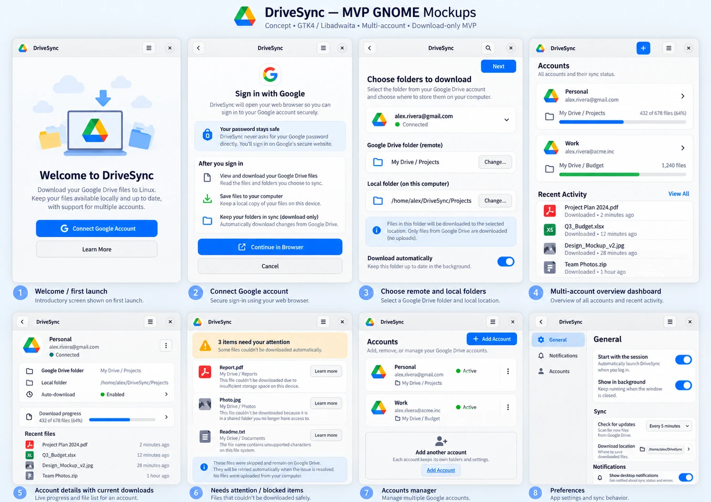

# DriveSync

**Google Drive file synchronization for Linux, built with Rust.**

DriveSync is an independent project that aims to bring a simple, reliable Google Drive experience to Linux. The goal is to keep your files available on your computer, up to date, and protected against interrupted transfers or accidental data loss.

Designed with GNOME in mind, DriveSync aims to feel like a regular desktop application: open it when you need it, or let it work quietly in the background.

> **Project status: Early development.** DriveSync is not ready for everyday use, and file synchronization is not functional yet. Please do not rely on it for important files.

## What DriveSync aims to offer

- **Local access to your files:** keep selected Google Drive folders on your computer.
- **Automatic synchronization:** keep files up to date without manually downloading them.
- **Offline availability:** work with local copies when you're disconnected.
- **Safer transfers:** detect incomplete transfers and avoid silently overwriting changes.
- **Clear status:** see progress, errors, and files that need your attention.
- **Desktop integration:** run in the background, with future integration for the GNOME Files (Nautilus) file manager.

The first functional milestone focuses on **safe, one-way synchronization from Google Drive to Linux**. Uploads and two-way synchronization are planned for later stages.

## Welcome screen

The native GTK4/Libadwaita Welcome screen connects Google accounts through the
system browser using OAuth with PKCE. After secure credential storage, Account
Information shows the real account identifier and optional verified email.
Configure your own Desktop OAuth client using the [Google OAuth guide](docs/google-oauth.md).
File transfers and folder setup remain unavailable. Real Google/Flatpak acceptance
is still pending; see [validation evidence](docs/auth-validation.md).

## UI Preview — Concept Mockups

*Concept mockup only — not a screenshot of a working application. The design and available features may change during development.*

See the [visual concept archive](docs/mockups/README.md) for all ten images and the [MVP UI review](docs/ui-mockups.md) for GNOME component and engine compatibility notes.

## Get involved

DriveSync is a developing community project. Feedback, testing, bug reports, translations, documentation, and code contributions are welcome.

- **Issues and ideas:** [GitHub Issues](https://github.com/rafatosta/drivesync/issues)
- **Contact:** [rafa.ecomp@gmail.com](mailto:rafa.ecomp@gmail.com)
- **Maintainer:** [Rafael Tosta](https://github.com/rafatosta)

## Support development

If you'd like to support the maintainer's open-source work, you can do so through [GitHub Sponsors](https://github.com/sponsors/rafatosta).

## Learn more

Looking for development plans, technical decisions, or implementation details? Visit the [documentation](docs/README.md) or the [MVP roadmap](docs/MVP.md).

---

**Keywords:** Google Drive · Linux · GNOME · file synchronization · offline files · Rust · Flatpak

*DriveSync is not affiliated with, sponsored by, or endorsed by Google.*
