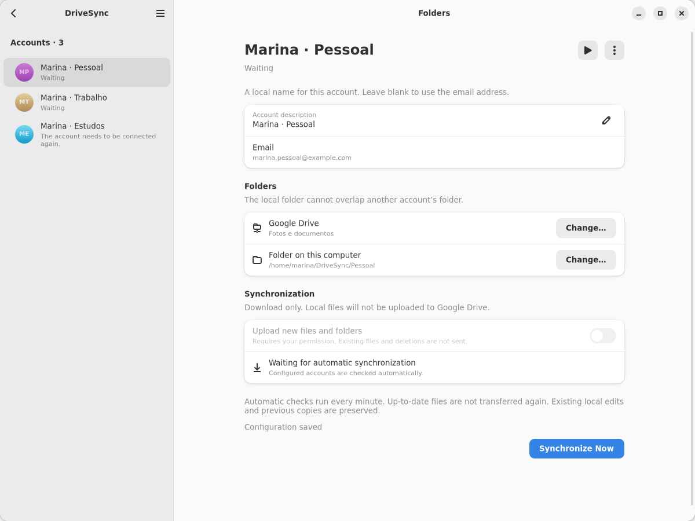
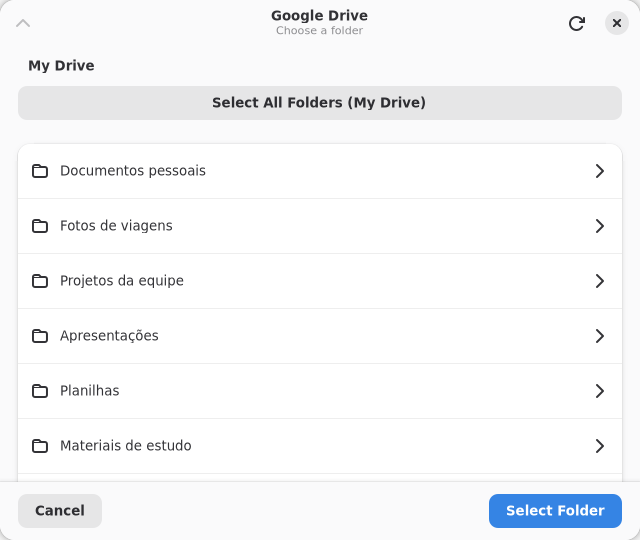
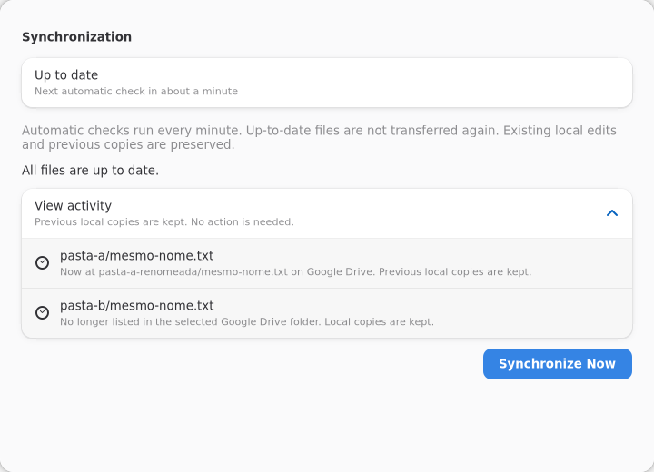

# DriveSync

**A Google Drive client for Linux.**

DriveSync is an early-stage Linux application for keeping selected Google Drive folders available on this computer. Its GTK4/Libadwaita interface follows the GNOME design guidelines; GNOME is not a requirement for using the application. It is a technical preview, not a stable release. Test with files you can safely replace or recreate; DriveSync is not a backup service.

## Screenshots

Manage multiple accounts and configure a separate Google Drive and local folder for each one.



| Choose a Google Drive folder | Review synchronization activity |
| --- | --- |
|  |  |

These screenshots use fictional data. Synchronization states are simulated using the current interface components.

[View all screenshots, including welcome, connection, transfers, and compact layouts](data/screenshots/README.md) · [Regenerate screenshots](data/screenshots/README.md#gerar-novamente)

## What you can do today

DriveSync focuses on keeping local copies up to date with Google Drive. It does not yet offer complete two-way synchronization.

| Feature | Current availability and limits |
| --- | --- |
| Google accounts | Connect and manage multiple accounts, each with its own settings and credentials. |
| Folder selection | Choose one Google Drive folder and one local folder per account. Local folders for different accounts cannot overlap. |
| Downloads | Download files and subfolders, update managed local copies when remote files change, and keep previous versions. |
| Uploads | Optionally upload new files and folders. Changes to existing files and deletions are not sent to Google Drive. |
| Automatic checks | Check for remote changes periodically, or sync on demand. |
| Pause and resume | Pause a sync and resume later, preserving completed work. |
| Background operation | Continue checking while the app is allowed to run in the background. Session startup depends on desktop permission. |
| Conflicts and deletions | Preserve local files when changes conflict or remote files are removed. Conflicts need manual attention; there is no complete resolution interface yet. |
| Recovery | Save progress for later runs and check interrupted work. Recovery after failures or missing sync data still needs broader testing. |
| Google Docs, Sheets, and Slides | Create local links that open documents in the browser. Opening these links from GNOME Files still needs validation. |
| Status and activity | Show progress, account status, and sync activity. Preferences and notifications remain limited. |
| Shared Drives and special items | Shared Drives and some special Google Drive item types are not supported. |

## Download and install the experimental Flatpak

Prebuilt packages are available for **x86_64 Linux systems** (64-bit Intel/AMD) through [Production Flatpak on GitHub Actions](https://github.com/rafatosta/drivesync/actions/workflows/production-flatpak.yml). Each successful build from `main` provides an experimental installer; these packages are not stable releases.

### Download

1. Sign in to GitHub. GitHub requires an account to download workflow artifacts.
2. Open [Production Flatpak](https://github.com/rafatosta/drivesync/actions/workflows/production-flatpak.yml) and select the newest successful run on `main` (green check mark).
3. Scroll to **Artifacts** and download `DriveSync-experimental-x86_64-<commit>`.
4. Extract the downloaded ZIP. It contains the `.flatpak` installer, a `.sha256` checksum, and `INSTALL.txt`.

The commit identifier in the filename identifies the source used to build the package. Artifacts are retained for 30 days and may expire. If the latest run failed or is still running, use an earlier successful run with an available artifact.

### Install and run

Install Flatpak using your Linux distribution's package manager, or follow the [Flatpak setup guide](https://flatpak.org/setup/). Then add Flathub for the required GNOME runtime:

```sh
flatpak remote-add --user --if-not-exists flathub https://dl.flathub.org/repo/flathub.flatpakrepo
```

Open a terminal in the extracted folder, containing only one extracted build. The `*` in the commands below automatically matches the commit identifier in the filename:

```sh
sha256sum -c DriveSync-experimental-x86_64-*.flatpak.sha256
flatpak install --user ./DriveSync-experimental-x86_64-*.flatpak
flatpak run com.rtosta.DriveSync
```

Continue with installation only if the checksum reports `OK`. Flatpak may download the required runtime during installation. You can also launch **DriveSync** from your desktop's application menu.

Connect your Google account, then choose a Google Drive folder and a local destination. Start with a dedicated folder containing disposable test files. The prebuilt application already includes its OAuth client configuration: you do not need to create a Google Cloud project or provide a JSON file.

### Google sign-in status

The production OAuth project accepts external accounts without adding them to a test-user list. **Google verification is still pending**, so an unverified-app warning and a limit of 100 users currently apply. Institutional Google Workspace accounts may also be restricted by their administrator. Review the permissions before granting access.

### Update or uninstall

These standalone bundles do not provide automatic updates. To update, download and extract a newer successful build, verify its checksum, and run the same `flatpak install --user ./...flatpak` command with the new filename. Accept the update prompt.

To uninstall:

```sh
flatpak uninstall --user com.rtosta.DriveSync
```

To report a problem, include the commit identifier from the installer filename and your Linux distribution and desktop environment. Do not attach OAuth tokens or private files.

## What's next

The immediate focus is clearer first-time setup, more reliable recovery, better conflict handling, and validation of background operation and document links across Linux desktop environments. Updating existing files on Google Drive and propagating deletions require additional safeguards before they can be enabled.

Other possible improvements include selecting individual subfolders, faster detection of local changes, richer activity history and notifications, improved account management, support for shared content, file status indicators in GNOME Files, files on demand, and bandwidth or battery controls. These are candidate improvements, with no committed release schedule.

## Support development

DriveSync is free and open source, developed and maintained in my spare time. If you find the project useful, you can support its development using the same donation channels as ZapZap:

| Method | Link |
| --- | --- |
| GitHub Sponsors | [Sponsor on GitHub](https://github.com/sponsors/rafatosta) |
| Ko-fi | [Support on Ko-fi](https://ko-fi.com/rafaeltosta) |
| PayPal | [Donate with PayPal](https://www.paypal.com/donate/?business=E7R4BVR45GRC2) |
| Wise | [Donate with Wise](https://wise.com/pay/me/rafaelt2487) |
| Pix (Brazil) | [Donate with Pix](https://nubank.com.br/pagar/3c3r2/LS2hiJJKzv) |

All contributions are voluntary. DriveSync remains free and open source.

## License and copyright

Copyright (C) 2026 Rafael Tosta Santos.

DriveSync is free software distributed under the **GNU General Public License, version 3.0 only (GPL-3.0-only)**. You may use, study, modify, and redistribute it under the terms of that license. See the [LICENSE](LICENSE) file for the full license text.

## Feedback

Found a problem or have a suggestion? [Open an issue](https://github.com/rafatosta/drivesync/issues).

DriveSync is an independent project and is not affiliated with Google.

## Build identification

About, Welcome, and the account sidebar display the package version and source
revision, for example `0.1.0 (a1b2c3d)`. About's troubleshooting information
contains the full revision. Both Flatpak application IDs use the same format.
`-modified` indicates changes to tracked files; untracked and ignored files are
not included in this check. The revision identifies source code, not a unique
build invocation.

The build detects Git metadata automatically, including the local directory
sources copied by the current Flatpak manifests. When packaging sources without
Git metadata, set `DRIVESYNC_BUILD_REVISION` in the build environment to the full
commit hash (optionally followed by `-modified`) before running Cargo. In a
Flatpak manifest, set it under the module's `build-options.env`. Without Git or
an explicit revision, the app displays `unknown`. No Git access is needed at
runtime.
