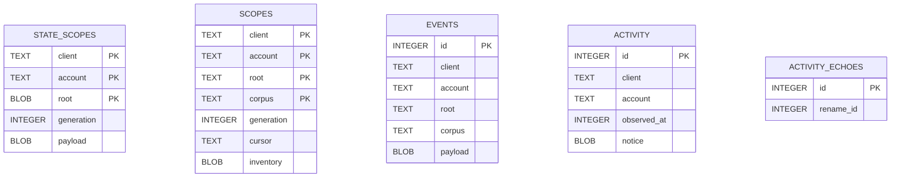

# Dados, esquemas e persistência

## Visão dos mecanismos

O projeto não tem um banco único. O índice de contas é JSON, credenciais usam o
keyring do desktop, estado/histórico/diário usam três bancos SQLite separados,
preferências usam `GKeyFile` e a tela de conflitos mantém JSON próprio.
Referências: `engine/src/accounts/repository.rs`,
`engine/src/auth/storage.rs`, `engine/src/local_state/store.rs`,
`engine/src/remote_detector/journal.rs`, `engine/src/activity_history.rs`,
`src/features/preferences/model.rs` e `src/features/dashboard/components/transfers.rs`.

| Dado | Localização observada | Formato / isolamento |
| --- | --- | --- |
| Perfis, descrição e pasta configurada | `$XDG_DATA_HOME/drivesync/accounts.json`; fallback `$HOME/.local/share/drivesync/accounts.json`. | JSON de versão 2, agrupado por OAuth client; gravação com arquivo temporário/rename, diretório `0700`, arquivo `0600`, mutex e sidecar `accounts.lock`. |
| Credenciais OAuth | Secret Service/keyring do desktop (`engine/src/auth/storage.rs::DesktopVault`). | Uma entrada por conta; serviço literal `com.rtosta.DriveSync.Devel.oauth.{client}` e atributo de usuário = ID da conta. Tokens não são incluídos no JSON de contas. |
| Estado/inventário local | Para download/observação portátil: `<pasta-local>/.drivesync/local-state.sqlite3`. | SQLite privado, user_version 2, application_id `1146309715`; conteúdo detalhado do escopo em JSON serializado no BLOB `payload`. |
| Estado do detector remoto | `$XDG_DATA_HOME/drivesync/remote-detector/remote-detector.sqlite3`; mesma alternativa de `$HOME/.local/share` quando XDG data home não existe. | SQLite privado, user_version 1; cursor/inventário e eventos pendentes separados. |
| Histórico de atividades | `$XDG_DATA_HOME/drivesync/activity-history/history.sqlite3`; fallback `$HOME/.local/share/drivesync/activity-history/history.sqlite3`. | SQLite privado; registros JSON em BLOB e paginação por ID. |
| Preferências | `$XDG_CONFIG_HOME/drivesync/preferences.ini` (via `glib::user_config_dir()`). | `GKeyFile`, seção `[Preferences]`. |
| Conflitos exibidos | `$XDG_DATA_HOME/drivesync/conflicts.json` (via `glib::user_data_dir()`). | JSON da interface; arquivos não legíveis ou JSON inválido são carregados como lista vazia. Erros de gravação geram aviso GLib. |

`XDG_DATA_HOME` e `XDG_CONFIG_HOME` podem ser redirecionados pelo ambiente
Flatpak. A resolução efetiva de diretórios por instalação não foi medida.

## Índice JSON de contas

`engine/src/accounts/models.rs::Index` tem `version: u32` (somente `2` é
aceito), `clients: BTreeMap<String, Vec<AccountSummary>>`, `folders:
BTreeMap<String, Vec<FolderConfiguration>>` e `descriptions:
BTreeMap<String, BTreeMap<String, String>>`. O client key é o ID OAuth público;
cada perfil contém `AccountId`, `provider_subject` e email opcional. A pasta
inclui ID/nome da pasta Drive, caminho local canônico e caminho de origem local
resolvido. Credenciais não aparecem neste índice.

`accounts/validation.rs::validate` verifica versão, unicidade de contas e
pastas por conta, formato de ID, referência lógica da pasta a perfil do mesmo
client, caminhos absolutos e descrição. Essas referências são validadas em
código, não são chaves relacionais de banco. Formato v1, corrompido ou futuro
não é migrado nem substituído silenciosamente.

## Esquemas SQLite

As definições a seguir reproduzem a forma SQL e os tipos declarados no código.
Nenhum `FOREIGN KEY` ou cláusula `REFERENCES` foi encontrado nos três bancos.

### Estado local — `local-state.sqlite3`

Declarado em `engine/src/local_state/store.rs::initialize`:

```sql
CREATE TABLE state_scopes (
    client TEXT NOT NULL,
    account TEXT NOT NULL,
    root BLOB NOT NULL,
    generation INTEGER NOT NULL CHECK (generation > 0),
    payload BLOB NOT NULL,
    PRIMARY KEY (client, account, root)
);
PRAGMA user_version = 2;
PRAGMA application_id = 1146309715;
```

`payload` é um `Document` serializado em JSON, com root item, registros
`TrackedItem`, estados observado/confirmado, fila `PendingInvestigation`,
contador e flag `initial_download_complete`. O limite máximo do payload é
16 MiB; o documento limita itens a 10.000 e trabalhos pendentes a 4.096.
Updates de consumidor usam geração esperada (CAS) e transação `IMMEDIATE`.

No banco portátil, `LocalStateStore::portable` abre o diretório `.drivesync` da
pasta local e usa uma chave de escopo interna com `client = remote folder ID`,
`account = account ID` e `root = "/drivesync"`. Ela verifica se o banco não
contém outros escopos antes de operar. A chave lógica recebida pelo observador
usa OAuth client, conta e caminho local; esse mapeamento portátil não cria
colunas adicionais.

### Diário remoto — `remote-detector.sqlite3`

Declarado em `engine/src/remote_detector/journal.rs::initialize`:

```sql
CREATE TABLE scopes (
    client TEXT NOT NULL,
    account TEXT NOT NULL,
    root TEXT NOT NULL,
    corpus TEXT NOT NULL,
    generation INTEGER NOT NULL,
    cursor TEXT NOT NULL,
    inventory BLOB NOT NULL,
    PRIMARY KEY (client, account, root, corpus)
);

CREATE TABLE events (
    id INTEGER PRIMARY KEY AUTOINCREMENT,
    client TEXT NOT NULL,
    account TEXT NOT NULL,
    root TEXT NOT NULL,
    corpus TEXT NOT NULL,
    payload BLOB NOT NULL
);
CREATE INDEX event_scope ON events(client, account, root, corpus, id);
PRAGMA user_version = 1;
```

`inventory` e `events.payload` contêm estruturas JSON serializadas pelo
detector. `corpus` é `"user"` ou `"drive:<id>"`. A chave de `scopes` separa
OAuth client, conta, pasta raiz e corpus. A coluna `events.id` é a identidade
durável da entrega e permite acknowledgment. O escopo das linhas de evento é
também conferido explicitamente em consultas/remoções; não é FK. O banco
incompatível é recusado sem recriação.

### Histórico — `history.sqlite3`

Declarado em `engine/src/activity_history.rs::open`:

```sql
CREATE TABLE IF NOT EXISTS activity (
    id INTEGER PRIMARY KEY,
    client TEXT NOT NULL,
    account TEXT NOT NULL,
    observed_at INTEGER NOT NULL,
    notice BLOB NOT NULL
);
CREATE INDEX activity_account ON activity(client, account, id);
CREATE INDEX activity_time ON activity(client, account, observed_at);

CREATE TABLE IF NOT EXISTS activity_echoes (
    id INTEGER PRIMARY KEY,
    rename_id INTEGER NOT NULL
);
CREATE INDEX activity_echo_rename ON activity_echoes(rename_id);
```

`notice` serializa `StoredNotice`: `LocalNotice`, atividade remota opcional,
bytes do caminho raiz e dados de integridade opcionais. A timeline filtra por
client/contas, oculta IDs registrados em `activity_echoes` e pagina por `id`.
As relações lógicas são `activity_echoes.id` → linha local de
`activity.id` suprimida na apresentação e `activity_echoes.rename_id` → linha
remota usada para agrupar ecos; **não** há restrição formal dessas referências.
Também não há versão de esquema verificada para esse banco no código
inspecionado.

## DER dos bancos relacionais

As entidades de cada arquivo SQLite aparecem separadas. Não há linhas de
relacionamento porque o SQL não declara chaves estrangeiras. Os vínculos
lógicos de `activity_echoes` estão descritos acima e não devem ser lidos como
restrições do banco.



## Outros formatos e restrições observadas

- `preferences.ini` guarda `color-scheme`, `keep-running`, `notify-on-close` e
  `remote-check-minutes`; defaults são sistema, `true`, `true` e 5 minutos,
  respectivamente. Valores inválidos recorrem ao default; intervalo válido
  documentado pelo código é 1–1440.
- `conflicts.json` guarda caminho e textos de apresentação agrupados por conta.
  Essa persistência pertence à UI; não é a fonte de estado das operações de
  download.
- O arquivo JSON de contas usa trava interprocessos `accounts.lock`; as bases
  SQLite usam `SQLITE_OPEN_NOFOLLOW`, permissões restritas e `synchronous=FULL`.
- Nenhum sistema de migração comum entre essas persistências foi identificado.

