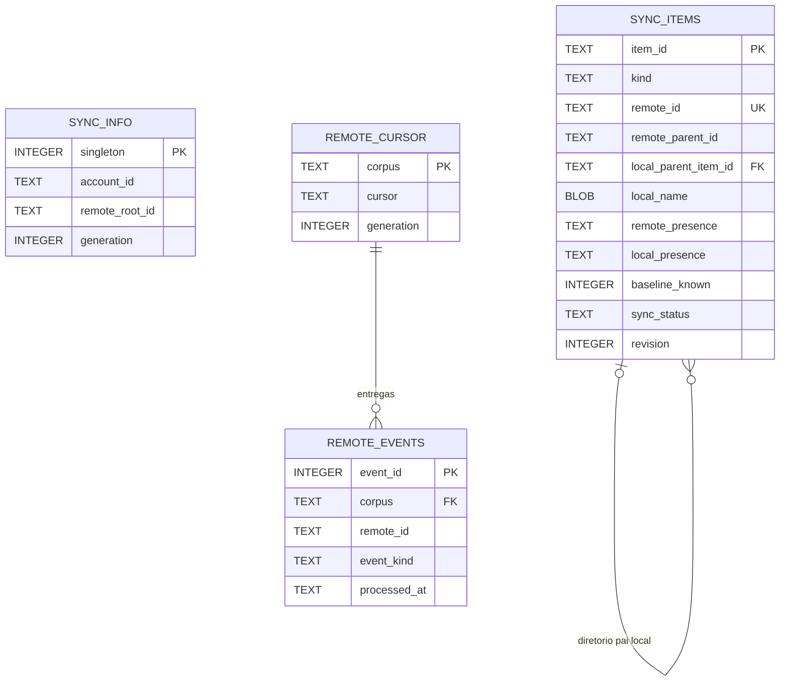

# Data Model — DriveSync

## 1. Visão geral

O DriveSync utiliza o Google Drive como referência canônica para a identidade e a estrutura remota dos arquivos. Cada pasta local configurada é uma projeção gerenciada de uma pasta remota. Alterações locais e remotas são observadas e registradas sem perda de identidade.

O inventário é organizado por **sincronização** (um par entre conta, pasta remota e pasta local). Cada arquivo ou diretório é representado por **um único `SyncItem`**, que reúne identidade, metadados remotos, metadados locais, último estado confirmado e condição de sincronização.

A aplicação mantém:
- cadastro global de contas e configurações de pastas;
- armazenamento protegido das credenciais;
- inventário SQLite próprio de cada pasta sincronizada;
- histórico de atividades próprio de cada sincronização;
- preferências e diagnósticos gerais do aplicativo.

O `InventoryManager` encapsula as consultas, gravações, validações e comparações do inventário. Outros componentes utilizam sua API, sem acesso direto às tabelas.

## 2. Localização dos dados

```text
<pasta-local-sincronizada>/
├── .drivesync/
│   ├── inventory.sqlite3      # Identidade, estados, cursor e eventos pendentes
│   └── history.sqlite3        # Atividades desta sincronização
├── ...
└── arquivos-do-usuario
```

`.drivesync/` é reservado ao DriveSync: não faz parte do conteúdo sincronizado, não é enviado ao Google Drive e é ignorado pelo observador local. O diretório e os bancos são protegidos com permissões restritas e operações de escrita transacionais.

Dados globais seguem os mecanismos próprios da aplicação:

| Dados | Armazenamento |
| --- | --- |
| Contas, descrições e pares de pastas | `$XDG_DATA_HOME/drivesync/accounts.json` |
| Tokens e credenciais OAuth | Secret Service/keyring |
| Preferências gerais | `$XDG_CONFIG_HOME/drivesync/preferences.ini` |
| Diagnósticos técnicos | Logs estruturados do aplicativo, com rotação e retenção limitada |

Caminhos XDG são resolvidos no contexto da instalação, inclusive em Flatpak. O cadastro global identifica a conta e a pasta configuradas, enquanto cada banco local identifica e valida a sincronização à qual pertence. Credenciais nunca são gravadas na pasta sincronizada.

## 3. Entidade central: SyncItem

`SyncItem` representa **arquivo** ou **diretório**, compartilhando o mesmo contrato e a mesma tabela. Possui uma identidade lógica interna imutável, independente de nome, caminho ou inode.

```rust
struct SyncItem {
    id: SyncItemId,
    kind: ItemKind,
    remote: RemoteSnapshot,
    local: LocalSnapshot,
    baseline: ConfirmedState,
    status: SyncStatus,
}
```

Os snapshots representam fatos observados, inclusive situações em que um lado ainda não foi observado. `RemoteSnapshot` e `LocalSnapshot` não são cadastros independentes: são partes do **mesmo item**.

### 3.1 Identidade

| Campo | Tipo lógico | Descrição |
| --- | --- | --- |
| `item_id` | ID interno | Chave imutável do item na sincronização |
| `kind` | `file / directory` | Tipo do objeto |
| `remote_id` | ID do Google Drive, opcional | Identidade remota confirmada; ausente antes da associação/upload |
| `remote_parent_id` | ID do Google Drive, opcional | Diretório pai remoto conhecido |
| `local_parent_item_id` | `SyncItemId`, opcional | Diretório pai na árvore local |

A unicidade de `remote_id` é garantida dentro do banco da sincronização. O ID interno não muda ao renomear, mover, baixar ou enviar conteúdo. O `remote_id` não é substituído por nome/caminho. O inode ou equivalente local é somente evidência auxiliar e pode mudar após o salvamento de um arquivo.

A localização é derivada da raiz configurada e da cadeia de diretórios pais. As relações de pais local e remoto são mantidas separadamente porque podem divergir enquanto há mudanças pendentes.

### 3.2 Estado remoto observado

| Campo | Tipo | Descrição |
| --- | --- | --- |
| `remote_presence` | enum | `unknown`, `present` ou `absent_confirmed` |
| `remote_name` | TEXT, opcional | Nome apresentado pelo Drive |
| `remote_mime_type` | TEXT, opcional | Tipo MIME |
| `remote_version` | TEXT, opcional | Versão informada pelo provedor |
| `remote_checksum` | TEXT, opcional | Assinatura de conteúdo, quando disponibilizada |
| `remote_size` | INTEGER, opcional | Tamanho em bytes, quando disponibilizado |
| `remote_modified_at` | TEXT, opcional | Timestamp do Drive em formato normalizado |
| `remote_trashed` | INTEGER, opcional | Situação da lixeira, quando conhecida |

O `remote_id` e `remote_parent_id` integram a identidade/hierarquia. Campos opcionais permanecem nulos quando o provedor não os informa. A falta de metadados não constitui prova de exclusão.

### 3.3 Estado local observado

| Campo | Tipo | Descrição |
| --- | --- | --- |
| `local_presence` | enum | `unknown`, `present` ou `absent_confirmed` |
| `local_name` | BLOB, opcional | Bytes de **um único nome** de arquivo Unix |
| `local_size` | INTEGER, opcional | Tamanho em bytes |
| `local_checksum` | TEXT, opcional | Assinatura verificada do conteúdo |
| `local_modified_ns` | INTEGER, opcional | Timestamp local em nanossegundos |
| `local_device` | INTEGER, opcional | Dispositivo, como evidência auxiliar |
| `local_inode` | INTEGER, opcional | Inode, como evidência auxiliar |

Um arquivo parcial de download não é marcado como presença local confirmada. O caminho completo não é identidade do objeto.

### 3.4 Último estado confirmado (baseline)

O baseline preserva a situação efetivamente sincronizada, separada das observações atuais. Os atributos de baseline cobrem:
- presença anterior em cada lado;
- nome e diretório pai anteriores em cada lado;
- versão remota e assinatura local anteriores;
- instante da última confirmação.

O baseline é atualizado **apenas após operação concluída e verificada**. Uma observação local ou remota não o modifica automaticamente. Um item ainda não sincronizado pode não possuir baseline.

A comparação entre baseline, estado remoto observado e estado local observado permite identificar alterações de conteúdo, nome, localização e presença. Datas são evidências auxiliares: a versão mais recente no relógio não prevalece automaticamente quando ambos os lados mudaram.

### 3.5 Estado de sincronização

`sync_status` descreve a condição registrada do item:

| Valor | Significado |
| --- | --- |
| `pending_reconciliation` | Há observações a analisar |
| `pending_download` | Materialização/atualização local pendente |
| `pending_upload` | Envio remoto pendente |
| `synced` | Estados confirmados e equivalentes segundo a verificação |
| `conflict` | Divergência que exige decisão ou política de resolução |
| `error` | Falha operacional registrada |

Uma categoria opcional `conflict_reason` descreve o conflito no próprio `SyncItem`. **Não existe tabela de conflitos**. Erros de rede não são automaticamente conflitos.

`unknown`, `present` e `absent_confirmed` distinguem falta de observação, presença e exclusão efetivamente comprovada. O modelo não deduz exclusão a partir de falha de leitura, perda de conexão ou ausência de uma pasta montada.

## 4. Bancos e modelo relacional

### 4.1 Banco `inventory.sqlite3`

Contém as tabelas `sync_info`, `sync_items`, `remote_cursor` e `remote_events`.

- **`sync_info`**: identifica a sincronização e o estado de sua inicialização.
- **`sync_items`**: um registro por arquivo ou diretório, com estado remoto, local, baseline e status.
- **`remote_cursor`**: checkpoint da leitura de mudanças no Drive, incluindo geração e corpus.
- **`remote_events`**: eventos remotos pendentes de processamento e confirmação individual.

A existência de `remote_cursor` e `remote_events` não cria um segundo inventário de arquivos. Essas tabelas armazenam o protocolo de observação e entrega de eventos. Publicar cursor e eventos de uma mesma verificação é uma operação transacional; avançar o cursor não implica reconhecer eventos como processados.

#### Esquema SQLite

```sql
PRAGMA foreign_keys = ON;

CREATE TABLE sync_info (
    singleton INTEGER PRIMARY KEY CHECK (singleton = 1),
    oauth_client_id TEXT NOT NULL,
    account_id TEXT NOT NULL,
    remote_root_id TEXT NOT NULL,
    initial_download_complete INTEGER NOT NULL DEFAULT 0
        CHECK (initial_download_complete IN (0, 1)),
    generation INTEGER NOT NULL DEFAULT 1 CHECK (generation > 0)
);

CREATE TABLE sync_items (
    item_id TEXT PRIMARY KEY,
    kind TEXT NOT NULL CHECK (kind IN ('file', 'directory')),
    remote_id TEXT UNIQUE,

    remote_parent_id TEXT,
    remote_name TEXT,
    remote_mime_type TEXT,
    remote_version TEXT,
    remote_checksum TEXT,
    remote_size INTEGER CHECK (remote_size IS NULL OR remote_size >= 0),
    remote_modified_at TEXT,
    remote_trashed INTEGER CHECK (remote_trashed IS NULL OR remote_trashed IN (0, 1)),
    remote_presence TEXT NOT NULL DEFAULT 'unknown'
        CHECK (remote_presence IN ('unknown', 'present', 'absent_confirmed')),

    local_parent_item_id TEXT REFERENCES sync_items(item_id),
    local_name BLOB,
    local_size INTEGER CHECK (local_size IS NULL OR local_size >= 0),
    local_checksum TEXT,
    local_modified_ns INTEGER,
    local_device INTEGER,
    local_inode INTEGER,
    local_presence TEXT NOT NULL DEFAULT 'unknown'
        CHECK (local_presence IN ('unknown', 'present', 'absent_confirmed')),

    baseline_known INTEGER NOT NULL DEFAULT 0 CHECK (baseline_known IN (0, 1)),
    base_remote_presence TEXT CHECK (base_remote_presence IN ('unknown', 'present', 'absent_confirmed')),
    base_local_presence TEXT CHECK (base_local_presence IN ('unknown', 'present', 'absent_confirmed')),
    base_remote_name TEXT,
    base_local_name BLOB,
    base_remote_parent_id TEXT,
    base_local_parent_item_id TEXT REFERENCES sync_items(item_id),
    base_remote_version TEXT,
    base_local_checksum TEXT,

    sync_status TEXT NOT NULL DEFAULT 'pending_reconciliation'
        CHECK (sync_status IN (
            'pending_reconciliation', 'pending_download', 'pending_upload',
            'synced', 'conflict', 'error'
        )),
    conflict_reason TEXT,
    last_checked_at TEXT,
    last_synced_at TEXT,
    revision INTEGER NOT NULL DEFAULT 1 CHECK (revision > 0)
);

CREATE INDEX idx_items_remote_parent ON sync_items(remote_parent_id);
CREATE INDEX idx_items_local_parent ON sync_items(local_parent_item_id);
CREATE INDEX idx_items_status ON sync_items(sync_status);

CREATE TABLE remote_cursor (
    corpus TEXT PRIMARY KEY,
    cursor TEXT NOT NULL,
    generation INTEGER NOT NULL CHECK (generation > 0)
);

CREATE TABLE remote_events (
    event_id INTEGER PRIMARY KEY AUTOINCREMENT,
    corpus TEXT NOT NULL REFERENCES remote_cursor(corpus),
    remote_id TEXT,
    event_kind TEXT NOT NULL,
    observed_version TEXT,
    observed_at TEXT NOT NULL,
    processed_at TEXT
);

CREATE INDEX idx_remote_events_pending
    ON remote_events(corpus, event_id)
    WHERE processed_at IS NULL;
```

O modelo preserva os campos de estado como colunas individualmente consultáveis. Informações adicionais de evento necessárias à reavaliação são representadas em **colunas próprias**; um evento pode ser uma indicação para consultar novamente os metadados remotos pelo ID.

`sync_info` valida o vínculo do banco com o par de pastas/conta configurado. A versão física do esquema é controlada pelo `PRAGMA user_version` com validação na abertura. Atualizações por item utilizam `revision` como precondição otimista e transações SQLite.

#### Diagrama entidade-relacionamento



### 4.2 Banco `history.sqlite3`

O histórico é **da sincronização**, não uma timeline global compartilhada por todas as contas. Cada acontecimento relevante ocupa uma linha, com campos consultáveis. O histórico não armazena snapshots completos e não define o estado atual do inventário.

```sql
CREATE TABLE activity (
    id INTEGER PRIMARY KEY AUTOINCREMENT,
    item_id TEXT,
    operation TEXT NOT NULL,
    origin TEXT NOT NULL CHECK (origin IN ('local', 'remote', 'system')),
    result TEXT NOT NULL,
    occurred_at TEXT NOT NULL,
    description TEXT
);

CREATE INDEX idx_activity_time ON activity(occurred_at, id);
CREATE INDEX idx_activity_item ON activity(item_id, id);
```

A referência `item_id` é uma **identidade lógica**: `history.sqlite3` e `inventory.sqlite3` são arquivos separados, portanto não se declara uma chave estrangeira direta entre eles. Ao consultar detalhes, a aplicação pode procurar o item correspondente no inventário; atividades permanecem legíveis mesmo quando o item deixa de existir.

Registros de diagnóstico técnico, com componente, operação, correlação e erro sanitizado, pertencem aos logs gerais e não à timeline de atividades. Nenhum armazenamento registra credenciais ou tokens.

## 5. Regras de representação relacional

Os bancos SQLite armazenam cada item, evento ou atividade em **linha própria**, com atributos acessíveis por colunas.

- Consultar ou alterar um arquivo não requer carregar nem regravar todos os itens do inventário.
- Listas, mapas, objetos Rust, snapshots, eventos e históricos são modelados por colunas e relacionamentos; não são serializados inteiros em BLOB, JSON/TEXT ou outro campo opaco.
- `BLOB` atende somente a **valores binários individuais** que exigem preservação exata, como os bytes de um único nome de arquivo Unix. Não guarda estruturas de dados.
- Relações, unicidade, estados permitidos e integridade são expressos por chaves, índices, `CHECK` e validações do `InventoryManager`.
- Gravações de observações, confirmações e progressão de eventos respeitam transações e condições de versão.
- O estado remoto e o estado local não são duplicados em cadastros de itens concorrentes.

## 6. API de dados: InventoryManager

`InventoryManager` é a interface interna única para leitura, atualização e análise do inventário. Ele conhece as tabelas e os contratos de persistência; consumidores da engine não executam SQL diretamente.

Operações de domínio disponibilizadas pela interface:

| Operação | Resultado |
| --- | --- |
| Buscar item por `item_id` | `SyncItem` |
| Buscar item por `remote_id` | `SyncItem` ou ausência de registro |
| Registrar observação remota | Inserção/atualização do mesmo item lógico |
| Registrar observação local | Atualização dos campos locais |
| Confirmar operação verificada | Atualização atômica dos campos confirmados e baseline |
| Consultar divergências | Comparação entre baseline, remoto atual e local atual |
| Consultar itens por estado | Coleção paginada/iterável de `SyncItem` |
| Registrar e confirmar evento remoto | Entrega e acknowledgment duráveis |

A API garante validação de identidade e associação de itens, controle de concorrência, segurança transacional e erros explícitos para estados obsoletos ou incompatíveis.

O módulo não faz download, upload, renomeação, movimentação, exclusão física ou autenticação. A análise dos dados não escolhe automaticamente qual versão deve prevalecer: a coordenação e a política de resolução são responsabilidades dos componentes de execução.

## 7. Ciclo de vida dos dados

### 7.1 Sincronização inicial

Uma pasta local **vazia** pode iniciar a sincronização inicial:

1. Validar conta, par de pastas e diretório local.
2. Criar o banco da sincronização e registrar o escopo em `sync_info`.
3. Registrar cada item remoto conhecido em `sync_items`, inicialmente sem materialização local confirmada.
4. Executar o download por meio dos mecanismos de transferência.
5. Após instalação e verificação, preencher a representação local e confirmar o baseline **no mesmo `SyncItem`**.
6. Registrar atividades relevantes no histórico e marcar a conclusão inicial quando a árvore exigida estiver confirmada.

A pasta de metadados gerada pelo próprio aplicativo não conta como conteúdo de usuário na verificação de pasta vazia.

### 7.2 Interrupções e reinício

Transferências interrompidas preservam seus checkpoints operacionais e não são declaradas concluídas no inventário. O mecanismo existente de retomada de download mantém suas próprias garantias. O inventário confirma somente resultados verificados.

Cursor remoto e eventos ainda não processados permanecem duráveis até seu reconhecimento. Uma falha de leitura, acesso ou conexão não é tratada como exclusão remota/local.

### 7.3 Pasta com arquivos e inventário ausente

Sem inventário válido, uma pasta local contendo arquivos do usuário **não inicia automaticamente download, upload, sobrescrita nem exclusão**. O aplicativo solicita uma pasta vazia para a primeira sincronização.

A associação assistida de arquivos locais já existentes — baixar, enviar, manter ambos ou combinar árvores — pertence a uma evolução posterior. O inventário já representa presença apenas local, apenas remota e ambas, mas essa possibilidade de dados não ativa por si só o fluxo futuro.

Se a pasta configurada estiver ausente ou inacessível, as operações são suspensas e a ausência não é interpretada como exclusão de arquivos no Google Drive.

## 8. Invariantes de integridade

1. Um `SyncItem` representa um objeto lógico; a mesma identidade remota não pertence a dois itens na sincronização.
2. Alterações de nome, diretório pai e conteúdo não substituem a identidade do item.
3. Um resultado físico só avança o baseline após confirmação verificável.
4. Observações novas não apagam a informação do baseline.
5. Registros desconhecidos e falhas de acesso não autorizam exclusões.
6. O inventário e o histórico são separados por sincronização; os metadados globais continuam sob a aplicação.
7. A pasta `.drivesync/` nunca é tratada como arquivo sincronizável.
8. Dados estruturados são persistidos em colunas relacionais; BLOB é reservado a valores binários individuais.
9. Atualizações são atômicas e detectam concorrência por versões/revisões.
10. Os componentes executores utilizam as APIs do inventário, preservando as garantias de download, retomada, integridade, movimentação, renomeação e exclusão.
