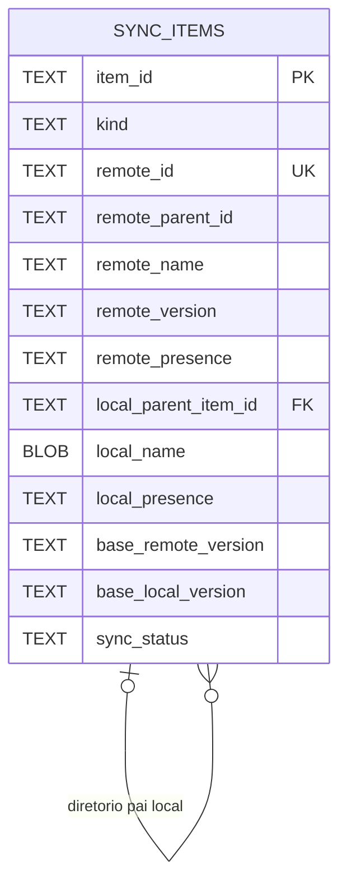

# DATA MODEL — Modelo de dados desejado do DriveSync

> **Natureza:** especificação arquitetural proposta, ainda não implementada.
> **Escopo:** organização, identidade, persistência e contratos dos dados. Não redefine os algoritmos de download, movimentação, renomeação ou exclusão.
> **Referência do estado atual:** `docs/architecture/DATA_MODEL.md` na branch de levantamento `docs/current-architecture`, além do código-fonte. Em caso de divergência, verificar o código.
>
> **Regra de interpretação:** as decisões firmadas estão indicadas como **Definido**; nomes, campos ou detalhes ainda sujeitos à auditoria aparecem como **A validar**. Este documento não é autorização para modificar a engine.

## 1. Objetivo

O Google Drive continua sendo a referência canônica da identidade e da árvore remota; a pasta local é uma projeção gerenciada, mas alterações locais legítimas precisam ser reconhecidas e preservadas. A proposta é substituir inventários de itens fragmentados por **um inventário lógico unificado por sincronização**, gerenciado por um futuro `InventoryManager`.

Cada arquivo ou diretório corresponde a **um `SyncItem`**. O mesmo registro representa:
- identidade do objeto;
- última observação remota;
- última observação local;
- último estado confirmado em cada lado (baseline);
- condição atual de análise/sincronização, incluindo conflito quando pertinente.

O modelo deve permitir comparar **anterior × remoto atual × local atual** sem presumir que uma data mais recente implica prevalência de um dos lados. A comparação alimentará futuras decisões; **as políticas e a execução dessas decisões não pertencem ao armazenamento**.

## 2. Estado atual × estado desejado

| Tema | Atual (conforme levantamento) | Desejado | Situação |
| --- | --- | --- | --- |
| Estado local | `local-state.sqlite3`, tabela `state_scopes` com `Document` serializado em `payload BLOB` | Registros relacionais individuais de `SyncItem` | **Definido** |
| Inventário remoto | `remote-detector.sqlite3`, `scopes.inventory BLOB` com mapa de metadados remotos | Metadados de itens reunidos no `SyncItem`, sem segundo inventário de itens concorrente | **Definido** |
| Identidade | `TrackedItem.id`, `remote_id` e inventário remoto separados | Identidade lógica interna única, associação inequívoca ao ID do Drive quando existente | **Definido** |
| Comparação | `confirmed` e `observed`, mais observações remotas em outro armazenamento | Estados remoto/local observados e baseline confirmado, distinguíveis | **Definido** |
| Conflitos | Estado parcial na engine e `conflicts.json` de apresentação | Condição do próprio item; sem tabela de conflitos para o inventário | **Definido** |
| Histórico | `history.sqlite3` global com filtros de conta | Histórico contextualizado e armazenado por sincronização, separado dos estados atuais | **Definido** |
| Recuperação de download | Checkpoints auxiliares em `download/resume.rs` | Preservar garantias e comportamento; avaliar localização sem reescrever mecanismo | **Definido** |
| Cursor e eventos remotos | Diário remoto com geração, cursor e eventos até confirmação | Preservar checkpoint/cursor, entrega pendente e confirmação; localização/modelagem exatas a estudar | **A validar** |
| Persistência de contas | `accounts.json` global | Permanece cadastro global de contas e pares de pastas | **Definido** |
| Credenciais | Secret Service/keyring | Permanece fora do inventário e da pasta sincronizada | **Definido** |
| Preferências gerais | `preferences.ini` global | Permanecem configuração global | **Definido** |

A unificação refere-se **aos registros de arquivos e diretórios**, não à eliminação indiscriminada de todos os mecanismos de persistência do projeto.

## 3. Entidade central: `SyncItem`

**Definido:** há uma entidade lógica por arquivo **ou** diretório, identificada por um ID interno estável. As representações local e remota podem estar ausentes ou ainda não confirmadas; a ausência de informação não prova exclusão.

Modelo conceitual (não é uma assinatura Rust definitiva):

```rust
struct SyncItem {
    id: SyncItemId,
    kind: ItemKind,                  // File | Directory
    remote: Option<RemoteSnapshot>, // observação remota conhecida
    local: Option<LocalSnapshot>,   // observação local conhecida
    baseline: Option<ConfirmedState>,
    state: ItemSyncState,
}
```

### 3.1 Identidade e escopo

- `item_id`: chave interna imutável; existe inclusive antes do primeiro upload.
- `kind`: arquivo ou diretório.
- `remote_id`: ID do Google Drive, nullable até haver associação remota comprovada.
- `account` e `sync_root`: associação do item à conta e ao **par de pastas** configurado; a identidade remota deve ser única **no escopo aplicável**, considerando a conta/provedor.
- A identidade do filesystem (quando disponível) é **evidência auxiliar**, não substitui `item_id` nem `remote_id`; inode pode mudar numa edição.
- Nome e caminho não são identidade. Dois nomes iguais não justificam associar automaticamente dois objetos.
- Diretórios também são `SyncItem`; referências a pais identificam a hierarquia. Caminhos absolutos podem ser derivados, não precisam ser a identidade persistida.

### 3.2 Metadados remotos observados

Campos candidatos a validar com os consumidores reais:
`remote_id`, `remote_name`, `remote_parent_id`, `remote_mime_type`,
`remote_version`, `remote_checksum` (quando disponível),
`remote_size` (quando disponível), `remote_modified_at`,
`remote_presence` (conhecido/presente, ausente comprovado, desconhecido),
`remote_trashed` (quando confirmado).

Metadados não suportados para determinados tipos de arquivo ou respostas da API são opcionais. O modelo não pode exigir checksum ou data que o Drive não forneceu.

### 3.3 Metadados locais observados

Campos candidatos:
`local_parent_id`, `local_name` (capaz de preservar nomes Unix não UTF-8),
`local_identity` (quando verificável), `local_size`, `local_checksum`,
`local_modified_at`, `local_presence`.

O caminho local completo decorre da raiz sincronizada e da hierarquia; qualquer caminho persistido deve ser tratado como localização, não identidade. Estado de download **parcial** não equivale a item local confirmado.

### 3.4 Baseline (última sincronização confirmada)

Manter evidência suficiente para identificar separadamente mudanças de:
- **conteúdo** (versão, assinatura e/ou equivalentes validados);
- **nome**;
- **diretório pai / localização**;
- **presença / exclusão confirmada**.

O baseline pode precisar de valores anteriores **dos dois lados**, pois `remote_version` e `local_checksum` não são necessariamente comparáveis entre si.

**Não** sobrescrever o baseline a cada observação. Ele só avança após uma operação efetivamente concluída e verificada. Deve ser possível representar `baseline = desconhecido` para itens nunca sincronizados.

### 3.5 Estado do item e conflitos

Um campo `sync_status` pode expressar situações como `synced`, `pending_download`,
`pending_upload`, `pending_reconciliation`, `conflict` ou `error`.
**Nomes e transições exatas: a validar.**

O conflito é um estado/resultado associado ao `SyncItem`, **não uma entidade separada obrigatória**. Uma razão ou categoria pode ser guardada no próprio item, se necessária. Falha de rede não é automaticamente conflito de conteúdo.

É necessário distinguir, no modelo ou na API, ao menos:
1. presença confirmada;
2. ausência **comprovada**;
3. desconhecimento/não observado.

Duas mudanças em lados distintos não significam necessariamente conflito: renomeação remota e edição de conteúdo local podem ser compatíveis. O armazenamento registra fatos; a política de resolução fica para uma etapa posterior.

## 4. Persistência relacional pretendida

**Definido:** usar SQLite relacional, com **uma linha por `SyncItem`**, e não um `Document` inteiro ou mapa de arquivos serializado em BLOB.

A opção inicial preferida é **uma tabela central `sync_items`**, com colunas agrupadas logicamente em identidade, remoto atual, local atual, baseline e estado. Não criar tabelas `remote_state`, `local_state`, `baseline` ou `conflicts` apenas para dividir esses grupos. Tabelas operacionais distintas são possíveis quando seus dados não representarem diretamente o estado atual de um item.

### 4.1 Esquema conceitual — não executar como migração

```sql
-- Esboço para revisão de tipos, nulabilidade, unicidade e consumidores.
CREATE TABLE sync_items (
    item_id TEXT PRIMARY KEY,
    kind TEXT NOT NULL CHECK (kind IN ('file', 'directory')),
    remote_id TEXT,

    remote_parent_id TEXT,
    remote_name TEXT,
    remote_version TEXT,
    remote_checksum TEXT,
    remote_modified_at INTEGER,
    remote_presence TEXT NOT NULL,

    local_parent_item_id TEXT,
    local_name BLOB,
    local_identity TEXT,
    local_size INTEGER,
    local_checksum TEXT,
    local_modified_at INTEGER,
    local_presence TEXT NOT NULL,

    base_remote_version TEXT,
    base_local_version TEXT,
    base_remote_name TEXT,
    base_local_name BLOB,
    base_remote_parent_id TEXT,
    base_local_parent_item_id TEXT,
    base_remote_presence TEXT,
    base_local_presence TEXT,

    sync_status TEXT NOT NULL,
    conflict_reason TEXT,
    last_checked_at INTEGER,
    last_synced_at INTEGER,

    FOREIGN KEY (local_parent_item_id) REFERENCES sync_items(item_id),
    FOREIGN KEY (base_local_parent_item_id) REFERENCES sync_items(item_id)
);
CREATE UNIQUE INDEX idx_sync_items_remote_id
    ON sync_items(remote_id) WHERE remote_id IS NOT NULL;
```

**A validar antes de implementar:** completar atributos necessários (inclusive tipo MIME/tamanho remoto, versões/assinaturas locais e presença no baseline), identificação da raiz, representação dos estados desconhecidos, associação entre pastas e IDs, invariantes de pais, índices e versão do esquema. A restrição acima presume **um banco isolado por sincronização**; se esse escopo mudar, a unicidade deverá incluir a identidade da conta/provedor.

Usar `BLOB` **para um nome individual em bytes Unix**, se necessário, não contradiz a decisão de evitar BLOBs contendo inventários inteiros.

### 4.2 Diagrama lógico



O diagrama resume a tabela central; não implica que o conjunto de colunas já esteja fechado.

### 4.3 Garantias do repositório

- Unicidade de identidade interna e associação remota; não associar arquivos só por nome.
- Escritas **atômicas** e rejeição de atualizações obsoletas/concorrentes; preservar ou substituir de modo comprovadamente equivalente as garantias atuais de geração/CAS.
- Confirmação do baseline somente após verificar o resultado físico da operação.
- Persistência de estado intermediário suficiente para recuperação segura.
- Ausência ou falha de leitura do banco **não autoriza exclusões de arquivos**.
- A consulta e alteração de `sync_items` devem ocorrer por uma API do `InventoryManager`; consumidores não consultam SQL diretamente.

## 5. Localização e ciclo de vida dos dados

### 5.1 Por pasta sincronizada

**Definido:** cada **par remoto/local configurado** possui seu próprio estado e histórico, sob diretório oculto e excluído de observação/sincronização:

```text
<pasta-local>/
├── .drivesync/                 # Dados internos; não enviar ao Google Drive
│   ├── inventory.sqlite3      # Inventário relacional (nome proposto)
│   └── history.sqlite3        # Histórico desta sincronização (nome proposto)
└── ...                        # Arquivos do usuário
```

O diretório `.drivesync/` não pode produzir eventos de upload/download nem entrar no inventário de conteúdo do usuário. Os arquivos SQLite devem ter permissões adequadas, controle de concorrência e fechamento consistente. As localizações finais de cursor/eventos remotos e checkpoints devem ser decididas após auditar suas dependências; **não mover automaticamente** um diário ou checkpoint que funciona.

O histórico existente já contém campos de conta e filtros. A mudança desejada é o **isolamento físico/lógico por sincronização**, não perder seus vínculos de conta. O histórico não precisa ser parte do `SyncItem`, mas pode referenciá-lo para diagnóstico e apresentação.

### 5.2 Dados globais do aplicativo

Continuam fora da pasta sincronizada:
- cadastro de contas, descrições e pares de pastas (`accounts.json`);
- credenciais OAuth (Secret Service/keyring, jamais no inventário);
- preferências gerais (`preferences.ini`);
- logs técnicos de diagnóstico do aplicativo, com limites de retenção e sem segredos.

Histórico de atividade de uma conta/sincronização e **logs técnicos do aplicativo** são conceitos diferentes.

### 5.3 Inventário ausente ou pasta inexistente

- **Primeira configuração sem inventário + pasta local vazia:** iniciar o download inicial existente.
- **Sem inventário + pasta local com arquivos de usuário:** **não iniciar upload, download, sobrescrita nem exclusão**; impedir a sincronização inicial e informar que é necessária uma pasta vazia.
- **Inventário válido + pasta já sincronizada:** retomada normal com verificação dos estados.
- **Pasta sincronizada ausente ou inacessível:** suspender operações; não interpretar a ausência da pasta como exclusão remota.

A pré-análise e resolução interativa de diretórios locais não vazios (usar remoto, usar local, manter ambos, mesclar) é **evolução futura**, fora da primeira versão estável.

## 6. InventoryManager — responsabilidade de dados

**Definido:** primeiro especificar/implementar e testar um módulo `inventory/` independente. Só depois adaptar gradualmente os consumidores atuais; reorganização de orquestrador, executores, upload e reconciliador é posterior.

O módulo:
- é a **única interface de acesso ao inventário**, ocultando SQL e detalhes do esquema;
- registra e consulta `SyncItem` por identidade e associação remota;
- recebe observações remotas/locais e resultados **verificados** de operações;
- atualiza snapshots e baseline de maneira consistente;
- informa diferenças entre base, remoto e local, sem executar operações físicas;
- pode informar divergência ou potencial conflito, sem escolher a resolução.

Exemplos **conceituais**, ainda não assinaturas definitivas:

```text
get(item_id) -> SyncItem
find_by_remote_id(remote_id) -> SyncItem?
register_remote(observation) -> SyncItem
update_local(item_id, observation) -> SyncItem
confirm_download(item_id, verified_result) -> SyncItem
analyze(item_id) -> ItemAnalysis
```

O `InventoryManager` **não** transfere conteúdo, move arquivos, renomeia, apaga, decide políticas nem administra autenticação. Suas operações de escrita devem validar IDs, precondições e versões. Um download não deve ser considerado confirmado pelo simples fato de uma função ter retornado sem verificar as condições necessárias.

## 7. Preservação das funcionalidades existentes

A primeira refatoração pretende alterar **somente os mecanismos de armazenamento e acesso ao inventário**, sem reimplementar as operações físicas já existentes.

Precisam permanecer corretos, conforme os testes pertinentes:
- download inicial e incremental;
- interrupção e retomada de downloads, inclusive após perda de conexão/reinício;
- verificação de integridade e publicação segura;
- renomeação e movimentação de arquivos/diretórios;
- exclusões remotas comprovadas, sem perdas acidentais;
- atualização de hierarquia e associação estável ao ID remoto;
- continuidade dos eventos pendentes e confirmações.

Mudanças necessárias nas chamadas à persistência são permitidas; mudanças não solicitadas no comportamento não são. Não presumir que a existência de teste automatizado equivalha à validação real com Drive/Flatpak. A base atual tem validação local/simulada documentada e lacunas de integração real.

## 8. Decisões ainda pendentes — não implementar por suposição

1. Inventário exato de campos do `SyncItem`: origem, consumidores, nulabilidade, formato e retenção do baseline.
2. Modelo final de presença/ausência/observação inconclusiva e tipos de `sync_status`.
3. Identidade e relações de pais quando remoto e local divergirem, inclusive árvores movimentadas.
4. Destino e relação entre `remote-detector.sqlite3` (cursor/eventos), o novo inventário e o banco portátil.
5. Local e ciclo de vida dos checkpoints de download; separação entre transferência parcial e item confirmado.
6. Esquema definitivo, índices, concorrência, escopo/versão e política de abertura de banco ausente ou incompatível.
7. Retenção e formato do histórico por sincronização; registros técnicos de diagnóstico em separado.
8. Assinaturas públicas e erros do `InventoryManager` após mapear os consumidores existentes.

## 9. Sequência documental e de desenvolvimento

1. **Auditar** estruturas atuais, dados persistidos, pontos de leitura e gravação, consumidores e fluxos de confirmação; classificar dados essenciais, derivados, redundantes, operacionais e históricos.
2. **Fechar este DATA MODEL desejado**, confrontando os campos com os fluxos reais e explicitando as invariantes.
3. **Especificar os EXECUTION FLOWS desejados**, usando os contratos do inventário sem alterar o comportamento esperado dos operadores.
4. **Planejar a transição**: lacunas entre estado atual/desejado, testes de regressão e etapas pequenas de adaptação.
5. **Implementar e testar `InventoryManager` isoladamente** com SQLite real em diretório de teste; sem integração precoce.
6. **Adaptar gradualmente** chamadas de persistência da engine; validar cada fluxo, incluindo testes funcionais com Flatpak e Drive real quando disponíveis.
7. **Somente depois** avaliar a reorganização da orquestração, dos executores e das políticas de sincronização.

Nenhuma etapa deste documento exige camada de compatibilidade com formatos experimentais antigos. Isso **não autoriza eliminar arquivos do usuário ou recriar silenciosamente bancos incompatíveis**.
