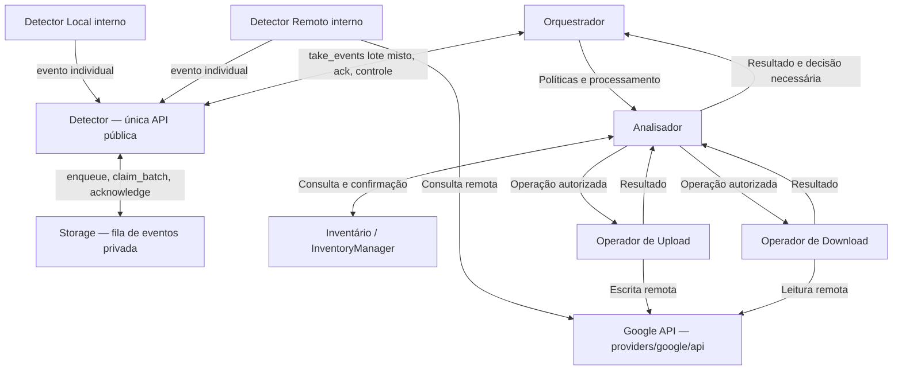

# System Architecture — DriveSync

## 1. Visão geral

O DriveSync é um cliente de sincronização do Google Drive para GNOME. O **Google Drive é a referência canônica da identidade e da estrutura remota**; a pasta local é uma projeção gerenciada. Alterações legítimas feitas localmente também são observadas e devem ser consideradas, sem sobrescrita ou exclusão automática baseada apenas em suposições.

A engine é organizada por **responsabilidades independentes**, cujos componentes se comunicam por interfaces explícitas. Cada componente conhece o contrato dos demais, mas não depende de sua implementação interna.

A arquitetura distingue cinco responsabilidades principais:

1. **Observar** alterações locais e remotas.
2. **Armazenar e consultar** o estado unificado dos itens.
3. **Analisar e encaminhar** operações permitidas a partir das diferenças entre estados.
4. **Coordenar e definir políticas** de processamento e situações que exijam decisão do usuário, expondo uma interface independente para consumidores externos.
5. **Executar** operações sobre o Google Drive ou a pasta local.

Este documento define a organização **macro** dos componentes. Não especifica classes internas, arquivos Rust, assinaturas de métodos, protocolos de eventos nem algoritmos de sincronização.

## 2. Componentes da engine

### 2.1 Detector — fachada, produtores e armazenamento independentes

O **Detector** é a única API pública de detecção da engine. Local e Remoto são **produtores independentes**, cada qual com estratégia própria (watcher/varredura local; polling/cursor remoto) e emissão **individual** de eventos para um sink interno. O **Storage** é o terceiro submódulo privado, dono do banco e da **fila de eventos de detecção**; Detector consome somente sua API. São quatro componentes com implementação e testes independentes.

**Fluxo:** Local/Remoto → um evento por emissão → Detector → Storage.enqueue; Orquestrador → Detector.take_events → lote que pode conter **eventos locais e remotos simultaneamente**; Orquestrador → Detector.acknowledge(Processed/Discarded) → Storage. Somente o Orquestrador decide descartar, e `stop` não exclui eventos pendentes.

Receber alterações de ambos os lados **num único lote não resolve conflitos**; o Orquestrador encaminha itens/escopos à análise, que compara estados/baseline via Inventário. A ordem do lote é de enfileiramento, não necessariamente a sequência causal de mudanças. Storage é banco próprio, distinto do Inventário, e sua localização é **privada de Storage**.

O Detector fornece criação, início, parada, observação solicitada, status, reserva de eventos em lote, confirmação e liberação. Não expõe APIs de filhos, não executa operações físicas nem determina políticas de conflito. Cada um dos três filhos é testável com portas fake sem os outros implementados.

Referência: [Detector](engine/detectors/README.md), [API pública](engine/detectors/INTERFACES.md), [Storage](engine/detectors/storage/README.md), [Detector Remoto Google](engine/detectors/remote/google/README.md) e [estrutura de Providers](engine/providers/README.md).

### 2.2 Inventário (InventoryManager)

**Responsabilidade:** centralizar o conhecimento e a persistência dos dados dos itens sincronizados.

- Mantém o **SyncItem**, entidade única para cada arquivo ou diretório, incluindo estados local, remoto e confirmado.
- Registra e consulta metadados, identidades, hierarquia e condições dos itens.
- Valida associações de identidade e a consistência das atualizações.
- Disponibiliza informações e comparações de estado através de sua interface.
- Encapsula a persistência: nenhum outro componente consulta ou altera diretamente o SQLite do inventário.

A estrutura e a localização dos dados seguem o [README do Inventário](engine/inventory/README.md). O Inventário **não executa** operações em arquivos e **não escolhe** políticas de sincronização.

### 2.3 Analisador

**Responsabilidade:** coordenar o processamento de arquivos e diretórios individuais: analisar seus estados e encaminhar operações autorizadas pelas condições e políticas recebidas do Orquestrador.

- Consulta o Inventário e compara observações locais e remotas com o último estado confirmado.
- Identifica mudanças de conteúdo, nome, localização e presença.
- Pode contar com um **submódulo interno de identificação de conflitos**, responsável por reconhecer divergências incompatíveis entre os estados observados e o baseline. O Analisador continua sendo a interface externa desse trabalho.
- Recebe do Orquestrador as condições e políticas aplicáveis ao processamento.
- Quando a alteração pode ser tratada com segurança dentro dessas condições, solicita diretamente ao operador de Upload ou Download a ação necessária.
- Recebe os resultados dos operadores e registra, pelo Inventário, os estados efetivamente confirmados.
- Coordena o registro histórico das atividades no momento em que as operações e seus resultados ocorrem, sem depender de um módulo independente de histórico.
- Quando faltam informações, autorização ou critérios para resolver a situação, devolve o diagnóstico ao Orquestrador e aguarda nova orientação.

O histórico é uma consequência registrada do processamento e das operações, não um componente autônomo: o Analisador determina quando registrar eventos e resultados; a persistência continua encapsulada pelas interfaces de dados, sem acesso direto a SQLite.

O Analisador **não implementa transferências nem modifica arquivos diretamente**. Sua autonomia é limitada às políticas recebidas: ele pode determinar e encaminhar uma operação, mas não escolher por conta própria uma política de prevalência ou perda de dados. A detecção de conflitos é parte da análise por item; decisões que extrapolem os critérios autorizados retornam ao Orquestrador. A decomposição interna do submódulo de conflitos fica para uma etapa posterior.

### 2.4 Orquestrador

**Responsabilidade:** coordenar a sincronização em nível global e estabelecer as condições e políticas que orientam o Analisador.

- Recebe as notificações dos Detectores.
- Acessa as configurações e preferências de sincronização definidas pelo usuário.
- Solicita ao Analisador o processamento de itens, informando as condições e políticas aplicáveis.
- Recebe os resultados do Analisador e as situações que exigem decisão adicional, suspensão ou intervenção do usuário.
- Coordena o fluxo geral da sincronização inicial e do acompanhamento das alterações.
- Define quando o processamento pode prosseguir, ficar pendente ou ser retomado, sem determinar necessariamente a operação técnica para cada arquivo.

O Orquestrador trabalha com **informações globais da sincronização** (eventos recebidos, condições de operação, configurações e preferências do usuário); o Analisador trabalha com **informações dos itens** (identidades, metadados, estados e baseline). Ambos coordenam e tomam decisões em seus respectivos níveis, sem duplicar responsabilidades.

A **porta de entrada pública da engine** é a API reexportada por `engine/src/lib.rs`. A conexão entre aplicativo, Providers e Accounts pertence ao componente privado [Connection](engine/connection/README.md), sem passar pelo Orquestrador. Contratos de sincronização serão acrescentados quando necessários; não há obrigação de uma facade universal ou de outra crate.

O Orquestrador **não aciona diretamente os operadores de Upload e Download** e não executa operações físicas. O Analisador identifica e encaminha as operações compatíveis com as políticas e retorna ao Orquestrador quando uma decisão não puder ser tomada dentro dessas condições. O mecanismo concreto de fila e retomada será definido posteriormente.

### 2.5 Operador de Upload

**Responsabilidade:** aplicar no Google Drive alterações originadas localmente, quando solicitadas pelo Analisador.

Abrange operações sobre arquivos e diretórios, incluindo:
- criação e envio de arquivos ou diretórios;
- atualização de conteúdo;
- renomeação;
- movimentação;
- exclusão, quando expressamente determinada.

A execução deve utilizar as capacidades adequadas do Google Drive; renomear ou mover um item não implica reenviar seu conteúdo. O operador devolve o resultado e os metadados verificáveis da operação, sem decidir autonomamente se ela deveria ocorrer.

### 2.6 Operador de Download

**Responsabilidade:** aplicar na pasta local alterações originadas remotamente, quando solicitadas pelo Analisador.

Abrange operações sobre arquivos e diretórios, incluindo:
- criação e materialização de arquivos ou diretórios;
- atualização de conteúdo;
- renomeação;
- movimentação;
- exclusão, quando expressamente determinada.

O operador preserva as garantias de transferência, integridade, interrupção e retomada de downloads. Operações somente de metadados ou de localização não exigem baixar novamente o conteúdo quando não for necessário. Devolve resultados verificáveis, sem decidir autonomamente qual mudança deve prevalecer.

**Upload e Download são operadores direcionais**, não apenas funções de transferência de bytes.

### 2.7 Google API — `providers/google/api/`

**Responsabilidade:** abstrair a comunicação técnica com os serviços e recursos do Google Drive.

- Disponibiliza operações de consulta e alteração de metadados e conteúdo remoto.
- Encapsula os detalhes de comunicação com a API e os mecanismos de autenticação necessários ao acesso.
- É utilizada por componentes que precisam interagir com o ambiente remoto, como Detector Remoto e operadores.
- Não conhece regras de conflitos, decisões de sincronização nem detalhes de persistência do Inventário.

O componente oferece acesso ao provedor, não uma segunda fonte de verdade local.

## 3. Relacionamentos entre componentes

**Organização de suporte:** `accounts/` gerencia contas e contém internamente `auth/`, responsável pelos mecanismos de autenticação e credenciais. A autenticação é acessada por contratos de `accounts/`; não constitui módulo de primeiro nível da arquitetura. A raiz da crate expõe somente os contratos externos necessários, sem centralizar a comunicação interna entre módulos.

**Dois níveis de coordenação:** o Orquestrador administra o processamento da sincronização como um todo; o Analisador administra a análise e a execução autorizada por arquivo ou diretório. A identificação de conflitos pode ser organizada como submódulo do Analisador, sem se tornar um oitavo componente independente na arquitetura macro.

O diagrama mostra **relações e responsabilidades**, não uma sequência de execução obrigatória. O Detector é a única API pública para o Orquestrador; Local e Remoto enviam eventos individuais à fachada, e Storage persiste a fila de notificações por contrato privado. O Orquestrador estabelece políticas e solicita o processamento. O Analisador identifica e encaminha diretamente as operações permitidas aos operadores, retornando ao Orquestrador resultados ou decisões que excedam sua autorização. **Não há ligação direta entre Orquestrador e Upload/Download.**

## 4. Princípios de comunicação

**Interfaces explícitas.** Componentes se comunicam por contratos, sem depender de estruturas internas uns dos outros. Cada um pode ser testado independentemente.

**Eventos não são comandos.** Uma notificação de alteração informa que um item ou escopo exige atenção. Não equivale a ordenar upload, download ou exclusão.

**Separação por escopo de dados e decisão.** Detectores observam; Inventário guarda e fornece estado; Orquestrador coordena o nível global com eventos, configurações e políticas; Analisador coordena o nível dos itens com metadados, estados, baseline e identificação de conflitos, determinando e encaminhando operações autorizadas; operadores executam. O que não estiver autorizado retorna ao Orquestrador.

**Inventário como acesso único aos dados por sincronização.** Resultados, observações e histórico por arquivo são registrados mediante contratos do InventoryManager; os componentes não acessam diretamente o SQLite do inventário. Dados globais de contas, conexões e preferências têm contratos próprios. O Analisador coordena a confirmação dos resultados devolvidos pelos operadores.

**Histórico integrado ao processamento.** O registro histórico ocorre quando uma atividade ou operação relevante é realizada ou concluída, sob coordenação do Analisador, sem um componente independente `activity_history`. O armazenamento do histórico permanece definido pelo modelo de dados.

**Identidade persistente.** O mesmo `SyncItem` representa as duas faces de um objeto, independentemente de alteração de nome, pasta ou conteúdo.

**Resultados verificáveis.** Uma operação executada não é automaticamente uma sincronização confirmada. A confirmação do estado é distinta da execução física.

**Falhas não são exclusões.** Ausência de conexão, indisponibilidade e observação incompleta não autorizam exclusões nem substituições destrutivas.

**Independência de testes.** Cada responsabilidade admite testes próprios com implementações simuladas das interfaces externas; operações com filesystem e banco podem ser validadas em ambientes reais isolados.

## 5. Limites da arquitetura

A engine funciona **independentemente da GUI**. GTK/libadwaita ou outro consumidor utiliza os contratos públicos reexportados pela raiz da crate. Connection compõe os serviços de autenticação e contas, independentemente do Orquestrador de sincronização e de GTK.

O módulo `accounts/` é proprietário do cadastro das contas e encapsula `accounts/auth/` para autenticação e credenciais; o levantamento provisório de dados de conexões permanece documentado em `docs/engine/accounts/README.md` até que sua responsabilidade seja definida. O módulo `configuration/` é proprietário das preferências e políticas. **Cada módulo decide e encapsula sua própria persistência, se necessária**, expondo somente sua API; não existe um banco global obrigatório nem acesso direto ao armazenamento dos outros módulos. Esses serviços dão suporte à engine sem pertencerem à interface gráfica.

A persistência dos itens, estados e histórico é definida pelo `docs/engine/inventory/README.md`. Esta arquitetura não cria um segundo inventário nos detectores nem atribui ao Orquestrador acesso direto ao SQLite.

## 6. Critério arquitetural

A organização é considerada respeitada quando:
- uma mudança local ou remota pode ser informada ao Orquestrador sem que o detector escolha a ação;
- o Orquestrador fornece condições e políticas ao Analisador sem conhecer a persistência nem acionar diretamente operadores;
- o Analisador encaminha diretamente ao operador correspondente uma operação autorizada, sem executar fisicamente a ação;
- situações não resolvíveis pelas políticas recebidas retornam ao Orquestrador para decisão adicional;
- os resultados podem ser confirmados sobre a mesma identidade lógica no Inventário;
- a implementação interna de um componente pode ser alterada sem exigir conhecimento dos detalhes internos dos demais;
- a aplicação gráfica pode ser substituída por outro consumidor sem mudanças nos componentes internos, utilizando a API pública da engine.

Os **fluxos de execução**, a **organização interna dos módulos** e o **plano de desenvolvimento** serão especificados separadamente.
