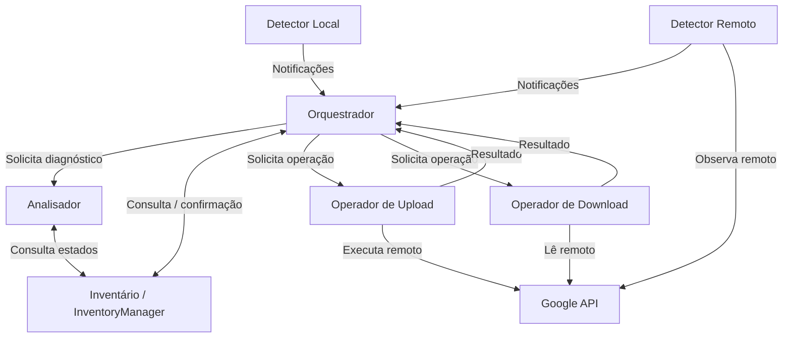

# System Architecture — DriveSync

## 1. Visão geral

O DriveSync é um cliente de sincronização do Google Drive para GNOME. O **Google Drive é a referência canônica da identidade e da estrutura remota**; a pasta local é uma projeção gerenciada. Alterações legítimas feitas localmente também são observadas e devem ser consideradas, sem sobrescrita ou exclusão automática baseada apenas em suposições.

A engine é organizada por **responsabilidades independentes**, cujos componentes se comunicam por interfaces explícitas. Cada componente conhece o contrato dos demais, mas não depende de sua implementação interna.

A arquitetura distingue cinco responsabilidades principais:

1. **Observar** alterações locais e remotas.
2. **Armazenar e consultar** o estado unificado dos itens.
3. **Analisar** diferenças entre estados.
4. **Decidir e coordenar** o que deve ser feito.
5. **Executar** operações sobre o Google Drive ou a pasta local.

Este documento define a organização **macro** dos componentes. Não especifica classes internas, arquivos Rust, assinaturas de métodos, protocolos de eventos nem algoritmos de sincronização.

## 2. Componentes da engine

### 2.1 Detectores

**Responsabilidade:** observar alterações nos ambientes local e remoto e **notificar o Orquestrador** quando houver algo a avaliar.

- **Detector Local:** acompanha alterações no filesystem da pasta sincronizada.
- **Detector Remoto:** acompanha alterações na pasta correspondente do Google Drive.
- Produzem notificações de alterações ou necessidades de reavaliação.
- Não decidem executar upload, download, renomeação, movimentação ou exclusão.
- Não tratam a simples falta de observação como prova de exclusão.

**Direção da comunicação:** **Detectores → Orquestrador**. O Orquestrador não precisa solicitar uma observação para que os detectores o informem; eles operam como produtores de notificações. O mecanismo concreto de entrega será definido nos fluxos de execução.

### 2.2 Inventário (InventoryManager)

**Responsabilidade:** centralizar o conhecimento e a persistência dos dados dos itens sincronizados.

- Mantém o **SyncItem**, entidade única para cada arquivo ou diretório, incluindo estados local, remoto e confirmado.
- Registra e consulta metadados, identidades, hierarquia e condições dos itens.
- Valida associações de identidade e a consistência das atualizações.
- Disponibiliza informações e comparações de estado através de sua interface.
- Encapsula a persistência: nenhum outro componente consulta ou altera diretamente o SQLite do inventário.

A estrutura e a localização dos dados seguem o [DATA_MODEL.md](DATA_MODEL.md). O Inventário **não executa** operações em arquivos e **não escolhe** políticas de sincronização.

### 2.3 Analisador

**Responsabilidade:** interpretar os estados disponíveis para identificar mudanças, divergências e possíveis conflitos.

- Compara observações locais e remotas com o último estado confirmado.
- Diferencia alterações de conteúdo, nome, localização e presença quando houver evidência suficiente.
- Produz um diagnóstico que pode ser utilizado pelo Orquestrador.
- Não modifica arquivos, não executa transferências e não decide qual lado deve prevalecer.

O Analisador utiliza a interface do Inventário para obter os dados necessários.

### 2.4 Orquestrador

**Responsabilidade:** receber informações, decidir o fluxo de trabalho e coordenar as ações da sincronização.

- Recebe as notificações dos Detectores.
- Consulta o Inventário e utiliza os diagnósticos do Analisador.
- Decide se uma alteração exige uma operação imediata, uma operação pendente, nova avaliação, suspensão ou tratamento de conflito.
- Coordena as operações de sincronização inicial e de acompanhamento.
- Encaminha operações aos componentes de Upload ou Download.
- Recebe os resultados das operações e coordena sua confirmação no Inventário.
- Controla conceitualmente o trabalho pendente e sua retomada; o desenho interno de filas e armazenamento fica para especificação posterior.

O Orquestrador **decide o que fazer**, mas não implementa diretamente transferência de conteúdo ou manipulação física de arquivos.

### 2.5 Operador de Upload

**Responsabilidade:** aplicar no Google Drive alterações originadas localmente, quando solicitadas pelo Orquestrador.

Abrange operações sobre arquivos e diretórios, incluindo:
- criação e envio de arquivos ou diretórios;
- atualização de conteúdo;
- renomeação;
- movimentação;
- exclusão, quando expressamente determinada.

A execução deve utilizar as capacidades adequadas do Google Drive; renomear ou mover um item não implica reenviar seu conteúdo. O operador devolve o resultado e os metadados verificáveis da operação, sem decidir autonomamente se ela deveria ocorrer.

### 2.6 Operador de Download

**Responsabilidade:** aplicar na pasta local alterações originadas remotamente, quando solicitadas pelo Orquestrador.

Abrange operações sobre arquivos e diretórios, incluindo:
- criação e materialização de arquivos ou diretórios;
- atualização de conteúdo;
- renomeação;
- movimentação;
- exclusão, quando expressamente determinada.

O operador preserva as garantias de transferência, integridade, interrupção e retomada de downloads. Operações somente de metadados ou de localização não exigem baixar novamente o conteúdo quando não for necessário. Devolve resultados verificáveis, sem decidir autonomamente qual mudança deve prevalecer.

**Upload e Download são operadores direcionais**, não apenas funções de transferência de bytes.

### 2.7 Google API

**Responsabilidade:** abstrair a comunicação técnica com os serviços e recursos do Google Drive.

- Disponibiliza operações de consulta e alteração de metadados e conteúdo remoto.
- Encapsula os detalhes de comunicação com a API e os mecanismos de autenticação necessários ao acesso.
- É utilizada por componentes que precisam interagir com o ambiente remoto, como Detector Remoto e operadores.
- Não conhece regras de conflitos, decisões de sincronização nem detalhes de persistência do Inventário.

O componente oferece acesso ao provedor, não uma segunda fonte de verdade local.

## 3. Relacionamentos entre componentes

O diagrama mostra **relações e responsabilidades**, não uma sequência de execução obrigatória. A origem das notificações é sempre o detector correspondente; a decisão sobre aplicar, adiar, enfileirar ou reavaliar pertence ao Orquestrador.

## 4. Princípios de comunicação

**Interfaces explícitas.** Componentes se comunicam por contratos, sem depender de estruturas internas uns dos outros. Cada um pode ser testado independentemente.

**Eventos não são comandos.** Uma notificação de alteração informa que um item ou escopo exige atenção. Não equivale a ordenar upload, download ou exclusão.

**Separação entre observação, análise, decisão e execução.** Detectores observam; Inventário guarda e fornece estado; Analisador compara; Orquestrador decide; operadores executam.

**Inventário como acesso único aos dados.** Resultados e observações relevantes são registrados mediante contratos do InventoryManager; os componentes não acessam SQL diretamente.

**Identidade persistente.** O mesmo `SyncItem` representa as duas faces de um objeto, independentemente de alteração de nome, pasta ou conteúdo.

**Resultados verificáveis.** Uma operação executada não é automaticamente uma sincronização confirmada. A confirmação do estado é distinta da execução física.

**Falhas não são exclusões.** Ausência de conexão, indisponibilidade e observação incompleta não autorizam exclusões nem substituições destrutivas.

**Independência de testes.** Cada responsabilidade admite testes próprios com implementações simuladas das interfaces externas; operações com filesystem e banco podem ser validadas em ambientes reais isolados.

## 5. Limites da arquitetura

A interface GTK/libadwaita consome capacidades públicas da engine. Ela não conhece tabelas do Inventário nem implementa regras de sincronização. Os serviços globais de contas, preferências, credenciais e diagnóstico dão suporte à aplicação e não alteram a divisão de responsabilidades da sincronização.

A persistência dos itens, estados e histórico é definida por `DATA_MODEL.md`. Esta arquitetura não cria um segundo inventário nos detectores nem atribui ao Orquestrador acesso direto ao SQLite.

## 6. Critério arquitetural

A organização é considerada respeitada quando:
- uma mudança local ou remota pode ser informada ao Orquestrador sem que o detector escolha a ação;
- o Orquestrador consegue consultar o estado e solicitar análise sem conhecer a persistência;
- uma operação é executada pelo operador correspondente, sem embutir a decisão de sincronização;
- os resultados podem ser confirmados sobre a mesma identidade lógica no Inventário;
- a implementação interna de um componente pode ser alterada sem exigir conhecimento dos detalhes internos dos demais.

Os **fluxos de execução**, a **organização interna dos módulos** e o **plano de desenvolvimento** serão especificados separadamente.
