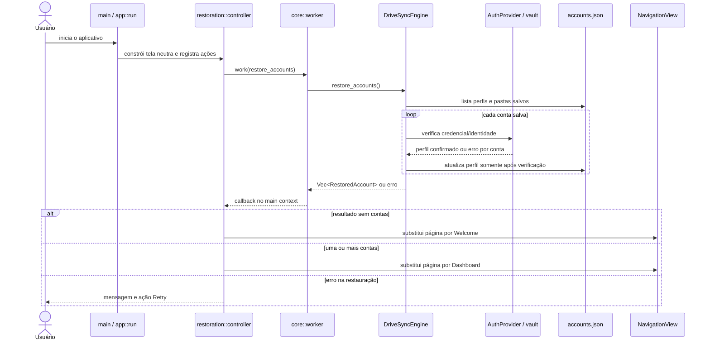
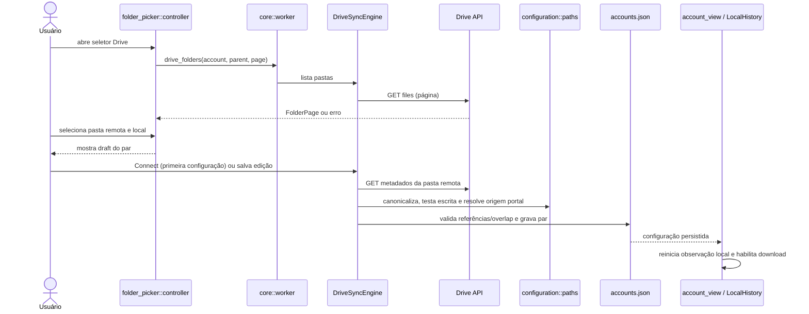
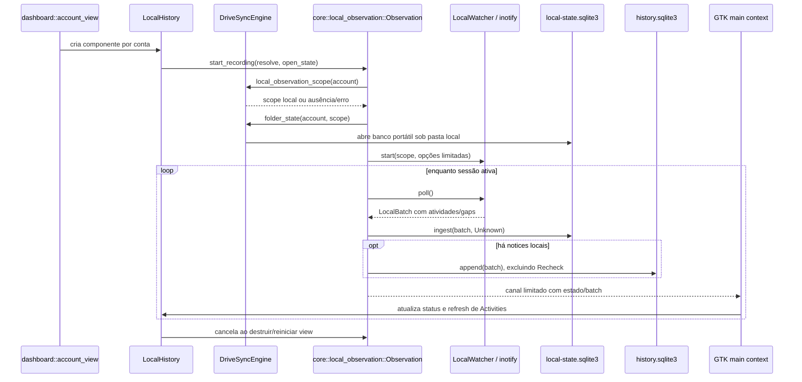

# Fluxos de execução

As sequências descrevem chamadas conectadas no código. Um fluxo descrito como
blocking roda fora do main loop GTK quando iniciado pelo handler da interface,
por meio de `src/core/worker.rs::work`.

## Inicialização e restauração de contas

`src/app/lifecycle.rs::run` cria o app, engine e página neutra. `restoration`
executa `restore_accounts`; somente uma lista vazia leva à tela Welcome. Uma
falha mantém página com retry, não é convertida em lista vazia.



Evidências: `src/app/restoration/controller.rs::bind`,
`src/app/restoration/mod.rs::show_accounts`,
`src/app/navigation/mod.rs::initial_destination` e
`engine/src/facade.rs::restore_accounts`. O resultado por conta preserva perfil
em falha de verificação, conforme `engine/src/models.rs::RestoredAccount`.

## Conexão OAuth e gravação do perfil

O handler abre a janela compartilhada; a thread de autorização pede ao main
context que abra a URL com GIO. A conclusão só é publicada depois de troca do
código, identificação e gravação no vault e no índice JSON.

```mermaid
sequenceDiagram
    actor U as Usuário
    participant UI as connection::controller
    participant Worker as thread de autorização
    participant Engine as DriveSyncEngine / AuthProvider
    participant Browser as Browser via GIO OpenURI
    participant Callback as listener loopback
    participant Google as OAuth + OpenID Google
    participant Vault as Secret Service
    participant Index as accounts.json

    U->>UI: Add account / Connect
    UI->>Worker: inicia add_account(Cancellation)
    Worker->>Engine: lê OAuthConfig e inicia PKCE
    Engine->>Callback: bind listener efêmero
    Engine-->>UI: URL + canal de confirmação de abertura
    UI->>Browser: lança URL; retorna sucesso/erro
    Browser-->>U: consentimento e autenticação
    Browser->>Callback: redirecionamento loopback com state/code
    Callback->>Engine: valida state, host, path, método e unicidade
    Engine->>Google: troca code/verifier por tokens
    Engine->>Google: consulta identidade OpenID
    Engine->>Vault: carrega entrada anterior e salva credencial validada
    Engine->>Index: registra perfil sem segredo
    Engine-->>UI: AccountSummary ou erro sanitizado
    UI->>Index: solicita restauração/seleção da nova conta após sucesso
```

Implementação: `engine/src/auth/provider.rs::authorize`,
`complete`, `verify_with_config`; `engine/src/auth/callback.rs`; adaptadores
`google.rs`/`storage.rs`; UI em
`src/features/accounts/connection/controller.rs`. O fluxo de teste usa
`FakeGoogle` e `MemoryVault`; não comprova integração real com Google ou
Secret Service.

## Escolha e persistência de pastas

O primeiro par fica como draft até a ação Connect; alterações posteriores são
salvas automaticamente quando a seleção muda, conforme `folders.rs`.
`DriveSyncEngine::configure_folder` busca e valida metadados remotos, valida o
caminho local e checa sobreposição antes de persistir.



Evidências: `src/features/accounts/folder_picker/controller.rs::load`,
`src/features/dashboard/components/folders.rs::autosave`/`configure`,
`engine/src/facade.rs::configure_folder` e
`engine/src/accounts/repository.rs::configure`. A ação local de abrir pasta e a
ação remota de abrir URL usam o último par salvo, não um draft incompleto.

## Observação local, estado e histórico

Para cada conta representada no dashboard, `account_view::populate` cria
`LocalHistory`; ao construir a view, ela inicia `Observation`. A resolução da
pasta é local; a sessão chama `LocalWatcher::poll` repetidamente, persiste
hints com conectividade `Unknown` e escreve eventos observados no histórico.
Não há chamada desse caminho para upload.



`LocalWatcher` é volátil: não executa thread própria nem entrega persistente;
reinício e gaps produzem necessidade de rechecagem. A interface persiste estado
e histórico em consumidores separados. Referências: `engine/src/local_detector/watcher.rs`,
`src/core/local_observation.rs::spawn`, `engine/src/local_state/store.rs::ingest`
e `engine/src/activity_history.rs::append`.

## Download inicial e processamento de alterações remotas

Ao existir pasta configurada e conta sem erro, `initial_download.rs` agenda a
ação no idle do GLib. A operação inicial chama `initial_download_with_progress`;
após sucesso o timer usa a preferência `remote_check_minutes` para iniciar
`poll_remote_downloads`. O botão “Sync now” usa o mesmo fluxo da conta.

```mermaid
sequenceDiagram
    actor U as Usuário
    participant UI as initial_download component
    participant Worker as core::worker
    participant Engine as DriveSyncEngine
    participant Auth as AuthProvider
    participant API as Drive API
    participant Detector as remote_detector
    participant Journal as remote-detector.sqlite3
    participant Download as download.rs
    participant State as local-state.sqlite3
    participant History as history.sqlite3

    alt primeira materialização / retry inicial
        UI->>Worker: initial_download_with_progress(account)
        Worker->>Engine: inicializa estado e baixa árvore
        Engine->>Auth: verifica acesso da conta
        Auth->>API: busca metadados e páginas de filhos
        API-->>Download: itens Drive
        Download->>State: registra itens confirmados e identidade
        Download->>API: baixa conteúdo em staging / range quando possível
        Download->>Download: verifica versão, tamanho e SHA-256; publica arquivo
        Download->>History: registra atividade remota confirmada
        Download-->>UI: progresso e relatório
    else verificação periódica ou botão de conta
        UI->>Worker: poll_remote_downloads(account)
        Worker->>Engine: autentica e executa checagem incremental
        Engine->>Detector: lê change log e confere inventário
        Detector->>API: changes e metadados necessários
        Detector->>Journal: transação de cursor, inventário e eventos
        Detector-->>Engine: entregas pendentes
        Engine->>Download: baixa chegadas novas e reconcilia existentes
        Download->>State: atualiza baseline após verificação
        Download->>History: registra resultados remotos verificados
        Engine->>Journal: acknowledgment somente dos eventos processados
        Engine-->>UI: conflitos pendentes, itens ignorados ou erro
    end
```

Implementação: `engine/src/facade.rs::initial_download_with_progress`,
`poll_remote_downloads`; `engine/src/download.rs::run_selected`,
`reconcile_item`; `engine/src/remote_detector/detector.rs`; UI em
`src/features/dashboard/components/initial_download.rs`. Conflitos e itens não
confirmados podem permanecer pendentes. Não foi identificada operação de
upload no fluxo local→Drive.

