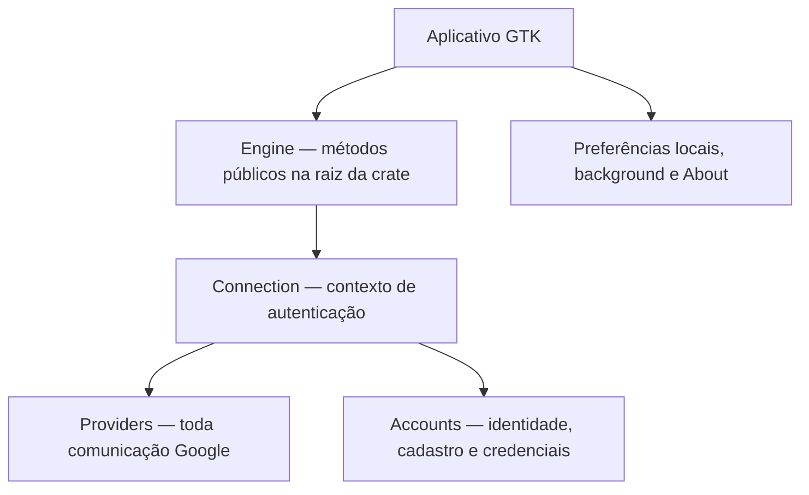

# Arquitetura da interface gráfica — 2026-11-10

## Estado atual

A interface GTK4/Libadwaita está novamente ativa em `src/main.rs`. O recorte desta versão é conexão Google e apresentação de contas. A [API pública de conexão](../engine/connection/README.md) pertence à crate existente da engine e é reexportada por `engine/src/lib.rs`; não é criada uma nova crate ou uma facade universal.

## Fronteiras

O Orquestrador de sincronização não participa da criação de contas. O front-end não importa módulos internos, tokens, sessões Google nem backends. Os contratos de componente já públicos de Providers/Accounts não foram alterados para acomodar GTK.

## Telas preservadas

| Tela | Responsabilidade e contrato |
| --- | --- |
| Inicialização | `Engine::open` e `list_accounts`; erro mantém a tela com Tentar novamente, sem assumir lista vazia ou resetar dados |
| Boas-vindas | Entrada para conectar a primeira conta; nenhuma autenticação automática |
| Conexão | `begin_google_sign_in`, navegador via GIO, cópia da URL, `finish_google_sign_in` e cancelamento explícito |
| Dashboard | Lista de contas, identidade e condição conhecida; não afirma conectividade em tempo real |
| Editor de nome | Abre automaticamente para conta criada; Salvar chama `update_account`, Cancelar descarta o rascunho; falha mantém o texto editável |
| Reautorização | Mesmo diálogo, passando AccountId; Accounts exige a mesma identidade Google |
| Preferências | Aparência e comportamento de fechar/notificar em background; sem configuração de módulos da engine |
| About | Informações do aplicativo e revisão do código |

## Remoções

Foram retirados seleção/configuração de pastas, download inicial, observação local, histórico/timeline, transferências, conflitos, execução manual de sincronização e intervalo remoto. Os componentes e testes gráficos específicos desses fluxos foram removidos. O teste de diagnóstico local que dependia de um executável inexistente também foi retirado com o recorte de observação local; não foi alterado para simular aprovação.

A ação antiga de Sign Out prometia remover configurações de pastas. Ela não foi ligada diretamente a Accounts::remove: a nova API inicial não inclui remoção enquanto não existir o contrato integrado do proprietário de conexões. O método interno seguro de Accounts foi preservado.

## Execução e validação

Engine possui executor privado e GTK aguarda futures via GLib. Uma janela fechada solicita cancelamento; persistência já iniciada pode terminar e ser refletida na lista, sem promessa de rollback. Os retornos usam referências fracas aos widgets. A engine guarda a tentativa/callback/PKCE e os tokens; GTK só recebe a URL pública e o identificador opaco.

Os testes visuais usam dados fictícios e diretórios XDG isolados; não acessam Google real, contas pessoais, keyring nem portais de autostart. Veja [Connection — TESTS](../engine/connection/TESTS.md) e [capturas](../../data/screenshots/README.md).
