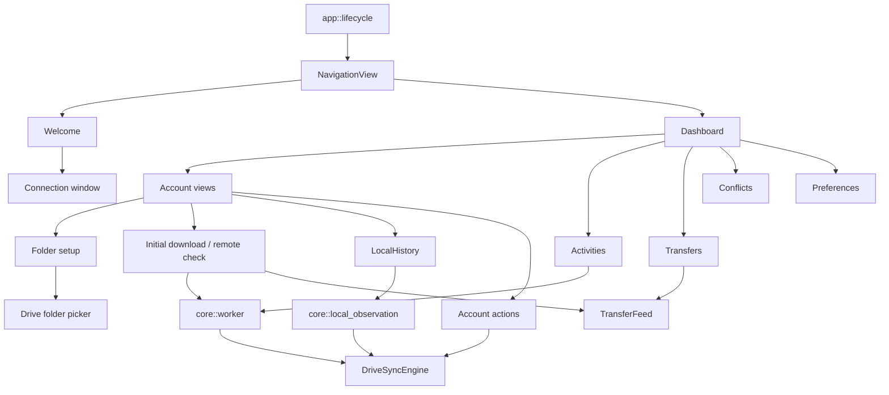

# Arquitetura da interface gráfica

## Composição

O binário `drivesync` parte de `src/main.rs` e delega criação e execução do
`adw::Application` a `src/app/lifecycle.rs::run`. O ciclo de vida compõe a
janela principal, `adw::NavigationView`, `adw::ToastOverlay`, ações globais,
restauração de contas e inicialização de preferências/background. O GTK main
context é responsável por alterações de widgets. Operações blocking solicitadas
por handlers usam `src/core/worker.rs::work`, que executa a closure em uma
thread e retorna o resultado ao main context.

## Páginas e janelas

| Tela ou janela | Implementação | Conteúdo e integração observada |
| --- | --- | --- |
| Welcome | `src/features/welcome/page.rs::build` | Tela mostrada quando a restauração não encontra contas; botão conecta à janela de autorização. A tela não inicia OAuth por si só. |
| Dashboard | `src/features/dashboard/page.rs::build_selected` | `NavigationSplitView`, lista de contas, atalhos Activities/Transfers/Conflicts e acesso a Preferences. Cada conta tem view própria; a página adapta sidebar em largura estreita. |
| Account view | `src/features/dashboard/account_view.rs::populate` | Composição dos dados e componentes da conta: cabeçalho, descrição, pastas, observação/histórico local e download/verificação remota. |
| Connection | `src/features/accounts/connection/dialog.rs`, `controller.rs` | Janela de autorização, progresso, cancelamento e cópia/abertura de URL no browser. O controller chama `DriveSyncEngine::add_account`. |
| Folder picker | `src/features/accounts/folder_picker/dialog.rs`, `controller.rs` | Diálogo de navegação paginada de pastas do Drive e seleção. Consulta a engine para obter páginas. |
| Preferences | `src/features/preferences/window.rs::build` | Navegação por Appearance, Accounts e Background; busca textual dos títulos/termos. Persistência via `Preferences`. |
| Activities | `src/features/dashboard/components/activities.rs::Activities` | Timeline paginada, filtro de conta, lista e painel de detalhe, carregada pela engine. Recebe pedido de refresh quando a observação local emite novas atividades. |
| Transfers | `src/features/dashboard/components/transfers.rs::build` | Feed da sessão com progresso, estado, taxa estimada e filtro por conta. Alimentado pelos callbacks de download; não é uma fila de jobs persistente. |
| Conflicts | `src/features/dashboard/components/transfers.rs::build_conflicts` | Lista e detalhe dos conflitos apresentados pelo feed; “Open folder in Google Drive” abre URL. A ação “Rename through DriveSync” existe visualmente, mas fica `sensitive(false)`. |
| Preferências de conta | `src/features/preferences/accounts.rs` | Seletor de contas e editores por conta; reutiliza os objetos do dashboard para descrição, configurações e ações existentes. |
| Menu principal | `src/app/main_menu.rs` | Ações globais da janela, incluindo adição de conta, preferências e informações do app conforme o ponto de instalação. |

O restante detalhamento dos componentes da conta está em
`src/features/dashboard/components/`: `account_header.rs`,
`description.rs`, `folders.rs`, `initial_download.rs`, `local_history.rs`,
`activities/rows.rs`, `activities/details.rs` e `account_actions.rs`.
Componentes de apresentação genéricos `content`, `row` e `scroll` estão em
`src/ui/widgets.rs`.

## Ações e handlers ligados a comportamento

| Ação visível | Handler e efeito observado |
| --- | --- |
| Connect Google Account / Add account | `connection/controller.rs::bind`; chama `add_account` e só navega ao dashboard após sucesso persistido e restauração da lista. |
| Change Drive folder / Change local folder | `folders.rs`; usa diálogo/seletor. Para perfil novo, o primeiro par é draft e Connect o salva; edição de configuração existente é salva após alteração. |
| Open local folder / Open Google Drive folder | `folders.rs` cria ações de abertura sobre o último par salvo; `account_actions.rs` reusa essas ações no menu da conta. |
| Sync now / Retry | `initial_download.rs::build`; dispara download inicial ou poll remoto conforme estado do componente. O nome “Sync now” não significa sincronização bidirecional. |
| Preferences | ação `app.preferences` e ação `account.preferences`; abrem ou focam Preferences, podendo selecionar contexto de conta. |
| Sign Out | `account_actions.rs` encaminha para botão de sign-out da conta; `features/accounts/session.rs` chama `DriveSyncEngine::sign_out`. |
| Activities filter / Older activities / Back to latest | `activities.rs`; seleciona contas e página por cursor na consulta `activity_history`. |
| Conflict “Open folder in Google Drive” | `transfers.rs::build_conflicts`; mostra detalhes e liga à pasta remota. O rename é indisponível e não há ação para resolver/substituir arquivos na UI inspecionada. |
| Appearance / background / remote check interval | `preferences/window.rs`; handlers atualizam estilo e persistem `Preferences`. O intervalo é lido pelo timer do componente de download. |
| Local activity feed | `local_history.rs` inicia `core::local_observation::Observation`; atualiza estado e solicita refresh da timeline. A tela não expõe cada hint local como operação de sincronização. |

As ações chamadas de `sync` na UI não acionam upload local: o handler relevante
chama `initial_download_with_progress` no estado inicial ou
`poll_remote_downloads` depois do download inicial, conforme
`initial_download.rs`.

## Comunicação e estado de validação da UI

Handlers com rede/disco passam pela engine via `Arc<DriveSyncEngine>`. A
comunicação é por chamadas síncronas em worker thread e callback no main
context; progresso de download e status remoto são repassados a
`TransferFeed`. A observação local entrega batches via canal limitado ao
componente `LocalHistory`; esse componente sinaliza a timeline para recarregar
histórico persistido. A UI de conflitos persiste sua lista em `conflicts.json`,
separada do estado de inventário.

Existem testes de navegação e layout GTK, mas vários estão marcados `ignore`
por exigir display. Portanto, a composição e os handlers estão identificados
no código, mas não foram validados como interação real de desktop nesta
execução. Evidências: `src/app/navigation/tests.rs`,
`src/app/layout_tests.rs`,
`src/features/preferences/window.rs` (testes ignorados) e
`src/features/dashboard/components/local_history/tests.rs`.

