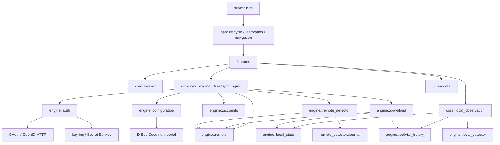

# Organização e dependências dos módulos

Os caminhos abaixo correspondem à árvore e às declarações `mod` atuais. Os
módulos privados são listados porque participam da implementação; a coluna de
integração diferencia chamadas identificadas de código de teste ou ferramenta.
O ponto de reexportação da engine é `engine/src/lib.rs`; o da aplicação é
`src/main.rs`.

## Crate `drivesync-engine`

| Módulo / arquivos | Responsabilidade e itens centrais | Dependências e uso observado |
| --- | --- | --- |
| `lib.rs`, `models.rs`, `error.rs` | Reexporta a API pública; define `AccountId`, `AccountSummary`, `RestoredAccount` e `EngineError`. | Entrada usada pela GUI e pelos bins. |
| `facade.rs` | `DriveSyncEngine`: autorização, restauração, descrição, listagem de pastas, configuração, observação, histórico, download e checagem remota. `sync_jobs` impede operações simultâneas por conta durante download/checagem. | Integra `auth`, `accounts`, `configuration`, `remote`, `download`, `remote_detector`, `local_state` e `activity_history`; principal interface da GUI. |
| `accounts/` — `mod.rs`, `models.rs`, `repository.rs`, `validation.rs` | Índice JSON v2 de metadados não secretos; `Accounts` executa leitura/gravação validada, descrição e relação de pastas. | Usado somente através da fachada. Não apaga arquivos de usuário; validações e testes em `accounts/tests.rs`. |
| `auth/` — `mod.rs`, `models.rs`, `ports.rs`, `provider.rs`, `callback.rs`, `google.rs`, `storage.rs`, `error.rs` | OAuth com PKCE e callback loopback; renovação e verificação por conta; contratos `GoogleApi`/`CredentialStore`; adaptadores HTTP Google e keyring/Secret Service; erros sanitizados. | `facade.rs` chama `AuthProvider`. Testes de `provider` usam API/vault falsos; `storage/tests.rs` cobre classificação do adaptador, não um serviço real. |
| `configuration/` — `mod.rs`, `models.rs`, `paths.rs` | `DriveFolder`, `FolderConfiguration`, caminho local, origem de portal, permissão local e detecção de sobreposição. | Usado por fachada e `download`; `paths.rs` consulta portal de documentos via D-Bus quando o caminho é alias Flatpak. |
| `remote/` — `mod.rs`, `client.rs`, `errors.rs`, `folders.rs`, `models.rs` | Transporte HTTP blocking limitado, erros do Drive, consulta/metadados e paginação de pastas; `FolderPage`. | Usado pela fachada, autenticação e download; funções de consulta são GET. |
| `download.rs`, `download/resume.rs` | Percorre árvore do Drive, cria arquivos locais, baixa conteúdo em partes com checkpoint, verifica versão/hash, registra identidades e reconcilia eventos remotos. | Chamado pela fachada; usa `remote`, `local_state` e `activity_history`. Há testes de filesystem e recuperação, mas não teste de download real contra Google. |
| `local_detector/` — `mod.rs`, `models.rs`, `watcher.rs` | `LocalScope`, `LocalNotice`, estados/limites e `LocalWatcher` sobre inotify. Atividades são dicas voláteis, não operações. | Exportado pela engine e consumido por `src/core/local_observation.rs` e diagnóstico local. |
| `local_state/` — `mod.rs`, `models.rs`, `store.rs` | `LocalStateStore`, snapshots de itens, baseline observado/confirmado e fila limitada de `PendingInvestigation`. | Usado pela fachada, observador local e download. Persistência SQLite local; não há worker de upload associado à fila. |
| `remote_detector/` — `mod.rs`, `provider.rs`, `detector.rs`, `journal.rs` | Consulta de change log e inventário por usuário/shared drive; produz eventos conservadores; diário SQLite com checkpoint e entrega até acknowledgment. | `poll_remote_downloads` usa `check` incremental; APIs `check_remote_changes`/eventos também são chamadas pelo bin diagnóstico remoto. Testes usam `Fake` provider. |
| `activity_history.rs` | `ActivityHistory`, `ActivityPage`, `ActivityRecord`, eventos locais/remotos e resumo de integridade do download. | Usado por observação local e download; consultado pela timeline do dashboard. |
| `oauth_config.rs`, `build.rs` | Validação e seleção de metadados públicos do cliente OAuth no build/runtime. | `engine/build.rs` gera arquivo em `OUT_DIR`; `auth/google.rs` carrega o resultado ou overrides de ambiente/arquivo. |

## Crate `drivesync`

| Módulo / arquivos | Responsabilidade e elementos centrais | Dependências e uso observado |
| --- | --- | --- |
| `main.rs` | Declara `app`, `core`, `features`, `ui`; chama `app::run`. | Ponto de entrada. |
| `app/` — `lifecycle.rs`, `main_menu.rs`, `navigation/`, `restoration/`, `layout_tests.rs`, `screenshot_demo.rs` | Cria app/janela, registra ações, restaura contas, escolhe tela inicial e faz transições. Fixtures visuais são testes ignorados sem display. | `lifecycle` compõe `core` e `features`; `navigation` chama engine por `core::worker`. |
| `core/worker.rs` | `work`: leva closure blocking a uma thread e entrega `Result` no main context GLib. | Usado por vários handlers de UI; não é uma fila persistente. |
| `core/local_observation.rs` | `Observation`, atualizações por canal limitado, start/stop de observadores por conta e persistência de hints/histórico. | Usa `LocalWatcher`, `LocalStateStore` e `ActivityHistory`; `LocalHistory` o inicia ao montar páginas. |
| `core/background/` — `mod.rs`, `portal.rs`, `startup.rs`, `tests.rs` | Integração com portal Background, notificação, ocultar/reabrir janela e opção `--background`. | Configurado em `app::lifecycle::run`; permissionamento real depende do desktop/portal. |
| `core/build_info.rs`, `core/i18n.rs` | Exibe versão/revisão embutidas e inicializa localização. | Chamados no ciclo de vida e telas. |
| `features/accounts/connection/` — `mod.rs`, `controller.rs`, `dialog.rs` | Janela de conexão, abertura de browser, cancelamento e apresentação de resultado OAuth. | `controller` chama `DriveSyncEngine::add_account` em thread; navega após sucesso. |
| `features/accounts/folder_picker/` — `mod.rs`, `controller.rs`, `dialog.rs` | Navegação paginada de pastas Drive e seleção explícita. | `controller` chama `drive_folders` usando `core::worker`; seleção retorna para configuração de pasta. |
| `features/accounts/session.rs` | Confirmação de sign-out. | Chama `DriveSyncEngine::sign_out` por worker. |
| `features/welcome/` — `mod.rs`, `page.rs` | Primeira tela sem OAuth próprio. | Construída somente quando a restauração não retorna contas. |
| `features/dashboard/` — `mod.rs`, `page.rs`, `account_view.rs` | Sidebar de contas/atividades/transfers/conflitos e composição das páginas individuais. | Páginas de atividade, transferências e conflitos são montadas; uma `LocalHistory` e fluxo de download são criados por conta. |
| `features/dashboard/components/account_actions.rs` | Ações locais/remotas, configurar conta e sign-out. | Conecta grupos `gio::SimpleAction`; não registra ação de upload ou sync local. |
| `.../account_header.rs`, `.../description.rs` | Identidade apresentada e edição assíncrona de descrição local. | Descrição é lida/salva pela fachada. |
| `.../folders.rs` | Drafts, seletor local/remoto, ação Connect e persistência de `FolderConfiguration`. | Usa `drive_folders`, `check_local_folder` e `configure_folder`; após salvar notifica os consumidores. |
| `.../initial_download.rs` | Botão de início/retry, atualizações de progresso e timer de checagem remota. | Invoca `initial_download_with_progress` ou `poll_remote_downloads` via worker. |
| `.../local_history.rs` | Estado e resumo visual da observação, cancelamento/reinício e notificação para atualizar atividades. | Inicia um `Observation` por conta configurada; a tela de produção não renderiza lista local detalhada. |
| `.../activities.rs`, `activities/rows.rs`, `activities/details.rs` | Timeline paginada e detalhes de registros do histórico. | Carrega `DriveSyncEngine::activity_history`; layout GTK real tem testes ignorados. |
| `.../transfers.rs` | Feed de downloads da sessão, progresso, velocidade e lista de conflitos. | Recebe callbacks da operação de download; `conflicts.json` persiste dados da interface. Botão “Rename through DriveSync” é desabilitado. |
| `features/preferences/` — `mod.rs`, `accounts.rs`, `model.rs`, `window.rs` | Preferências de aparência, contas e background; leitura/gravação de key file. | `remote_check_minutes` é consultado pelo timer da checagem remota; editor usa objetos de conta/dashboard. |
| `ui/` — `mod.rs`, `widgets.rs` | Helpers `content`, `row`, `scroll`. | Presentação reutilizável sem acesso à engine. |
| `bin/` | `drivesync-initial-download`, `drivesync-local-diagnostic`, `drivesync-remote-diagnostic`. | Ferramentas CLI; os diagnósticos são instalados pelo manifesto. O bin de download inicial não é listado nos comandos de instalação dos manifestos. |

## Dependências entre módulos

O código do detector e do estado local é parcialmente exposto como contratos
independentes; não há integração observada que transforme os hints locais em
upload. A chamada real de download para eventos remotos está em
`DriveSyncEngine::poll_remote_downloads`.

