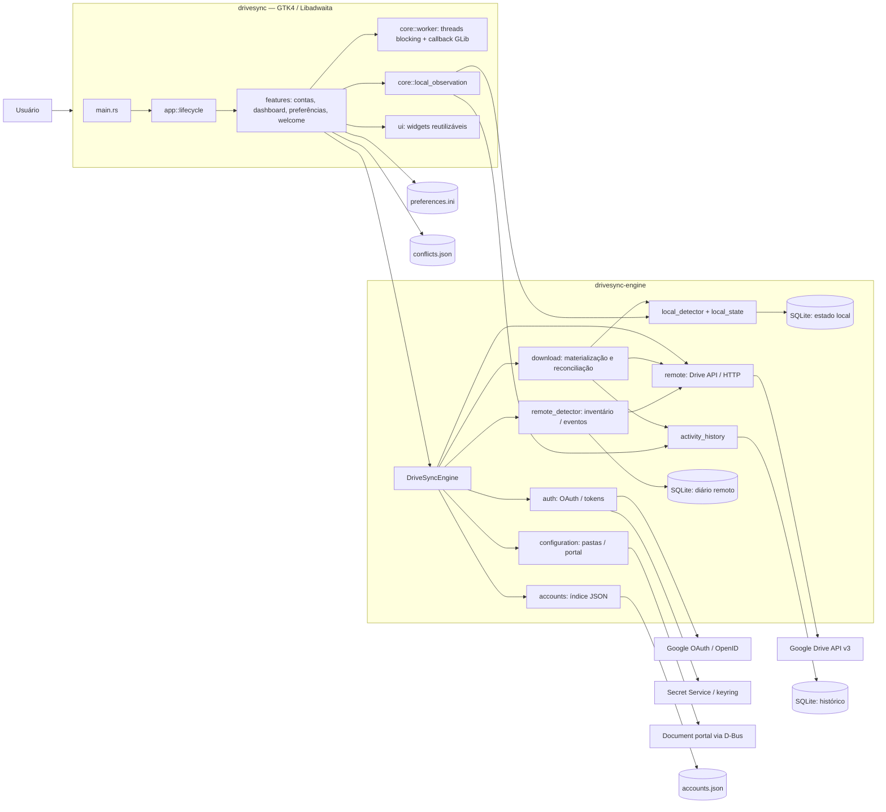

# Arquitetura do sistema

## Objetivo e estado observado

O aplicativo oferece uma interface Linux GTK4/Libadwaita para conectar contas
Google, configurar uma pasta do Drive e uma pasta local por conta, observar
alterações locais, registrar atividades, baixar a árvore remota inicialmente e
verificar/aplicar alterações remotas. Evidências: `DriveSyncEngine` em
[`engine/src/facade.rs`](../../engine/src/facade.rs), composição de tela em
[`src/features/dashboard/account_view.rs`](../../src/features/dashboard/account_view.rs)
e `initial_download.rs`, e `LocalHistory::new` em
[`src/features/dashboard/components/local_history.rs`](../../src/features/dashboard/components/local_history.rs).

O processamento de alterações disponível é orientado do Drive para a cópia
local. `LocalStateStore::ingest` guarda **pedidos de investigação**, não
instruções executáveis de upload; não foi localizada operação de envio de
arquivos. Portanto, “sincronização” em rótulos da interface não é prova de
sincronização bidirecional. O README principal e o comentário de About em
`src/app/main_menu.rs` dizem que nenhum arquivo é sincronizado, afirmação que
diverge dos fluxos de download conectados no código.

## Crates e tecnologias

O workspace Cargo usa resolver 2, edição Rust 2021 e contém dois membros
([`Cargo.toml`](../../Cargo.toml)):

| Crate | Tipo e responsabilidade observada |
| --- | --- |
| `drivesync` | Aplicativo GTK; `src/main.rs` declara `app`, `core`, `features` e `ui`, e delega a `app::run()`. |
| `drivesync-engine` | Biblioteca de domínio/adaptadores; `engine/src/lib.rs` expõe `DriveSyncEngine` e modelos, observadores, estado local e detector remoto. |

Dependências diretas declaradas:

- Aplicativo: `gtk4` 0.10 (feature `v4_10`), `libadwaita` 0.8 (feature
  `v1_4`), a biblioteca local `drivesync-engine`, `gettext-rs` 0.8 e
  `serde_json` 1.
- Engine: `oauth2` 5; `reqwest` 0.12 com transporte blocking, JSON e rustls;
  `rusqlite` 0.37; `dbus` 0.9; `dbus-secret-service` 4.1; `keyring` 3.6;
  `serde`/`serde_json`; `url`; `sha2`; `chrono`; `rustix`.
- Compilação: `engine/build.rs` lê e valida metadados OAuth Desktop e os
  incorpora como metadados públicos do cliente; `build.rs` da raiz embute
  versão e revisão Git. Os manifestos Flatpak definem runtime GNOME e extensão
  Rust; o manifesto Devel inspecionado seleciona GNOME Platform/SDK 50 e
  `org.freedesktop.Sdk.Extension.rust-stable`
  ([`flatpak/com.rtosta.DriveSync.Devel.yml`](../../flatpak/com.rtosta.DriveSync.Devel.yml)).

O código usa APIs Unix/Linux: inotify, descritores de diretório, modos Unix e
`openat2` aparecem em `engine/src/local_detector/watcher.rs`,
`engine/src/configuration/paths.rs` e `engine/src/download.rs`. Não foi
identificada implementação equivalente para outros sistemas operacionais.

## Pontos de entrada e composição

- `src/main.rs::main` é o ponto de entrada do aplicativo.
- `src/app/lifecycle.rs::run` inicializa gettext, cria `adw::Application`,
  janela, `NavigationView`, engine compartilhada e página de restauração.
- `engine/src/lib.rs` é o ponto de entrada da biblioteca e reexporta a fachada
  e os tipos públicos. Não há servidor ou processo backend separado.
- `src/bin/drivesync-initial-download.rs`,
  `drivesync-local-diagnostic.rs` e `drivesync-remote-diagnostic.rs` são
  executáveis auxiliares. Os manifestos Devel/produção instalam os dois
  diagnósticos e o binário principal, mas não o binário `drivesync-initial-download`.

O identificador do aplicativo é selecionado por `DRIVESYNC_APP_ID`, com fallback
para `com.rtosta.DriveSync.Devel` em `src/app/lifecycle.rs::APP_ID`. A separação
de armazenamento efetiva entre perfis não foi verificada em runtime.

## Limites entre componentes

- **Interface:** `app` compõe ciclo de vida e navegação; `features` constrói
  telas e handlers. `ui` fornece widgets sem acesso direto à engine.
- **Execução fora da thread GTK:** `core::worker::work` executa closures
  blocking em threads e entrega o resultado no contexto principal do GLib.
- **Regras e integrações:** `DriveSyncEngine` coordena módulos privados da
  engine. As chamadas blocking de conta, rede, vault e downloads são invocadas
  pelos handlers através do worker.
- **Observação local:** `core::local_observation::Observation` gerencia
  `LocalWatcher`, grava dicas de trabalho e histórico em thread própria; não
  transfere dados locais para o Drive.
- **Persistência:** índice JSON de contas, credenciais no Secret Service,
  arquivos SQLite separados para estado local, diário remoto e histórico, além
  de arquivos de preferências e conflitos.

## Diagrama geral

O diagrama representa chamadas identificadas no código, não garante que os
serviços externos estejam disponíveis. Os schemas SQLite são descritos em
[DATA_MODEL.md](DATA_MODEL.md); sequência de execução, em
[EXECUTION_FLOWS.md](EXECUTION_FLOWS.md).

