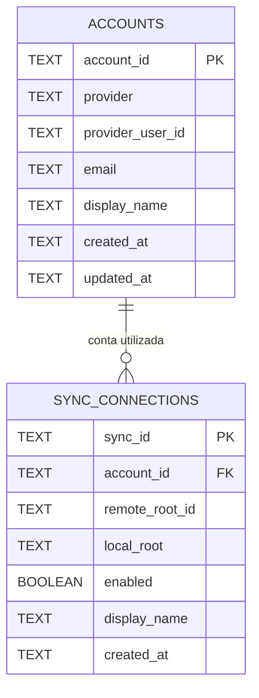

# Contas — responsabilidades, cadastro e persistência

## Objetivo

O módulo `accounts/` é responsável pelo **cadastro, identificação e ciclo de vida das contas conectadas** no DriveSync. Disponibiliza uma API pública para cadastrar, consultar, listar, atualizar e remover contas, sem expor seu meio de armazenamento aos consumidores.

O submódulo `accounts/auth/` é responsável pelo fluxo de autenticação e credenciais; `google_api/` implementa os contratos técnicos OAuth/OIDC e Drive API. O módulo de contas **não** implementa operações de sincronização e não consulta diretamente o banco do Inventário.

## Dados conhecidos de contas

Os campos abaixo preservam o modelo anteriormente discutido, ainda **conceitual**. Não representam uma decisão de criar obrigatoriamente uma tabela SQLite.

| Campo | Natureza | Significado |
| --- | --- | --- |
| `account_id` | Identificador interno estável | Chave da conta na aplicação |
| `provider` | Identificador do provedor | Inicialmente `google` |
| `provider_user_id` | Identidade externa estável | Identificador OIDC `sub`, não e-mail |
| `email` | Opcional e mutável | Endereço apresentado ao usuário |
| `display_name` | Opcional e mutável | Nome apresentado |
| `created_at` | Timestamp | Data de cadastro |
| `updated_at` | Timestamp | Última atualização dos metadados |

A combinação `(provider, provider_user_id)` deve identificar uma única conta cadastrada, independentemente de alterações de e-mail ou nome. Não persistir `access_token`, `refresh_token` ou segredos na estrutura de metadados da conta.

### Modelo relacional candidato — somente se houver necessidade de SQLite

Essa é uma **proposta de relação de domínio**, não uma imposição de tabelas no mesmo banco. As conexões podem pertencer a um componente específico no futuro; nesse caso, a relação entre elas e as contas será validada por **API**, sem exigir FK entre armazenamentos independentes.

## Dados conhecidos de conexões — responsabilidade em revisão

Uma conexão relaciona uma conta, uma pasta remota e uma pasta local. O levantamento anterior propôs:

| Campo | Significado |
| --- | --- |
| `sync_id` | Identificador estável do vínculo de sincronização |
| `account_id` | Conta à qual a conexão pertence |
| `remote_root_id` | ID da pasta remota no Google Drive |
| `local_root` | Caminho da pasta local selecionada |
| `enabled` | Sincronização ativa ou desabilitada |
| `display_name` | Nome de apresentação opcional |
| `created_at` | Data de criação do vínculo |

**Não foi decidido se conexões serão administradas por `accounts/`, por `configuration/` ou por um módulo dedicado.** Este levantamento permanece aqui para não perder as entidades já identificadas. `sync_id`, `account_id` e `remote_root_id` também são usados para validar o escopo de um inventário, mas o Inventário não é proprietário do cadastro global.

## API e persistência encapsulada

- Consumidores chamam operações do módulo de contas: cadastrar, listar, buscar, atualizar e remover conta, além de consultar as conexões associadas **quando o contrato entre módulos estiver definido**.
- A implementação **pode escolher** SQLite, arquivo estruturado ou outro mecanismo adequado se houver necessidade; nenhum formato ou caminho é obrigatório neste estágio.
- Apenas o módulo que possuir os dados consulta/grava sua persistência. Consumidores não recebem conexão SQLite, caminho do arquivo, transações SQL ou tabelas como API.
- Caso outro módulo seja proprietário das conexões, a referência `account_id` será resolvida e validada por contrato entre módulos, não por acesso direto ao armazenamento da conta.
- As credenciais são administradas por `accounts/auth/` em armazenamento seguro (Secret Service/keyring), acessado por sua própria API.
- Cada módulo deve testar tanto sua **API pública** quanto o armazenamento escolhido, sem exigir que consumidores conheçam sua implementação.
- Operações que removam uma conta devem considerar vínculos de sincronização existentes e nunca provocar exclusões remotas ou locais por efeito colateral implícito.

## Decisões pendentes

1. Contratos Rust completos de conta e de conexão.
2. Proprietário definitivo do cadastro de conexões.
3. Necessidade ou não de SQLite para cadastro global.
4. Semântica de desativação/remoção de conta com conexões existentes.
5. Local de persistência e testes de recuperação, somente depois da escolha técnica.

**Nesta etapa, documentam-se os dados e os limites de responsabilidade; nenhuma persistência é implementada.**
