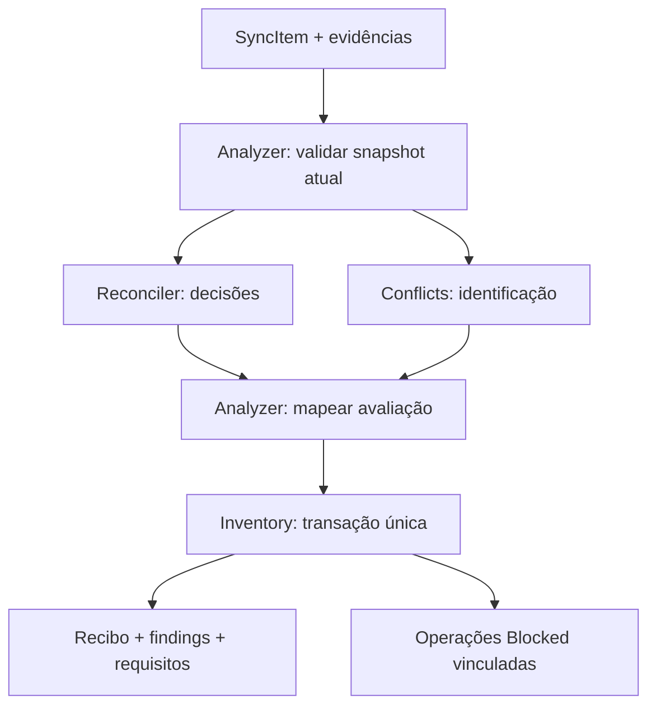

> Integração atual: a aplicação habilita novas réplicas por `AnalyzerExecution`.
> Analyzer chama Operator e confirma somente após reobservação. Ver [EXECUTION.md](EXECUTION.md).

# Analyzer

Coordena Reconciler e Conflicts para **um item do Inventory por chamada**, registra
a avaliação e suas decisões e cria operações pendentes persistentes. A fachada
pública oferece somente `new`, `analyze` e `status`; os algoritmos são privados e
independentes, sem I/O.

A implementação atual analisa e persiste. Não executa operações físicas, confirma
baseline ou resolve conflitos. Conflicts apenas identifica situações que exigem
intervenção futura do usuário; falta de evidência permanece separada de conflito.

A transação valida sincronização, snapshot e revisão, grava os fatos e o diagnóstico
do item e vincula cada decisão à fila. Retry idêntico não duplica registros.
Consultas do Inventory recuperam avaliações após reinício e indicam quando uma
observação mais recente tornou o registro obsoleto. As operações permanecem
bloqueadas porque comandos executáveis e ações de resolução virão depois.

`analyze` usa um worker bloqueante para SQLite. `status` consulta apenas memória
local, sem SQL ou espera pelo término. O mesmo item não tem duas análises ativas
na mesma instância; instâncias distintas preservam consistência por revisão e
transações do Inventory. Cancelamento do future não garante cancelamento do worker.

**Estado:** integração de análise/persistência implementada. O esquema Inventory
é 8; versões incompatíveis são preservadas e rejeitadas, sem migração automática.
O Orchestrator chama esta fachada após Scanner completo e continua entregando
itens observados pelos detectores durante a sessão, sem executar operações. Execução de comandos e opções/ações de resolução permanecem pendentes.

[Planos implementados](PLANNING.md) · [Mapa de ações](ACTIONS.md) · [Interfaces](INTERFACES.md) · [Testes](TESTS.md) ·
[Persistência](../inventory/ANALYSIS.md) · [Orientações](AGENTS.md)

## Decisão de direção no fluxo real

Itens novos locais sem vínculo remoto produzem intenção de `Upload`; itens novos
remotos sem vínculo local produzem intenção de `Download`, incluindo diretórios.
A identificação vem do Reconciler e é persistida pelo Analyzer, não inferida pela
GUI. A origem deve estar completamente observada e o tipo ser suportado. Ausência
de vínculo não comprova ausência do recurso: verificações de identidade, observação
e destino permanecem explícitas e a operação continua `Blocked`.

Conflitos comprovados produzem `PendingUserDecision`, apresentado como ação
manual. Dados inconclusivos sem direção identificável permanecem pendência de
evidência, sem escolher uma versão arbitrária nem fabricar conflito. Dois lados
já vinculados continuam usando baseline e comparações confiáveis para propagar
mudanças. A classificação não confirma sincronização nem executa comandos.

## Regra de associação

Nome, caminho semelhante e conteúdo igual nunca estabelecem identidade entre
itens independentes. Associar recursos preexistentes exige definição explícita do
usuário; uma futura criação por upload/download registra o vínculo pela identidade
do recurso efetivamente criado e verificado. Nenhum desses vínculos confirma
baseline por presunção. O [mapa de ações](ACTIONS.md) detalha as condições, limites
e pendências antes da implementação do Operator.

A etapa de planejamento materializa dados dos comandos do Operator, bloqueios,
dependências e recursos para intervenção manual, sem instanciar um executor.
Lixeira produz intenção condicionada à autorização; restauração exige pedido
explícito. Consulte [PLANNING.md](PLANNING.md) e [EVIDENCE.md](EVIDENCE.md).
