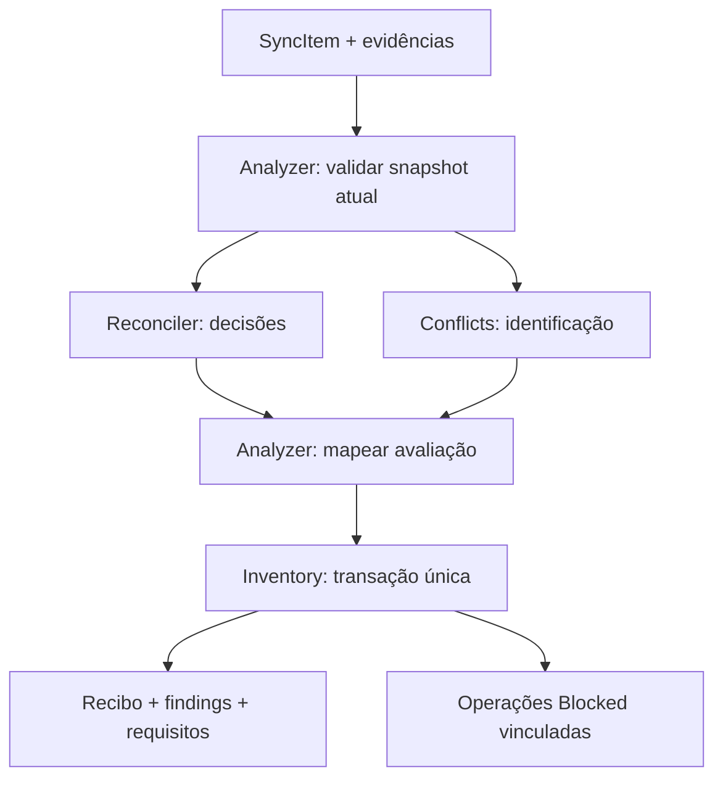

# Analyzer

Coordena Reconciler e Conflicts para **um item do Inventory por chamada**, registra
a avaliação e suas decisões e cria operações pendentes persistentes. A fachada
pública oferece somente `new`, `analyze` e `status`; os algoritmos são privados e
independentes, sem I/O.

A implementação atual analisa e persiste. Não executa operações físicas, confirma
baseline ou resolve conflitos. Conflicts apenas identifica situações que exigem
intervenção futura do usuário; falta de evidência permanece separada de conflito.

A transação valida sincronização, snapshot e revisão, grava os fatos e o diagnóstico
do item e vincula cada decisão à fila. Retry idêntico não duplica registros.
Consultas do Inventory recuperam avaliações após reinício e indicam quando uma
observação mais recente tornou o registro obsoleto. As operações permanecem
bloqueadas porque comandos executáveis e ações de resolução virão depois.

`analyze` usa um worker bloqueante para SQLite. `status` consulta apenas memória
local, sem SQL ou espera pelo término. O mesmo item não tem duas análises ativas
na mesma instância; instâncias distintas preservam consistência por revisão e
transações do Inventory. Cancelamento do future não garante cancelamento do worker.

**Estado:** integração de análise/persistência implementada. O esquema Inventory
é 4; versões incompatíveis são preservadas e rejeitadas, sem migração automática.
O Orchestrator chama esta fachada após Scanner completo e continua entregando
itens observados pelos detectores durante a sessão, sem executar operações. Execução de comandos e opções/ações de resolução permanecem pendentes.

[Interfaces](INTERFACES.md) · [Testes](TESTS.md) ·
[Persistência](../inventory/ANALYSIS.md) · [Orientações](AGENTS.md)
