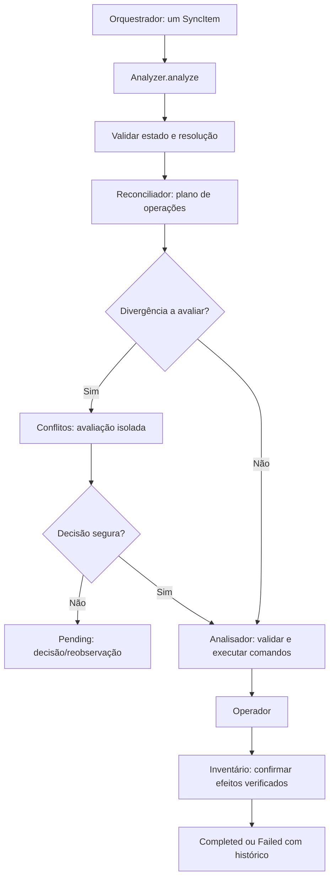

# Analisador

## Objetivo

Processar **um `SyncItem` por chamada**, determinar as transformações necessárias entre estado local, remoto e último baseline confirmado, coordenar a avaliação de conflitos e executar os comandos autorizados por meio da API pública do [Operador](../operations/INTERFACES.md).

O resultado de cada chamada é conclusivo para aquela tentativa: **concluído**, **pendente de resolução** ou **falha**, com evidências sobre as operações que tenham ocorrido. O Analisador encerra a chamada quando precisa de uma decisão externa; não fica bloqueado aguardando o usuário.

## Modelo de funcionamento

1. Recebe `AnalyzeRequest` com um `SyncItem` de [Inventário](../inventory/INTERFACES.md) e, opcionalmente, uma resolução para uma pendência anterior.
2. Valida identidade, revisão e suficiência dos estados observados. O baseline é o **último estado sincronizado confirmado**, não uma suposição de equivalência.
3. Coordena dois algoritmos privados, independentes:
   - **Reconciliação** compara os estados e devolve uma **lista ordenada de operações propostas**, incluindo dependências quando necessárias.
   - **Conflitos** avalia uma divergência contextualizada entre as versões envolvidas e retorna uma conclusão, uma possível resolução automática ou uma decisão externa necessária.
4. Valida os comandos propostos e executa-os sequencialmente por meio do [Operador](../operations/INTERFACES.md), conservando identidades, precondições e evidências.
5. Confirma no Inventário apenas estados efetivamente verificados, preservando histórico e recuperação de efeitos parciais.
6. Retorna `AnalysisOutcome` ao chamador.

Nenhum dos dois algoritmos privados chama o Operador. **Somente o Analisador coordena e aciona a execução.** O Orquestrador entrega itens individuais e recebe o desfecho; não interpreta nem executa comandos.

## Fluxo

## Interface pública

- `Analyzer::new(AnalyzerConfig) -> AnalyzerResult<Analyzer>`: configura acesso aos contratos dependentes.
- `Analyzer::analyze(AnalyzeRequest) -> AnalyzerResult<AnalysisOutcome>`: processa exatamente um `SyncItem`, com resolução opcional.
- `Analyzer::status(AnalysisStatusRequest) -> AnalyzerResult<AnalysisStatusResult>`: consulta a etapa e o progresso da execução ativa de um item, sem aguardar sua conclusão.

`AnalysisOutcome` oferece `Completed`, `Pending` e `Failed`. `Pending` devolve um objeto autocontido para registrar a pendência e apresentar alternativas, sem suspender outros itens. `Failed` preserva os efeitos já ocorridos. A mesma função `analyze` retoma um item após decisão externa, validando novamente o estado.

As assinaturas, campos, tipos, regras de falha e integração estão em [INTERFACES.md](INTERFACES.md).

## Acompanhamento durante a análise

`analyze()` é uma **tarefa assíncrona delimitada**, não um serviço que permanece observando eventos. Sua execução passa pelas etapas de validação, reconciliação, avaliação de conflito quando necessária, execução de comandos, verificação e confirmação. `status(item_id)` devolve uma fotografia interna da etapa atual e, quando existirem, contadores de comandos e progresso real das transferências fornecido pelo Operador.

A consulta não espera I/O, não acessa SQLite, não produz operação e não consulta submódulos diretamente. `active=None` significa apenas que **não há uma análise em andamento para o item nesta instância**; a conclusão/pendência/falha é comunicada pelo retorno `AnalysisOutcome` e registros duráveis ficam no Inventário.

Uma análise de item pode devolver `Pending` imediatamente ao constatar necessidade de decisão externa; o Analisador não mantém tarefa aberta aguardando resposta. Itens distintos podem ser analisados em paralelo, mas uma segunda chamada simultânea para o mesmo item retorna `AlreadyRunning`, preservando revisões e precondições do Inventário para evitar efeitos duplicados entre instâncias.

Não criar `pause`, `resume` ou `stop` no Analisador. O gerenciamento de quando chamar ou não chamar análises pertence ao Orquestrador; execução e confirmação de comandos pertencem ao Analisador e ao Operador.

## Integração com os demais contratos

- [Inventário](../inventory/INTERFACES.md): fonte de `SyncItem`, `SyncBaseline`, estados de presença, revisão, fila durável, confirmação e atividades.
- [Models](../models/INTERFACES.md): modelos observados `LocalFile` e `RemoteFile` importados pelo Inventário.
- [Operador](../operations/INTERFACES.md): contratos de requisição, resultado e erros das dez operações executáveis.

A implementação não deve criar cópias concorrentes dos modelos proprietários desses módulos.

## Invariantes

- Uma chamada analisa **um único `SyncItem`**, sem receber lote de `File`.
- `SyncItem.id`, `SyncItem.revision` e identidades remotas qualificadas não são intercambiáveis.
- `PresenceState::Unknown` não é ausência. A exclusão exige prova suficiente de `AbsentConfirmed`.
- Resultado de algoritmo não autoriza por si só alterar arquivos: precondições e capacidades precisam ser validadas antes da execução.
- A sequência de comandos pode incluir mais de uma operação; o resultado preserva ordem, dependências e progresso confirmado.
- `Completed` significa que não há ação necessária ou que todos os efeitos requeridos foram verificados **e registrados**.
- Não aguardar decisões humanas dentro de `analyze`; devolver `Pending` com contexto recuperável.
- Nunca repetir automaticamente operação de efeito remoto indeterminado; reobservar primeiro.
- Não avançar o baseline por sucesso presumido, efeito parcial ou mera observação.

## Documentação

[Interfaces](INTERFACES.md) · [Testes](TESTS.md) · [Orientações para agentes](AGENTS.md)

**Estado:** contrato arquitetural proposto para a primeira versão documental. Não representa implementação Rust comprovada. Os contratos próprios dos algoritmos internos serão documentados posteriormente.
