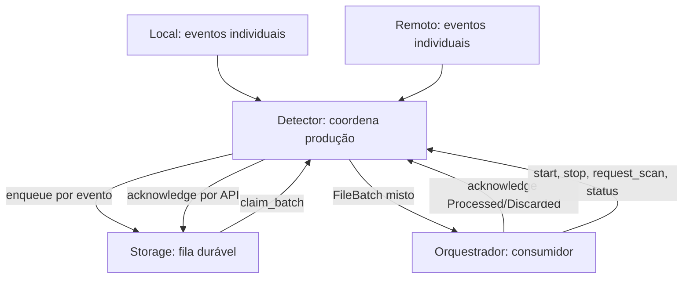

# Detector — fachada pública e fila produtor–consumidor

## Objetivo e separação

O **Detector** é a única API pública de detecção conhecida pelo Orquestrador. Coordena três componentes **independentes entre si e testáveis isoladamente**:

- [Local](local/README.md): observa filesystem por eventos e varreduras; emite **um sinal por ocorrência identificada**.
- [Remoto](remote/README.md): define uma interface de observação independente de provedor, com especialistas como [Google](remote/google/README.md); cada um emite **um sinal por ocorrência identificada**.
- [Storage](storage/README.md): fornece API privada de persistência, reservas e confirmações; oculta SQLite, tabelas e localização dos dados.

O Detector **consome somente a API** de cada filho. Não precisa conhecer watcher, detalhes de serviços remotos, SQL ou detalhes de implementação. Os filhos não dependem das implementações dos irmãos nem do Detector concreto: testes usam sinks e portas fake. O Orquestrador não chama Local, Remoto ou Storage.

## Fluxo

O Detector recebe alterações locais e remotas **concorrentes** sem criar duas filas públicas. Cada `File.id` identifica a ocorrência; o Storage preserva IDs e ordem de enfileiramento, enquanto o Detector entrega **um lote contendo eventos das duas origens**. O lote pode incluir várias alterações do mesmo arquivo observadas de lados diferentes.

**Agrupar a entrega não é resolver conflito.** Não descartar, sobrescrever ou consolidar eventos opostos silenciosamente. O Orquestrador encaminha os itens à análise; o Analisador consulta Inventário, baseline e versões atuais para decidir. Um lote comum reduz chamadas e permite avaliação conjunta, mas não comprova que os eventos ocorreram na mesma ordem causal.

## Responsabilidades

| Componente | Faz | Não faz |
| --- | --- | --- |
| Local | Observa filesystem; emite sinal individual pelo sink injetado | Não conhece Storage concreto, Remoto nem Orquestrador |
| Remoto | Observa Google; emite sinal individual pelo sink injetado | Não conhece Storage concreto, Local nem Orquestrador |
| Detector | Controle, recepção, persistência via API Storage, consumo em lotes, status | Não conhece SQL; não resolve conflitos nem transfere arquivos |
| Storage | Guarda, reserva, libera, confirma/descarta explicitamente, recupera eventos | Não conhece produtores nem Orquestrador |

## Produtor–consumidor e durabilidade

1. Cada filho chama seu sink **uma vez por evento**; o Detector recebe e invoca `EventStore.enqueue`.
2. **Só confirmar ao produtor depois do commit durável**. Falha exige backpressure/replay ou reobservação; não declarar sucesso.
3. O Orquestrador chama `take_events` e recebe `FileBatch`, com `batch_id`, `events`, `first_observed_at` e `last_observed_at`.
4. `take_events` apenas **reserva** eventos, não os elimina. `acknowledge(Processed | Discarded)` registra a decisão do Orquestrador. `release_events` devolve lote não confirmado.
5. Se o Orquestrador estiver ocupado ou desligado, o Detector **acumula eventos persistidos**. Crash antes do ack permite reentrega pelo lease expirado (sem promessa de exatamente uma vez).

O período do lote cobre **instantes em que eventos foram detectados**, não períodos sem detector ativo. O mesmo item pode aparecer mais de uma vez ou nos dois lados; isso é dado para reconciliação, não erro de fila. A fila do Detector é distinta da fila de operações de sincronização do Inventário.

## Stop e reinício

`stop(DrainInFlight)` cessa produção nova e tenta finalizar emissões em andamento. `stop(StopNow)` encerra prontamente as não confirmadas, mas **nenhum modo apaga eventos duráveis nem força acknowledge**. A escolha de descartar pertence ao Orquestrador ao consumir lotes.

`start` retoma a produção; varreduras e cursor próprios das fontes permitem encontrar diferenças não observadas enquanto estavam paradas. Reconciliação de versões e resolução de conflitos pertencem a outros módulos, não ao Detector.

## Persistência como abstração privada

O Storage inicialmente pode utilizar `<raiz-local>/.drivesync/detector.sqlite3`, mas **o Detector não conhece esse caminho ou a tecnologia**. O InventoryManager persiste estado e operações, enquanto o Storage persiste eventos de detecção e estado de entrega. Não acessar o SQLite do outro módulo.

## Invariantes e documentos

- Um `FileBatch` pode misturar Local/Remoto e eventos repetidos; não perde identidade nem ordem de enfileiramento.
- `acknowledge` depende de lote reservado e de decisão explícita; falha/cancelamento não apaga dados.
- Falha de observação, permissão, watcher ou rede não comprova exclusão.
- Apenas `Detector` é API pública externa; cada filho é implementável e testável separadamente.
- Sem upload, download, resolução de conflito ou atualização de baseline por detecção.

[INTERFACES.md](INTERFACES.md) · [TESTS.md](TESTS.md) · [AGENTS.md](AGENTS.md) · [Local](local/README.md) · [Remoto](remote/README.md) · [Storage](storage/README.md).

**Estado: documentação de contrato, sem implementação ou testes executados.**

## Contrato unificado com Models

O Detector recebe **um `models::File` por emissão**, vindo de Local ou Remoto. O `File` encapsula contexto (`FileEvent.kind`, `previous`, `current`, `scope`, `observed_at`, `coverage`) e `FileData::Local(LocalFile)` ou `FileData::Remote(RemoteFile)` quando conhecidos. Não existem eventos públicos paralelos reduzidos a ID, caminho ou enum de mudança.

Storage persiste cada `File` inteiro antes da entrega; a API `take_events` devolve `FileBatch { files: Vec<File>, ... }`, em geral com um item. O Orquestrador encaminha os `File` ao Analisador, que interpreta origem e observa o Inventário antes de decidir operações. A confirmação do lote significa apenas transferência segura de responsabilidade/processamento, **não sincronização realizada**.

A evolução de atributos de `LocalFile`/`RemoteFile` fica isolada nos coletores/adaptadores. Detector pai não projeta campos, não gera `SyncItem` e não interpreta propriedades do provedor. Todos os exemplos aqui são **documentação-alvo**, não Rust implementado.
