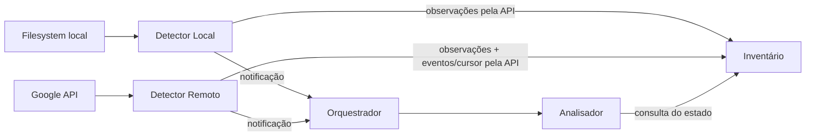

# Detectores — Local e Remoto

## Objetivo

O componente `detectors/` identifica **mudanças observadas e necessidades de reavaliação** nos dois lados de uma sincronização: a pasta local e o Google Drive. São produtores de notificações para o Orquestrador, que decide quando solicitar análise por item. O Inventário continua sendo o único proprietário dos metadados persistidos, operações e cursores.

**Regra arquitetural:** detectar **não é** analisar, decidir conflito, executar upload/download ou confirmar baseline. O Drive é a referência de identidade e estrutura remota; alterações locais legítimas também precisam ser observadas e encaminhadas com segurança.

## Responsabilidades e fronteiras

| Unidade | O que faz | O que não faz |
| --- | --- | --- |
| Detector Local | Inspeciona filesystem, mantém observação contínua quando ativo, executa varredura inicial/retomada, captura mudanças locais de conteúdo, nome, localização e presença | Não faz upload, não estabelece verdade remota, não converte falha de acesso em exclusão |
| Detector Remoto | Usa **somente** contratos de `google_api/` para inventariar árvore remota e consultar `changes` paginado; sinaliza itens potencialmente alterados | Não faz download, não seleciona versão vencedora, não assume `removed=true` como exclusão física |
| Ambos | Produzem registros/observações em `inventory/` por sua **API pública** quando houver fatos suficientes e notificam o Orquestrador para reavaliar | Não abrem SQLite, não atualizam baseline, não concluem operação, não registram atividade de sincronização como se fosse transferência |

Dependências explícitas: [Inventário](../inventory/INTERFACES.md), [Google API](../google_api/INTERFACES.md), [Arquitetura](../../SYSTEM_ARCHITECTURE.md). `LocalFile` depende da definição pública do componente responsável pelos metadados locais, ainda a fechar. O detector não duplica nem define sua estrutura.

## Modelo conceitual e ciclo de vida

O detector pertence a **uma conexão de sincronização por instância**. O Orquestrador fornece o escopo (IDs de sincronização/conta, raiz local ou remota, sessão do Google quando necessário), inicializa e consome eventos. Os componentes trabalham sem GTK/libadwaita e nunca exibem diálogos.

**Notificações são pistas, não autorização de operação.** Uma notificação pode ser agregada, repetida, atrasada ou perdida em caso de interrupção. O Orquestrador/Analisador deve consultar o Inventário antes de agir; o sistema precisa permitir reavaliação após reinício sem depender exclusivamente de evento efêmero.

### Estados públicos dos detectores

- `Stopped`: sem acompanhamento ativo; varreduras pontuais ainda precisam de escopo explícito.
- `Starting`: inicializando monitoramento, inventário e verificações iniciais.
- `Running`: monitorando ou consultando periodicamente.
- `Degraded`: observação parcial, watcher perdido, cursor inválido, acesso indisponível ou recurso limitado; **não** significa exclusão.
- `Stopping`: encerrando novas observações e liberando recursos.
- `Failed`: falha que exige intervenção ou nova inicialização segura.

O resultado de uma varredura diferencia **`Complete`, `Partial` e `Unavailable`**. `Complete` exige cobertura validada do escopo; `Partial` não autoriza inferir ausência por itens não vistos.

## Detector Local

### Inicialização, retomada e monitoramento

1. Validar a raiz local e a associação da sincronização; recusar a diretoria reservada `.drivesync/` como conteúdo.
2. Preparar monitoramento de mudanças e um mecanismo de varredura que feche a janela entre registrar o watcher e capturar estado inicial (por exemplo, registrar watcher, escanear e reconciliar sinais acumulados). Não confiar em uma varredura única com eventos concorrentes.
3. Ao iniciar **após período desligado**, executar comparação com o estado observado persistido: mudanças feitas enquanto a aplicação estava fechada devem ser detectáveis sem depender de notificações passadas.
4. Usar eventos do watcher para agendar reavaliação dos caminhos afetados, com coalescência/debounce. Evento isolado não comprova exclusão nem identidade.
5. Para mudança de diretório, varrer escopo afetado; não usar exclusivamente pathname ou inode como identidade do item.
6. Uma varredura abrangente só comprova ausência no escopo quando a leitura concluiu sem lacunas de permissões, mounts, erros ou cancelamento e a associação com a raiz foi validada.

Os detalhes do mecanismo de observação (`inotify`, `notify` ou equivalente), debounce e bloqueios serão escolhidos na implementação sem criar um novo contrato público. A solução deve suportar Linux/Flatpak no contexto do projeto.

### Segurança local

- Pasta raiz desaparecida, desmontada ou inacessível: reportar indisponibilidade e **não** gerar exclusão em massa.
- Nomes Unix podem conter bytes não UTF-8; não converter de maneira destrutiva.
- Symlinks não são percorridos para fora da raiz; sua política de materialização permanece separada e explicitamente validada.
- Alterações produzidas pelo próprio sincronizador também podem chegar ao watcher: o detector apenas registra fatos, sem criar loop de transferência por conta própria. O Analisador é responsável pela interpretação.
- `.drivesync/` e artefatos temporários internos devem ser excluídos do conjunto sincronizável com regra testada; não ocultar arquivos comuns sem política explícita.
- Escritas parciais podem ser observadas, mas não são automaticamente transferências prontas para upload.

## Detector Remoto

### Primeira leitura e mudanças incrementais

1. Usar o `GoogleSession` da conta fornecida e a raiz remota conhecida, sem realizar OAuth por conta própria.
2. Na primeira leitura, obter cursor inicial conforme o fluxo `changes` aplicável e percorrer **todas** as páginas necessárias à observação do escopo. Considerar alterações concorrentes entre aquisição do cursor e leitura da árvore.
3. Consultar `files.list` com paginação e campos necessários, reconstruindo hierarquia sem assumir que uma página corresponde à árvore completa. O Google pode devolver subconjuntos por projeção/permissão; ausência de campo não significa exclusão.
4. Reconciliar o cursor inicial e as alterações incrementais, persistindo eventos e checkpoints **pela API do Inventário**, com atomicidade por página. Nunca reconhecer eventos antes de reavaliá-los.
5. Nas consultas incrementais `changes.list`, `removed=true` pode indicar perda de acesso ou remoção: o evento **sinaliza reavaliação**, não exclusão confirmada.
6. Se cursor expirar ou houver lacuna, entrar em estado degradado e exigir nova leitura segura do escopo; não redefinir cursor nem assumir ausência sem nova observação completa.
7. `changes.watch`/notificações push podem ser mecanismo adicional, **não** garantia de entrega, ordem ou periodicidade. Manter meio de recuperação por polling/consulta incremental.

As operações de `files.list`, `changes.getStartPageToken` e `changes.list` permanecem integralmente encapsuladas em `google_api/`. O detector remoto não conhece URLs REST, JSON nem armazenamento de tokens.

### Segurança remota

Não confundir ausência de permissão, `404`, `403`, quota, falha de rede, resposta parcial ou filtro/paginação incompletos com arquivo excluído. A identidade `remote_id` permanece a referência canônica do recurso; nome e caminho remoto são metadados mutáveis.

## Integração com Inventário e Orquestrador

- **Inventário:** `record_local`, `record_remote`, `publish_remote_changes` e `get_remote_cursor` são contratos existentes que os detectores utilizam conforme a natureza da observação. Não usar SQL. Reconciliar IDs e revisões por consultas públicas quando necessário.
- **Orquestrador:** recebe notificações tipadas com `sync_id`, lado (`Local`/`Remote`), motivo, itens conhecidos e informação de cobertura; quando não há identidade segura, o detector notifica necessidade de reavaliação do escopo, não inventa `SyncItemId`.
- **Falhas de notificação:** não assumir que o envio efêmero ao Orquestrador comprova persistência nem vice-versa. Após reinício, varreduras e eventos pendentes do Inventário permitem retomada.
- **Escopo global de contas:** registro de contas e configurações não pertencem ao detector; uma raiz indisponível não apaga a conexão global.

## Invariantes para implementação e teste

1. Uma varredura completa precisa evidenciar o escopo coberto; resultados parciais não geram ausência confirmada.
2. O detector local recupera mudanças feitas enquanto o app estava fechado.
3. O detector remoto recupera alterações mesmo sem receber push notifications.
4. Um evento pode gerar múltiplas notificações, mas não cria operação física automaticamente.
5. A observação atual jamais altera o baseline confirmado.
6. Todo acesso ao Inventário é via seus contratos públicos; todo acesso remoto é via Google API pública.
7. Erros e status são tipados, sem tokens, SQL ou caminhos privados em mensagens.
8. Nenhum detector anuncia `Complete` quando houve falhas, cancelamento ou páginas pendentes.
9. Alterações de nome, localização e conteúdo preservam identidades estáveis quando conhecidas.
10. Persistência de cursor e eventos não perde sinais necessários para reconciliação após falha.

## Documentos associados

- [INTERFACES.md](INTERFACES.md): contratos, tipos, campos e comportamentos públicos.
- [TESTS.md](TESTS.md): testes isolados, cenários por método e critérios de aceite.
- [AGENTS.md](AGENTS.md): instruções operacionais para implementação com TDD.
- [Padrão de módulos](../MODULE_STANDARD.md): formato documental e execução integral.

**Estado:** especificação arquitetural. Esta documentação não comprova implementação nem testes executados.
