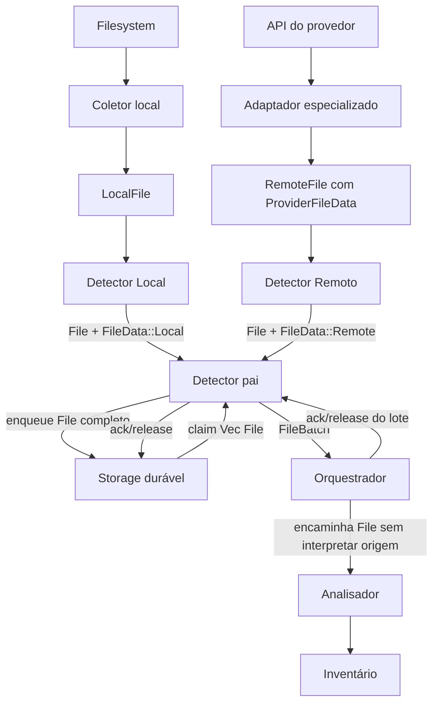
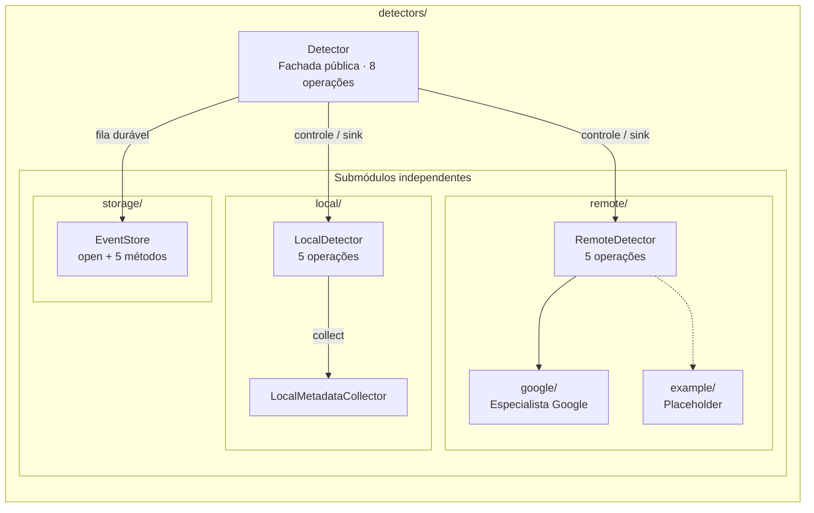
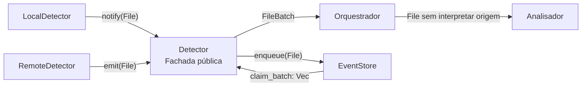
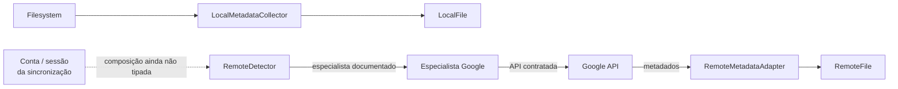
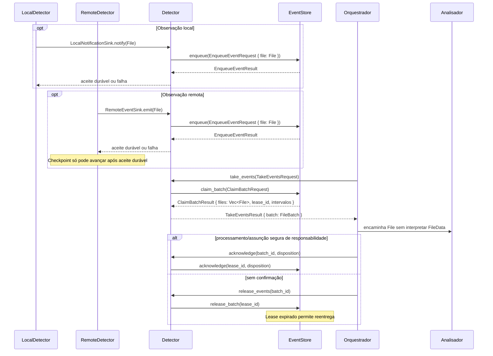
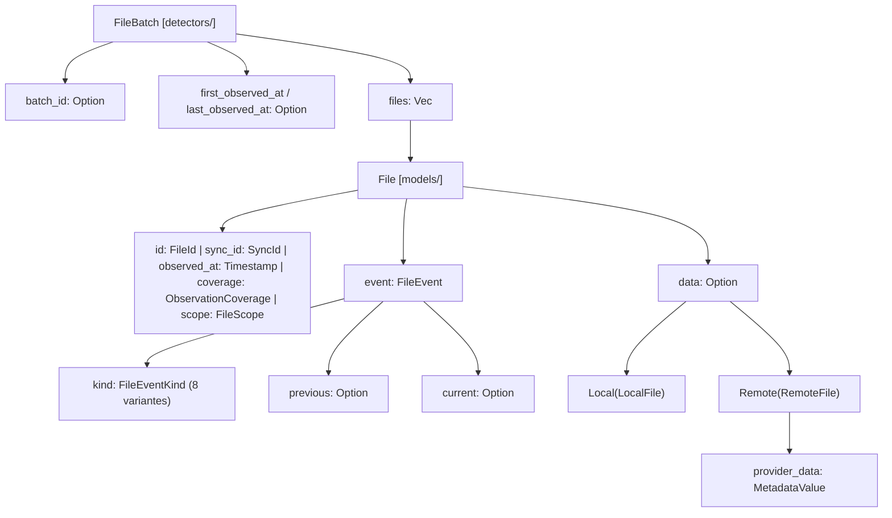
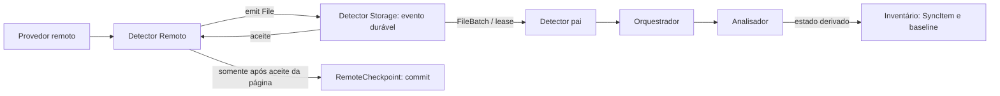

# Detector — fachada pública e fila produtor–consumidor

## Objetivo e separação

O **Detector** é a única API pública de detecção conhecida pelo Orquestrador. Coordena três componentes **independentes entre si e testáveis isoladamente**:

- [Local](local/README.md): observa filesystem por eventos e varreduras; emite **um sinal por ocorrência identificada**.
- [Remoto](remote/README.md): define uma interface de observação independente de provedor, com especialistas como [Google](remote/google/README.md); cada um emite **um sinal por ocorrência identificada**.
- [Storage](storage/README.md): fornece API privada de persistência, reservas e confirmações; oculta SQLite, tabelas e localização dos dados.

O Detector **consome somente a API** de cada filho. Não precisa conhecer watcher, detalhes de serviços remotos, SQL ou detalhes de implementação. Os filhos não dependem das implementações dos irmãos nem do Detector concreto: testes usam sinks e portas fake. O Orquestrador não chama Local, Remoto ou Storage.

## Fluxo



O Detector recebe alterações locais e remotas **concorrentes** sem criar duas filas públicas. Cada `File.id` identifica a ocorrência; o Storage preserva IDs e ordem de enfileiramento, enquanto o Detector entrega **um lote contendo eventos das duas origens**. O lote pode incluir várias alterações do mesmo arquivo observadas de lados diferentes.

**Agrupar a entrega não é resolver conflito.** Não descartar, sobrescrever ou consolidar eventos opostos silenciosamente. O Orquestrador encaminha os itens à análise; o Analisador consulta Inventário, baseline e versões atuais para decidir. Um lote comum reduz chamadas e permite avaliação conjunta, mas não comprova que os eventos ocorreram na mesma ordem causal.

## Responsabilidades

| Componente | Faz | Não faz |
| --- | --- | --- |
| Local | Observa filesystem; emite sinal individual pelo sink injetado | Não conhece Storage concreto, Remoto nem Orquestrador |
| Remoto | Observa Google; emite sinal individual pelo sink injetado | Não conhece Storage concreto, Local nem Orquestrador |
| Detector | Controle, recepção, persistência via API Storage, consumo em lotes, status | Não conhece SQL; não resolve conflitos nem transfere arquivos |
| Storage | Guarda, reserva, libera, confirma/descarta explicitamente, recupera eventos | Não conhece produtores nem Orquestrador |

## Produtor–consumidor e durabilidade

1. Cada filho chama seu sink **uma vez por evento**; o Detector recebe e invoca `EventStore.enqueue`.
2. **Só confirmar ao produtor depois do commit durável**. Falha exige backpressure/replay ou reobservação; não declarar sucesso.
3. O Orquestrador chama `take_events` e recebe `FileBatch`, com `batch_id`, `files`, `first_observed_at` e `last_observed_at`.
4. `take_events` apenas **reserva** eventos, não os elimina. `acknowledge(Processed | Discarded)` registra a decisão do Orquestrador. `release_events` devolve lote não confirmado.
5. Se o Orquestrador estiver ocupado ou desligado, o Detector **acumula eventos persistidos**. Crash antes do ack permite reentrega pelo lease expirado (sem promessa de exatamente uma vez).

O período do lote cobre **instantes em que eventos foram detectados**, não períodos sem detector ativo. O mesmo item pode aparecer mais de uma vez ou nos dois lados; isso é dado para reconciliação, não erro de fila. A fila do Detector é distinta da fila de operações de sincronização do Inventário.

## Stop e reinício

`stop(DrainInFlight)` cessa produção nova e tenta finalizar emissões em andamento. `stop(StopNow)` encerra prontamente as não confirmadas, mas **nenhum modo apaga eventos duráveis nem força acknowledge**. A escolha de descartar pertence ao Orquestrador ao consumir lotes.

`start` retoma a produção; varreduras e cursor próprios das fontes permitem encontrar diferenças não observadas enquanto estavam paradas. Reconciliação de versões e resolução de conflitos pertencem a outros módulos, não ao Detector.

## Persistência como abstração privada

O Storage inicialmente pode utilizar `<raiz-local>/.drivesync/detector.sqlite3`, mas **o Detector não conhece esse caminho ou a tecnologia**. O InventoryManager persiste estado e operações, enquanto o Storage persiste eventos de detecção e estado de entrega. Não acessar o SQLite do outro módulo.

## Invariantes e documentos

- Um `FileBatch` pode misturar Local/Remoto e eventos repetidos; não perde identidade nem ordem de enfileiramento.
- `acknowledge` depende de lote reservado e de decisão explícita; falha/cancelamento não apaga dados.
- Falha de observação, permissão, watcher ou rede não comprova exclusão.
- Apenas `Detector` é API pública externa; cada filho é implementável e testável separadamente.
- Sem upload, download, resolução de conflito ou atualização de baseline por detecção.

[INTERFACES.md](INTERFACES.md) · [TESTS.md](TESTS.md) · [AGENTS.md](AGENTS.md) · [Local](local/README.md) · [Remoto](remote/README.md) · [Storage](storage/README.md).

**Estado: documentação de contrato, sem implementação ou testes executados.**

## Contrato unificado com Models

O Detector recebe **um `models::File` por emissão**, vindo de Local ou Remoto. O `File` encapsula contexto (`FileEvent.kind`, `previous`, `current`, `scope`, `observed_at`, `coverage`) e `FileData::Local(LocalFile)` ou `FileData::Remote(RemoteFile)` quando conhecidos. Não existem eventos públicos paralelos reduzidos a ID, caminho ou enum de mudança.

Storage persiste cada `File` inteiro antes da entrega; a API `take_events` devolve `FileBatch { files: Vec<File>, ... }`, em geral com um item. O Orquestrador encaminha os `File` ao Analisador, que interpreta origem e observa o Inventário antes de decidir operações. A confirmação do lote significa apenas transferência segura de responsabilidade/processamento, **não sincronização realizada**.

A evolução de atributos de `LocalFile`/`RemoteFile` fica isolada nos coletores/adaptadores. Detector pai não projeta campos, não gera `SyncItem` e não interpreta propriedades do provedor. Todos os exemplos aqui são **documentação-alvo**, não Rust implementado.

## Arquitetura visual — reprodução das interfaces

As figuras seguintes representam **somente as relações e tipos declarados** em [Detector — INTERFACES](INTERFACES.md), [Local — INTERFACES](local/INTERFACES.md), [Remoto — INTERFACES](remote/INTERFACES.md), [Google — INTERFACES](remote/google/INTERFACES.md), [Storage — INTERFACES](storage/INTERFACES.md) e [Models — INTERFACES](../models/INTERFACES.md). Não são diagramas derivados de código Rust compilado.

### 1. Estrutura modular e dependências

O desenho foi separado em **dois diagramas complementares**: a composição mostra quem pertence a qual módulo; o fluxo mostra como os contratos se comunicam. Assim, não há setas de transferência de dados atravessando os contêineres de módulos.

#### 1.1 Composição dos módulos



O diagrama acima representa **propriedade e dependências internas**, não a sequência de detecção. `google/` é o especialista documentado; `example/` é somente um ponto de extensão ainda sem implementação. O Detector pai conhece as portas internas, não os detalhes concretos dos filhos.

#### 1.2 Fluxo entre serviços



O fluxo acima mostra apenas **entrega e consumo**. As chamadas de controle (`start`, `stop`, `request_scan`, `status`) e de confirmação (`acknowledge`, `release_events`) continuam documentadas nas [interfaces](INTERFACES.md) e no [diagrama de sequência](#2-fluxos-de-observação-durabilidade-e-consumo), sem sobrecarregar esta visão.

#### 1.3 Dependências externas e seleção do provedor



`LocalFile` e `RemoteFile` são tipos de `models/`, não serviços de I/O. O vínculo `SyncId → AccountId → ProviderId` e a fábrica de seleção **não têm assinatura definida nas interfaces**; a linha tracejada representa somente essa decisão conceitual. O especialista Google usa o adaptador para formar `RemoteFile`; o resultado é encapsulado em `FileData::Remote` na emissão de `File`.

#### Organização documental navegável

```text
detectors/
├── README.md                    [visão geral / facade]
├── INTERFACES.md                [Detector: 8 métodos / FileBatch]
├── local/
│   ├── README.md                [watcher, scan, coleta, emissão]
│   └── INTERFACES.md            [LocalDetector, LocalMetadataCollector, LocalNotificationSink]
├── remote/
│   ├── README.md                [intermediário remoto / seleção conceitual]
│   ├── INTERFACES.md            [RemoteDetector, RemoteMetadataAdapter, sinks, checkpoint]
│   ├── google/
│   │   ├── README.md            [especialista Google / GoogleFile → RemoteFile]
│   │   └── INTERFACES.md        [adaptação e contrato especialista]
│   └── example/
│       └── README.md            [placeholder sem implementação]
└── storage/
    ├── README.md                [persistência, claims e leases]
    └── INTERFACES.md            [EventStore: open + cinco métodos]
```

| Serviço | Diagramas detalhados | Fonte contratual |
| --- | --- | --- |
| [Local](local/README.md#visão-visual-detalhada-do-serviço-local) | Componentes, sequência e encapsulamento local | [Local INTERFACES](local/INTERFACES.md) |
| [Remoto](remote/README.md#visão-visual-dos-contratos-internos-do-serviço-remoto) | Composição da conta/provedor, polling, checkpoint e `RemoteFile` | [Remote INTERFACES](remote/INTERFACES.md) |
| [Google](remote/google/README.md#arquitetura-visual-do-especialista-google) | Dependência de API, conversão do `GoogleFile` e sequência da observação | [Google INTERFACES](remote/google/INTERFACES.md) |
| [Example](remote/example/README.md#representação-visual-do-ponto-de-extensão) | Exclusivamente ponto de extensão **não implementado** | [Remote INTERFACES](remote/INTERFACES.md) |
| [Storage](storage/README.md#arquitetura-visual-do-storage-do-detector) | Componentes, sequência, estados de lease e encapsulamento | [Storage INTERFACES](storage/INTERFACES.md) |

### 2. Fluxos de observação, durabilidade e consumo



O diagrama mostra **sequências condicionais**, não uma ordem obrigatória entre as fontes. O Storage atribui reserva/lease, o pai entrega `FileBatch` e o Orquestrador responde com reconhecimento ou liberação. `Processed` **não** implica que o arquivo foi sincronizado.

### 3. Encapsulamento exato dos tipos



```text
FileBatch                                             detectors/
├── batch_id: Option<BatchId>
├── files: Vec<File>
│   └── File                                          models/
│       ├── id: FileId
│       ├── sync_id: SyncId
│       ├── observed_at: Timestamp
│       ├── coverage: ObservationCoverage
│       ├── scope: FileScope
│       ├── event: FileEvent
│       │   ├── kind: FileEventKind
│       │   ├── previous: Option<FileLocation>
│       │   └── current: Option<FileLocation>
│       └── data: Option<FileData>
│           ├── Local(LocalFile)
│           └── Remote(RemoteFile)
│               └── provider_data: MetadataValue<ProviderFileData>
├── first_observed_at: Option<Timestamp>
└── last_observed_at: Option<Timestamp>
```

`FileEventKind` enumera `Created`, `Modified`, `Deleted`, `Renamed`, `Moved`, `MetadataChanged`, `RecheckRequired` e `ScopeUnavailable`. `FileLocation` mantém localização anterior/atual **quando conhecida**, não versões completas dos metadados. Um `File.data=None` não comprova exclusão. `FileBatch` pode misturar origens e não interpreta nem mescla os eventos.

### 4. Métodos e portas exatamente documentados

| Proprietário | API / porta | Declarações existentes |
| --- | --- | --- |
| `detectors/` | `Detector` | `new`, `start`, `stop`, `request_scan`, `status`, `take_events`, `acknowledge`, `release_events` |
| `detectors/local/` | `LocalDetector` | `new`, `start`, `scan_once`, `stop`, `status` |
| `detectors/local/` | `LocalMetadataCollector` | `collect(LocalMetadataRequest) → LocalMetadataResult` |
| `detectors/local/` | `LocalNotificationSink` | `notify(File)` |
| `detectors/remote/` | `RemoteDetector` | `new`, `start`, `poll_once`, `stop`, `status` |
| `detectors/remote/` | `RemoteMetadataAdapter` | `observe(RemoteMetadataRequest) → RemoteMetadataResult` |
| `detectors/remote/` | `RemoteEventSink` | `emit(File)` |
| `detectors/remote/` | `RemoteCheckpoint` | `read(SyncId)`, `commit(SyncId, checkpoint)` |
| `detectors/storage/` | `EventStore` | `open` (função de abertura), `enqueue`, `claim_batch`, `acknowledge`, `release_batch`, `status` |

### 5. Seleção do provedor: o que a interface comprova e o que ainda está em aberto

O contrato de `RemoteCreateRequest` **contém** `sync_id`, `remote_root_id`, `session: RemoteSessionPort`, `remote_api: RemoteApiPort`, `sink: RemoteEventSinkPort`, `checkpoints: RemoteCheckpointPort` e `polling_interval`. O especialista Google é documentado em `remote/google/` e satisfaz o contrato remoto.

Foi definida a **direção conceitual** de escolher a implementação a partir da **conta/provedor da sincronização**; detalhes estão no [README do Detector Remoto](remote/README.md#seleção-da-implementação-por-provedor--decisão-de-composição). Entretanto, as interfaces atuais **não apresentam** um tipo de fábrica/registry, uma assinatura de seleção de `ProviderId` ou a implementação da ligação `SyncId → AccountId → ProviderId`. Por isso, **nenhuma seta dos diagramas deve ser interpretada como prova de que essa fábrica já existe**. É uma responsabilidade de composição a especificar depois, sem alterar os contratos atuais neste documento.

**Preservação do escopo:** nenhum método, tipo, assinatura, requisito de persistência ou comportamento foi adicionado aos arquivos `INTERFACES.md` durante esta visualização. Os diagramas reproduzem os contratos conceituais existentes; não demonstram código Rust nem testes executados.

## Propriedade exclusiva de entrega e checkpoint

A propriedade dos mecanismos de eventos e cursores foi definida: `detectors/storage/` guarda **`File` completos e seus leases/ack/reentrega**, enquanto `detectors/remote/` mantém o checkpoint de observação por `RemoteCheckpoint.read/commit`. O `InventoryManager` não tem fila de eventos de detecção, não possui `remote_cursor` e não reconhece `FileBatch` diretamente.



**Checkpoints de leitura, reconhecimento da entrega e confirmação de sincronização são operações distintas.** Se o checkpoint falhar depois de gravar eventos, uma página pode ser lida novamente e os eventos precisam tolerar replay; nenhuma falha autoriza avançar cursor sem aceite durável. A localização física e o protocolo de deduplicação do checkpoint continuam para a implementação e testes do Detector Remoto, **não** para adição de APIs ao Inventário.
