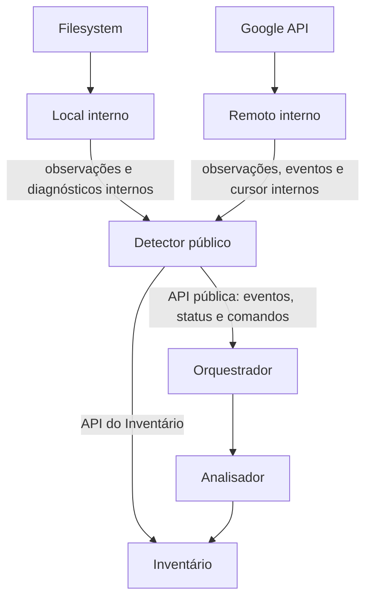

# Detector — coordenação de observação local e remota

## Objetivo

O **Detector** é o **único módulo público de detecção para o restante da engine**, especialmente para o Orquestrador. Ele coordena os dois componentes internos independentes:

- [Detector Local](local/README.md): leitura do filesystem e monitoramento de mudanças locais.
- [Detector Remoto](remote/README.md): leitura do Google Drive por `google_api/` e mudanças incrementais.

A separação é **de três unidades de implementação**: a fachada/coordenador `detectors/`, o componente `detectors/local/` e o componente `detectors/remote/`. Cada uma tem seus próprios contratos e testes, mas **Local e Remoto não expõem API para outros módulos**. O código Rust do componente pai pode utilizar `pub(super)`/`pub(crate)` conforme necessidade interna, sem reexportar os tipos dos detectores filhos no `mod.rs` público.

## Comunicação e propriedade

**A única fronteira de comunicação do Orquestrador é `Detector`.** Ele não recebe nem guarda `LocalDetector`/`RemoteDetector`, não conhece watcher, pagination Google ou callbacks de submódulos.

| Responsável | Faz | Não faz |
| --- | --- | --- |
| Local interno | Inspeciona raiz, watcher, varreduras e observações locais | Não notifica diretamente o Orquestrador |
| Remoto interno | Consulta API Google, inventaria/remonta cursores e observa changes | Não notifica diretamente o Orquestrador |
| Detector público | Inicia/pausa/retoma/para os filhos, recebe eventos internos, valida escopo, consolida/normaliza notificações, coordena gravações no Inventário e expõe estado agregado | Não decide conflito, upload/download, nem gera baseline |
| Inventário | Persiste observações, cursores/eventos e seu estado canônico observado | Não gerencia watchers ou consultas Google |
| Orquestrador | Recebe notificações unificadas, define políticas e solicita processamento ao Analisador | Não interage com APIs dos filhos |

Os filhos podem usar dependências injetadas conforme seus contratos internos. **Coordenação da persistência e publicação externa é responsabilidade do pai** para permitir verificar ordem, idempotência e falhas de notificação. Não é obrigatório centralizar toda a lógica de inspeção: a leitura de filesystem/Google continua nos filhos.

## API pública deliberadamente pequena

A fachada oferece capacidades de **inicialização, iniciar/retomar detecção, solicitar reavaliação, pausar/parar, consultar status e receber notificações tipadas**. Nenhuma API pública por arquivo para ordenar “upload/download” nem métodos remotos/local separados.

No evento enviado ao Orquestrador, usar objeto comum contendo:
- `sync_id` e **origem `Local` ou `Remote`**;
- motivo (mudança, reavaliação, indisponibilidade, cursor expirado etc.);
- IDs de itens afetados **quando conhecidos**, podendo estar vazios para reavaliação por escopo;
- abrangência da observação (`Complete`, `Partial`, `Unavailable`);
- instante e identificador de correlação quando disponíveis;
- indicação de que fatos relevantes foram persistidos no Inventário, **sem interpretar o aviso como sincronização concluída**.

**Notificação é sinal, não comando de transferência.** O Detector pode emitir avisos duplicados/agregados. A recuperação vem de nova varredura local e de eventos remotos duráveis no Inventário; não depender de notificação efêmera exatamente uma vez.

## Ciclo de vida dos dois filhos

O Detector coordena o ciclo de vida agregado. Um lado pode estar saudável e o outro degradado; **o status público deve expor estado por origem**, sem ocultar problemas. Parar/pausar um lado não exige parar o outro. `start` não deve fingir que toda varredura já terminou; `request_scan` pede uma verificação, não uma sincronização física.

As **interfaces internas comuns** são descritas pelo contrato de integração do pai em [INTERFACES.md](INTERFACES.md): ciclo de vida e observação seguem a mesma semântica; Local e Remoto podem ter operações especializadas que não escapam ao exterior. O contrato interno compartilhado não obriga desenvolver ambos simultaneamente nem criar uma camada de compatibilidade.

## Preservação de fatos e segurança

1. Erros de acesso, watcher, paginação ou serviço remoto não provam exclusão.
2. O Detector não atualiza baseline, fila nem histórico de transferências por observações.
3. Fatos remotos e cursor são persistidos pelo Inventário de modo atômico onde exigido.
4. A comunicação com Orquestrador ocorre **somente depois de persistir o necessário**, ou indica falha/estado degradado sem alegar que algo foi persistido.
5. Alteração feita durante aplicativo fechado é recuperada por varredura e cursor.
6. Identidade e escopo por sincronização são validados em todos os caminhos.
7. O estado interno dos filhos não é exposto nem consumido por outros módulos.
8. Os filhos podem ser desenvolvidos/testados em separado com um coordenador fake; a fachada pode ser testada com filhos falsos.

## Documentos

- [INTERFACES.md](INTERFACES.md) — contrato público do Detector e fronteira interna dos dois componentes.
- [TESTS.md](TESTS.md) — TDD do coordenador com filhos simulados e Inventário isolado.
- [AGENTS.md](AGENTS.md) — instruções para implementar apenas a fachada e integrá-la a componentes prontos.
- [Local](local/README.md) — documentação e implementação independente.
- [Remoto](remote/README.md) — documentação independente a desenvolver em etapa própria.

**Estado:** especificação de arquitetura. Nenhum contrato é comprovadamente compilado nem testado nesta etapa.
