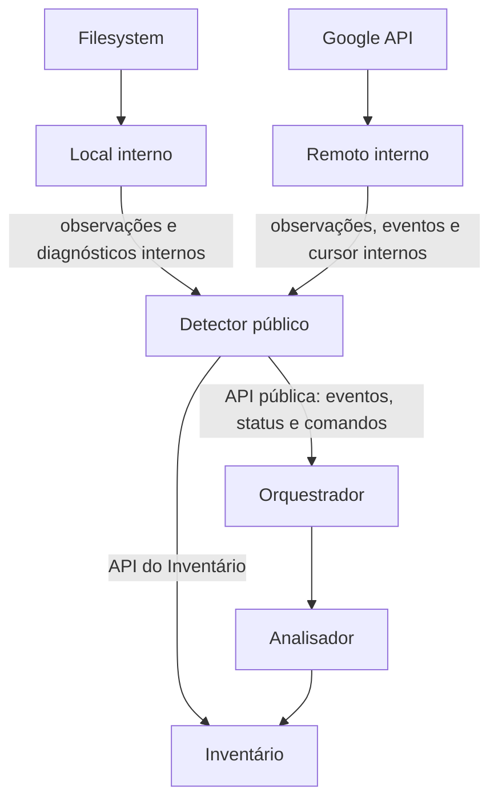

# Detector — coordenação de observação local e remota

## Objetivo

O **Detector** é o **único módulo público de detecção para o restante da engine**, especialmente para o Orquestrador. Ele coordena os dois componentes internos independentes:

- [Detector Local](local/README.md): leitura do filesystem e monitoramento de mudanças locais.
- [Detector Remoto](remote/README.md): leitura do Google Drive por `google_api/` e mudanças incrementais.

A separação é **de três unidades de implementação**: a fachada/coordenador `detectors/`, o componente `detectors/local/` e o componente `detectors/remote/`. Cada uma tem seus próprios contratos e testes, mas **Local e Remoto não expõem API para outros módulos**. O código Rust do componente pai pode utilizar `pub(super)`/`pub(crate)` conforme necessidade interna, sem reexportar os tipos dos detectores filhos no `mod.rs` público.

## Comunicação e propriedade

**A única fronteira de comunicação do Orquestrador é `Detector`.** Ele não recebe nem guarda `LocalDetector`/`RemoteDetector`, não conhece watcher, pagination Google ou callbacks de submódulos.

| Responsável | Faz | Não faz |
| --- | --- | --- |
| Local interno | Inspeciona raiz, watcher, varreduras e observações locais | Não notifica diretamente o Orquestrador |
| Remoto interno | Consulta API Google, inventaria/remonta cursores e observa changes | Não notifica diretamente o Orquestrador |
| Detector público | Inicia/pausa/retoma/para os filhos, recebe eventos internos, valida escopo, consolida/normaliza notificações, coordena gravações no Inventário e expõe estado agregado | Não decide conflito, upload/download, nem gera baseline |
| Inventário | Persiste observações, cursores/eventos e seu estado canônico observado | Não gerencia watchers ou consultas Google |
| Orquestrador | Recebe notificações unificadas, define políticas e solicita processamento ao Analisador | Não interage com APIs dos filhos |

Os filhos podem usar dependências injetadas conforme seus contratos internos. **Coordenação da persistência e publicação externa é responsabilidade do pai** para permitir verificar ordem, idempotência e falhas de notificação. Não é obrigatório centralizar toda a lógica de inspeção: a leitura de filesystem/Google continua nos filhos.

## API pública deliberadamente pequena

A fachada oferece capacidades de **inicialização, iniciar/retomar detecção, solicitar reavaliação, pausar/parar, consultar status e receber notificações tipadas**. Nenhuma API pública por arquivo para ordenar “upload/download” nem métodos remotos/local separados.

No evento enviado ao Orquestrador, usar objeto comum contendo:
- `sync_id` e **origem `Local` ou `Remote`**;
- motivo (mudança, reavaliação, indisponibilidade, cursor expirado etc.);
- IDs de itens afetados **quando conhecidos**, podendo estar vazios para reavaliação por escopo;
- abrangência da observação (`Complete`, `Partial`, `Unavailable`);
- instante e identificador de correlação quando disponíveis;
- indicação de que fatos relevantes foram persistidos no Inventário, **sem interpretar o aviso como sincronização concluída**.

**Notificação é sinal, não comando de transferência.** O Detector pode emitir avisos duplicados/agregados. A recuperação vem de nova varredura local e de eventos remotos duráveis no Inventário; não depender de notificação efêmera exatamente uma vez.

## Ciclo de vida dos dois filhos

O Detector coordena o ciclo de vida agregado. Um lado pode estar saudável e o outro degradado; **o status público deve expor estado por origem**, sem ocultar problemas. Parar/pausar um lado não exige parar o outro. `start` não deve fingir que toda varredura já terminou; `request_scan` pede uma verificação, não uma sincronização física.

As **interfaces internas comuns** são descritas pelo contrato de integração do pai em [INTERFACES.md](INTERFACES.md): ciclo de vida e observação seguem a mesma semântica; Local e Remoto podem ter operações especializadas que não escapam ao exterior. O contrato interno compartilhado não obriga desenvolver ambos simultaneamente nem criar uma camada de compatibilidade.

## Estratégias internas, pausa e retomada

O Detector conhece as **capacidades e os estados** de cada fonte, mas **não impõe um algoritmo comum** para observar alterações:

| Componente interno | Ritmo típico | Comportamento permitido durante `pause()` | Garantia ao retomar |
| --- | --- | --- | --- |
| Local | Watcher orientado a eventos, quase em tempo real, com varreduras de recuperação | Pode manter watcher ativo e registrar sinais; caso suspenda o watcher, deve registrar a necessidade de varredura posterior | Revarrer escopo necessário para recuperar eventos perdidos durante pausa/desligamento |
| Remoto | Polling agendado por intervalo interno, com cursor incremental e eventual sinal de push | Pode continuar sondando e persistindo eventos/cursor **ou** suspender polling sem perder o checkpoint confirmado | Consultar a partir do cursor válido, ou executar recuperação segura se expirado |
| Detector pai | Recebe sinais internos e controla entrega | Mantém notificações pendentes **duráveis ou recuperáveis** e não entrega trabalho comum ao Orquestrador enquanto pausado | Reconciliar pendências, emitir aviso(s) de reavaliação e liberar o processamento |

**`pause()` significa pausar a entrega de trabalho de detecção ao Orquestrador**, e não apagar alterações nem obrigatoriamente desligar observadores. Quando uma origem suspender observação por decisão própria, ela deverá conseguir detectar as alterações perdidas ao retomar. As escolhas específicas de watcher ativo, polling contínuo, frequência e economia de recursos são internas aos filhos; não precisam de opção pública separada.

**`resume()` não garante reprodução literal de cada evento bruto.** O que precisa sobreviver é a **necessidade de reavaliar os itens/escopos efetivamente alterados**. Eventos repetidos podem ser agregados. Caso haja perda de informação de origem, um aviso mais amplo de reavaliação substitui um conjunto incompleto de eventos; não inventar a lista exata.

**Durabilidade:** nenhuma lista de eventos mantida apenas em memória é garantia de recuperação após encerramento inesperado. O Inventário guarda observações/eventos/cursor já confirmados. Para sinais locais sem persistência suficiente, registrar a necessidade de nova varredura segura após a retomada/reinício. A fachada não deve criar silenciosamente uma segunda fila de uploads/downloads.

**`stop()` é distinto de `pause()`:** stop encerra recursos de monitoramento; um próximo start precisa fazer recuperação segura. Pausar não deve ser interpretado como cancelar operações já executadas pelo Analisador ou transferências em andamento; isso pertence às políticas do Orquestrador.

### Exemplo de fluxo durante pausa

1. O Orquestrador chama `Detector.pause()`; a fachada passa a **reter ou adiar notificações de reavaliação**.
2. O Local recebe três eventos do mesmo arquivo e sinaliza mudança; a fachada agrega a necessidade de reavaliar o item.
3. O Remoto executa uma consulta periódica, encontra alterações, confirma os eventos/cursor no Inventário e sinaliza mudanças à fachada.
4. O Orquestrador chama `Detector.resume()`; a fachada solicita recuperação específica a cada fonte antes de declarar cobertura suficiente.
5. O Detector envia um ou mais `DetectorEvent` normalizados, com itens conhecidos ou reavaliação de escopo, e o Orquestrador decide o encaminhamento ao Analisador.

**A fila de sinais de detecção é diferente de `sync_operations`.** A primeira registra/reconstrói **trabalho ainda a analisar**; a segunda contém **ações autorizadas** de sincronização. Nenhum detector decide criar operação física só por receber um evento.

## Preservação de fatos e segurança

1. Erros de acesso, watcher, paginação ou serviço remoto não provam exclusão.
2. O Detector não atualiza baseline, fila nem histórico de transferências por observações.
3. Fatos remotos e cursor são persistidos pelo Inventário de modo atômico onde exigido.
4. A comunicação com Orquestrador ocorre **somente depois de persistir o necessário**, ou indica falha/estado degradado sem alegar que algo foi persistido.
5. Alteração feita durante aplicativo fechado é recuperada por varredura e cursor.
6. Identidade e escopo por sincronização são validados em todos os caminhos.
7. O estado interno dos filhos não é exposto nem consumido por outros módulos.
8. Os filhos podem ser desenvolvidos/testados em separado com um coordenador fake; a fachada pode ser testada com filhos falsos.

## Documentos

- [INTERFACES.md](INTERFACES.md) — contrato público do Detector e fronteira interna dos dois componentes.
- [TESTS.md](TESTS.md) — TDD do coordenador com filhos simulados e Inventário isolado.
- [AGENTS.md](AGENTS.md) — instruções para implementar apenas a fachada e integrá-la a componentes prontos.
- [Local](local/README.md) — documentação e implementação independente.
- [Remoto](remote/README.md) — documentação independente a desenvolver em etapa própria.

**Estado:** especificação de arquitetura. Nenhum contrato é comprovadamente compilado nem testado nesta etapa.
