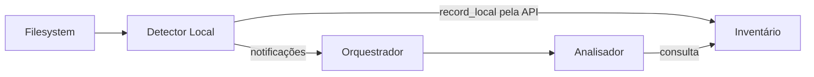

# Detector Local — README

## Objetivo e autonomia

O **Detector Local** observa o filesystem de uma pasta sincronizada e sinaliza alterações locais ou necessidade de reavaliação ao Orquestrador. É **independente** do Detector Remoto: possui contratos, testes e implementação próprios, que podem ser desenvolvidos separadamente.

O Detector Local registra fatos observados **pela interface pública do Inventário**. Não lê banco diretamente, não acessa Google Drive, não decide conflitos, não realiza upload/download e não atualiza baseline.

## Responsabilidades e exclusões

| Responsabilidade | Limite |
| --- | --- |
| Inspecionar uma raiz local por sincronização | Não administrar contas nem conexões globais |
| Executar varredura inicial e após reinício | Não depender exclusivamente de watcher |
| Acompanhar mudanças por filesystem watcher | Evento é pista, não prova de remoção |
| Observar criação, modificação, renomeação e movimentação | Não escolher versões vencedoras |
| Registrar metadados locais via API do Inventário | Não acessar SQLite diretamente |
| Notificar Orquestrador sobre reavaliações | Não inserir operações na fila nem registrar transferência concluída |

## Fluxo

1. Validar a identidade da sincronização e a raiz da pasta.
2. Registrar watcher e executar varredura reconciliando eventos ocorridos durante a leitura, para evitar lacunas entre monitoramento e inventário inicial.
3. Após o aplicativo permanecer fechado, executar **nova varredura completa** para recuperar alterações feitas sem watcher ativo.
4. Agregar eventos de mudanças como solicitações de reavaliação; não confiar em caminho ou inode isoladamente para concluir identidade.
5. Registrar observações confiáveis via `InventoryManager.record_local`, preservando campos não observados e sem modificar baseline.
6. Notificar o Orquestrador quando houver mudança ou necessidade de reavaliar um escopo. Caso não exista `SyncItemId` conhecido, notificar o escopo, sem fabricar vínculo.

## Cobertura e ausência

- **Complete:** escopo solicitado integralmente inspecionado sem erro e com evidência suficiente. Somente então a ausência de um item *dentro desse escopo* pode ser considerada, observadas as precondições do Inventário.
- **Partial:** parte do escopo foi inspecionada; os caminhos não observados mantêm situação desconhecida/anterior.
- **Unavailable:** raiz ou escopo não acessível. **Não** equivale a exclusão.

Um único evento de remoção, erro de permissão, pasta desmontada ou subpasta ilegível **não constitui prova de exclusão**. `AbsentConfirmed` requer comprovação explícita de cobertura e identidade.

## Dados locais e segurança

- `.drivesync/` é diretório interno: não enviar como conteúdo nem tratá-lo como item sincronizável.
- Nomes Unix não UTF-8 devem preservar seus bytes; não converter com perda.
- Symlinks não devem ser seguidos para fora da raiz; a política de sincronização de links precisa de definição própria.
- Arquivos em escrita podem gerar eventos intermediários; observar não é autorizar envio imediato de conteúdo incompleto.
- Eventos de mudanças produzidas pelo próprio DriveSync também podem ser vistos: o detector não deve disparar operações para compensá-los.
- Não presumir que watcher nunca perde eventos. Overflow/interrupção requer nova varredura.
- Dois diretórios sincronizados devem ter estados e notificações completamente isolados.

## Dependências e fronteiras

- [Inventário](../../inventory/INTERFACES.md): contrato de observações `record_local`, identidade e presença; armazenamento exclusivo do Inventário.
- **Metadados locais:** `LocalFile` pertence ao componente de metadados do filesystem, cujo contrato final ainda depende de definição.
- **Orquestrador:** consome notificações tipadas; seu contrato de recebimento não autoriza operações físicas pelo detector.
- **Detector Remoto:** independente, a documentar em `../remote/`; não é dependência de construção, teste ou execução do Local.

## Invariantes

1. Nenhuma observação modifica baseline, fila ou histórico de transferências.
2. O detector não consulta Google API, não executa SQL e não realiza sincronização física.
3. Falhas de leitura jamais viram ausência confirmada automaticamente.
4. Reinício detecta mudanças feitas com a aplicação fechada.
5. `.drivesync/` e caminhos externos via symlink não são varridos como conteúdo de usuário.
6. Identidades não devem se basear exclusivamente em nome, caminho ou inode.
7. Notificação perdida ou repetida não pode causar perda do fato persistido ou operação duplicada.
8. Erros e mensagens não expõem conteúdo ou caminhos privados desnecessários.

## Documentos

[INTERFACES.md](INTERFACES.md) · [TESTS.md](TESTS.md) · [AGENTS.md](AGENTS.md) · [MODULE_STANDARD.md](../../MODULE_STANDARD.md).

**Estado:** especificação de projeto, sem implementação ou testes executados.
