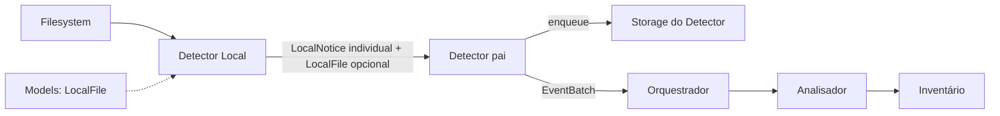

# Detector Local — observação baseada em Models

## Objetivo e autonomia

O **Detector Local** é o produtor de observações do filesystem. Ele constrói **`LocalFile` do domínio compartilhado** quando consegue observar com segurança os atributos de um arquivo/diretório, e emite **um aviso individual por chamada** ao sink interno fornecido pelo módulo pai [Detector](../README.md).

Sua implementação, seu watcher, suas varreduras e seus testes são **independentes** do Detector Remoto, de Storage, do Inventário e dos operadores. O Detector pai é o único módulo público de detecção para o Orquestrador. O Local depende do **contrato de dados** de [Models](../../models/INTERFACES.md), não de um serviço `ModelsManager` (inexistente).

## Responsabilidade de cada componente

| Componente | Faz | Não faz |
| --- | --- | --- |
| `models/` | Define `LocalFile`, `LocalFileKind`, `LocalRelativePath` e identidades compartilhadas | Não lê disco, não observa mudanças |
| `detectors/local/` | Lê filesystem, converte observações para `LocalFile`, emite sinais tipados e avalia cobertura | Não modifica baseline, não conhece SQL nem implementações dos demais filhos |
| `detectors/` | Recebe cada sinal local/remoto, adapta para evento público e chama Storage | Não executa observação física local |
| `detectors/storage/` | Persiste fila de notificações, leases e confirmações | Não observa filesystem |
| `inventory/` | Persiste estado e associa observações a `SyncItem` segundo seu contrato | Não é dependência de gravação do Detector Local |
| `analyzer/` | Analisa divergências e conflitos | Não é chamado diretamente pelo Local |

**`SyncItem` não faz parte desta revisão.** Sua eventual transferência para Models ocorrerá somente ao revisar o planejamento do Inventário. O Local **não cria nem exige `SyncItem`**, nem inventa `SyncItemId`.

## Coleta isolada da lógica do Detector

O Detector Local **não monta `LocalFile` atributo por atributo**. Sua responsabilidade é detectar a necessidade de observação, selecionar o escopo, chamar um **coletor de metadados locais** por interface estável e encaminhar o `LocalFile` devolvido de forma opaca.

O coletor é um componente especializado de aquisição/adaptação de metadados do filesystem, separado do watcher, da varredura e do pipeline de notificações. Rotinas auxiliares podem obter grupos adicionais (`statx`, atributos estendidos, ACLs, links, flags etc.) sem introduzir dependências desses campos no Detector.

**Critério obrigatório:** incluir, remover ou reorganizar campos de `models::LocalFile` **não exige qualquer alteração na lógica do Detector Local**. É permitido ajustar o coletor, os testes do coletor e consumidores interessados no campo. O Detector permanece desacoplado do esquema de metadados.

Isso não altera a distinção entre `LocalFile` observado, aviso sem arquivo e cobertura parcial, nem transfere I/O para `models/`. A coleta completa por categoria deve seguir o contrato e a futura revisão de necessidade dos metadados.

## Fluxo

1. Validar `sync_id` e raiz local fornecida pela composição do Detector.
2. Iniciar watcher e varredura, preservando evidência de observação durante a instalação do watcher.
3. Converter **somente atributos realmente observados** para `LocalFile` do módulo Models.
4. Para cada ocorrência, emitir um `LocalNotice` contendo o `LocalFile` **quando disponível** e um escopo relativo para reavaliação quando não houver arquivo conhecido.
5. O sink do Detector pai confirma sucesso apenas após persistência durável em Storage; se falhar, o Local não declara observação entregue e mantém necessidade de replay/revarredura.
6. Após reinício, reobservar o escopo local: o watcher não reconstrói o histórico de alterações feitas enquanto a aplicação esteve parada.

**O arquivo não é obrigatório em todo aviso.** Remoção, overflow, raiz indisponível e leitura incompleta podem produzir um aviso de reavaliação **sem `LocalFile`**. Isso não equivale a um `LocalFile` ausente comprovadamente.

## Cobertura e semântica

- **Complete:** escopo solicitado foi integralmente inspecionado com evidência suficiente; não significa que o Local confirmou exclusão de um `SyncItem`.
- **Partial:** apenas parte foi observada; não limpar atributos nem inferir remoção no restante.
- **Unavailable:** raiz/escopo inacessível; nunca equivale a exclusão.
- **Unknown:** `LocalFileKind::Unknown`, campos `None` ou identidade local opcional não devem ser substituídos por palpites.

O Local observa eventos de criação, mudança, renomeação e movimento, mas essas pistas podem ser ambíguas. Não converter automaticamente um evento de remoção em exclusão confirmada. Caminho e inode isolados não comprovam identidade estável.

## Segurança do filesystem

- `.drivesync/` e seus descendentes não são conteúdo de usuário sincronizável.
- Nomes Unix não UTF-8 devem ser preservados sem conversão com perda, conforme `LocalRelativePath` de Models.
- O `PathBuf` da **raiz operacional** pertence à configuração interna do detector; o `LocalFile.relative_path` é **relativo à raiz** e não carrega caminho absoluto externo.
- Symlinks não são seguidos para fora da raiz; tipo `Symlink` não implica permissão de sincronização.
- Arquivo ainda em escrita não deve ser interpretado como conteúdo final pronto para upload.
- Overflow, erros de permissão, desmontagem e mudanças concorrentes exigem cobertura parcial/indisponível e nova observação.
- Não varrer pastas fora da raiz, nem ler conteúdo para calcular hash indiscriminadamente.
- Dois escopos de sincronização não misturam identidades nem avisos.

## Dependências permitidas

**Permitida:** [Models](../../models/INTERFACES.md), filesystem e biblioteca watcher internos, clock/scheduler e sink de aviso tipado injetados. Tipos de identidade devem ser **reutilizados** de seus proprietários, sem novas definições incompatíveis.

**Proibida:** `GoogleFile`, Google API, Detector Remoto concreto, Storage concreto, Inventário/SQLite, Analisador, Orquestrador e Upload/Download. A porta de aviso pertence ao próprio contrato interno Local, e pode ser implementada por fake em testes.

## Invariantes

1. Toda observação de metadados disponível usa `models::LocalFile`, e não uma struct paralela própria de arquivo.
2. Cada `LocalNotificationSink.notify` recebe **um** `LocalNotice`; não há dois canais públicos para alterações locais.
3. `LocalNotice.local_file=None` significa que o aviso não carrega metadados seguros; **não** significa exclusão.
4. Sem acesso ou modificação de baseline, fila de operações, histórico, banco ou serviço remoto.
5. A falha de entrega não deve ser tratada como sucesso; eventos podem ser reemitidos.
6. `stop` encerra observação; `start` recupera mudanças por nova inspeção conforme cobertura.
7. Contratos próprios e testes reais do Local não exigem implementações reais dos irmãos.

[INTERFACES.md](INTERFACES.md) · [TESTS.md](TESTS.md) · [AGENTS.md](AGENTS.md) · [Models](../../models/README.md).

**Estado:** arquitetura-alvo documentada. Não representa código implementado nem testes executados.
