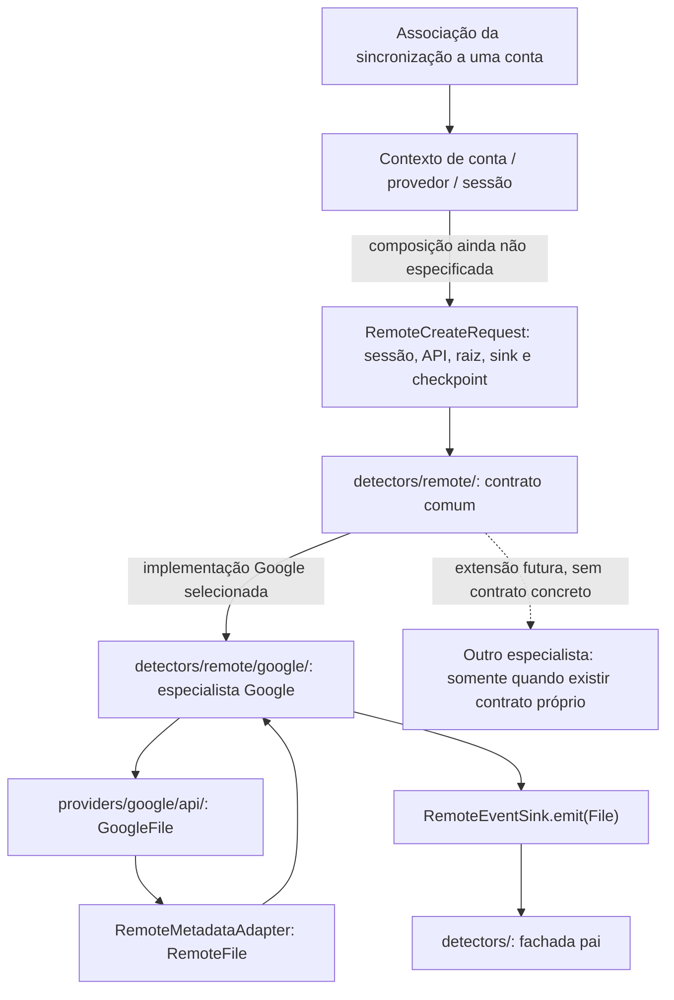
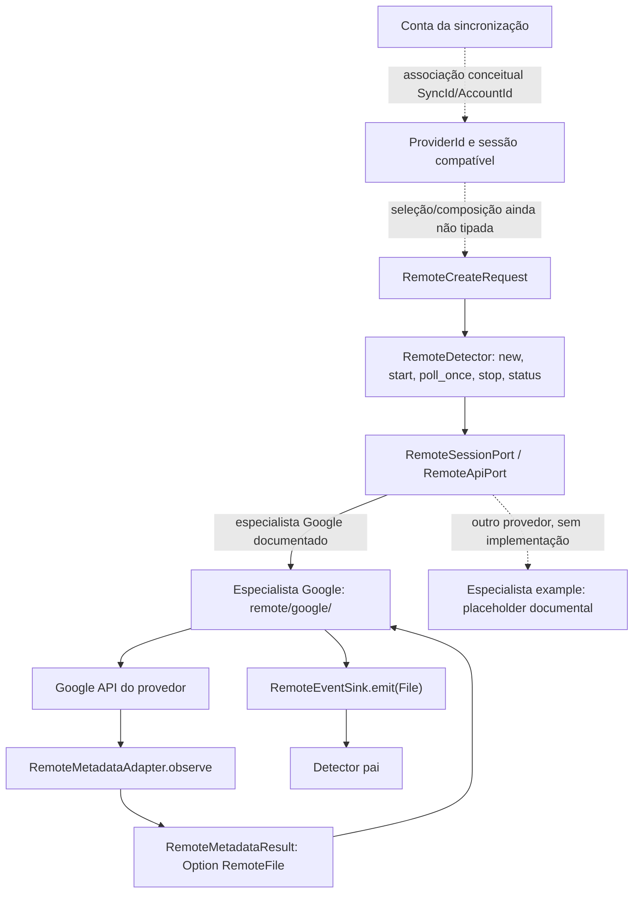
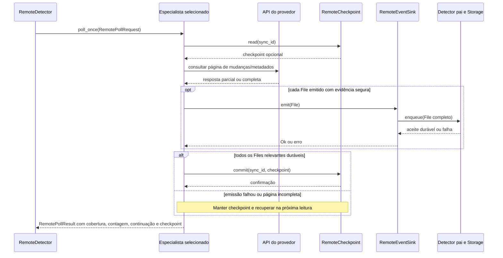

# Detector Remoto — contrato interno independente de provedor

## Objetivo

O **Detector Remoto** é um **produtor individual de sinais de alteração remota**. Ele define a interface de observação remota que especialistas independentes implementam, com estratégias próprias (consultas periódicas, leitura inicial e mecanismos de mudança), sem conhecer o Detector Local, o Storage do Detector ou o Orquestrador.

Seu único contrato de saída é um **sink interno de eventos individuais**, injetado pelo módulo pai Detector. **Cada chamada de emissão contém um evento**; agregação, fila, persistência de notificações, reserva e confirmação pertencem ao pai e ao Storage.

## Responsabilidades

- Validar escopo remoto/conta e sessão recebidos.
- Observar árvore por páginas na inicialização, respeitando limites e mudanças concorrentes.
- Solicitar mudanças remotas por uma implementação específica de provedor, com intervalos próprios configuráveis, sem impor periodicidade ao Local.
- Emitir sinais de alteração, diagnóstico e reavaliação, nunca comandos de upload/download.
- Manter ou recuperar checkpoint de leitura **próprio do mecanismo remoto**, por um contrato de checkpoint injetado e independente da fila do Detector. A localização/tecnologia dessa persistência não faz parte do contrato do Remoto.
- Confirmar avanço do checkpoint somente após aceitação durável de todos os sinais da página no sink. Resposta de envio aceita sem durabilidade comprovada **não** autoriza avançar cursor.

## Limites

- Sem SQL, armazenamento de notificações, `inventory.sqlite3`, `detector.sqlite3`, Orquestrador ou gerenciamento de contas globais.
- Sem chamadas HTTP diretamente: os especialistas (por exemplo, [Google](google/README.md)) utilizam a API do respectivo provedor, como [Google API](../../providers/google/api/INTERFACES.md).
- `removed=true` é sinal de reavaliação (pode significar perda de acesso), não prova inequívoca de exclusão.
- Sem inferir ausência por falha 403/404, timeout, paginação incompleta, cursor inválido, escopo limitado ou campos parciais.
- O arquivo remoto é identificado por ID estável; nome, versão e pais são metadados mutáveis.

## Estratégia de funcionamento

1. Receber sessão, raiz, parâmetros de intervalo e sink individuais.
2. Durante `start`, agendar leitura inicial ou retomada incremental conforme checkpoint.
3. Em cada ciclo, a implementação do provedor consulta sua API, converte mudanças em eventos individuais e publica ao sink.
4. Só depois que o sink confirmar persistência durável, confirmar checkpoint correspondente por seu backend injetado.
5. Consultar novamente segundo agendamento próprio. Push pode ser usado como otimização, nunca como garantia de entrega.
6. Se parar, encerrar polling; sinais já aceitos permanecem sob responsabilidade do Detector. Na próxima inicialização, recuperação por cursor ou nova leitura segura é responsabilidade deste produtor — não reconstituir necessariamente cada operação intermediária.

**O contrato Remoto pode ser validado com implementações fake; cada especialista realiza seus próprios testes com API fake, sink fake e checkpoint isolado.** Não precisa do Local, do banco Storage nem do Detector real.

## Invariantes

1. Evento emitido **individualmente**, sem lotes para o Orquestrador.
2. Não avançar cursor antes do sink confirmar recepção durável.
3. Erro remoto ou observação parcial nunca transforma ausência em exclusão confirmada.
4. Cursor expirado exige recuperação segura sem zerar checkpoint silenciosamente.
5. Se sink estiver indisponível, parar o avanço e repetir/reconciliar; não perder página.
6. Intervalo de polling é política própria; não afeta ciclo de vida local.
7. Nenhuma dependência concreta da implementação de `storage/` ou `local/`.

## Documentos

[INTERFACES.md](INTERFACES.md) · [TESTS.md](TESTS.md) · [AGENTS.md](AGENTS.md) · [Especialista Google](google/README.md) · [Detector pai](../README.md).

**Estado:** especificação proposta, sem testes executados nem implementação.

## Alinhamento a Models

O especialista converte metadados do serviço, por exemplo `GoogleFile`, em `RemoteFile` usando um adaptador isolado. Emite **`models::File` inteiro** por chamada ao sink interno, com `FileData::Remote(RemoteFile)` quando o arquivo foi observado e ID real. Evento e localização anterior/atual utilizam `FileEventKind`, `FileEvent` e `FileLocation` de Models; sem dados seguros, emite reavaliação com `data=None`. A fachada e o Orquestrador jamais leem os campos de RemoteFile e Storage não os reduz.

O pipeline conserva checkpoint, paginação e replay: o cursor só é confirmado depois de persistir a observação inteira. Mudar atributos remotos afeta apenas o adaptador especializado e seus testes, não a lógica de detecção. `removed` pode significar perda de acesso, portanto não prova exclusão.

## Seleção da implementação por provedor — decisão de composição

O módulo `detectors/remote/` é o **intermediário/contrato comum** das implementações remotas. A **conta associada à sincronização**, e não uma pergunta feita ao provedor para descobrir qual serviço está vigente, determina qual especialista deve ser utilizado.

A associação conceitual é `SyncId → AccountId → ProviderId → sessão compatível → especialista`. O componente de contas/configuração fornece contexto de conta e sessão apropriados; o Detector Remoto usa essas informações durante a **composição da instância**, selecionando a implementação do serviço correspondente. Não há um único provedor global "ativo": sincronizações simultâneas podem ter contas e serviços diferentes.

A seleção deve verificar correspondência entre conta, provedor, sessão e raiz remota. Falha de correspondência **não** permite utilizar outra conta ou outro especialista por aproximação. Depois de selecionado, o especialista atende às operações do contrato remoto sem nova seleção em cada `poll_once`; mudanças de conta/provedor exigem composição controlada de nova instância.

### O que as interfaces atuais efetivamente declaram

A [interface remota](INTERFACES.md) **já prevê** `RemoteCreateRequest { sync_id, remote_root_id, session: RemoteSessionPort, remote_api: RemoteApiPort, sink: RemoteEventSinkPort, checkpoints: RemoteCheckpointPort, polling_interval }` e os cinco métodos `new`, `start`, `poll_once`, `stop` e `status`. Portanto, há **portas injetadas para sessão e API de um especialista selecionado**, sem dependência da fachada pública em `GoogleFile`.

**Não está definido literalmente nas interfaces atuais:** a assinatura de uma fábrica/registry de provedores, o tipo concreto que liga `SyncId` a `AccountId`/`ProviderId`, o mecanismo de obtenção da sessão e as regras de recomposição. Esses detalhes ficam **pendentes da revisão de composição**, não devem ser inventados na implementação. Nenhuma nova trait ou método foi acrescentado aqui.

### Encaminhamento conceitual



A figura separa propositalmente o **contrato documentado** (requisição de criação, portas, especialista Google e `RemoteEventSink.emit(File)`) da **decisão de composição ainda sem assinatura** (origem da associação conta/provedor e seleção da instância). A implementação Google observa o serviço e emite `File` completo; o módulo pai persiste por sua API de Storage. Nenhum especialista é selecionado novamente por evento.

A inclusão de um novo provedor exige um especialista e um adaptador correspondentes, além do mecanismo de registro/seleção a ser definido; **não** modifica `FileData`, o Orquestrador ou os contratos de lotes do Detector.


## Visão visual dos contratos internos do serviço Remoto

Os diagramas a seguir estão vinculados aos tipos e métodos existentes em [Remote — INTERFACES](INTERFACES.md). **Linhas contínuas** representam contratos/portas documentados; **linhas tracejadas** representam a decisão de composição por conta e provedor, cujo mecanismo concreto ainda não tem assinatura.

### Composição por conta e execução pelo especialista



O vínculo entre sincronização e conta é um requisito de composição já registrado, **não** um método novo do `RemoteDetector`. O contrato atual recebe `sync_id`, `remote_root_id`, `session`, `remote_api`, `sink`, `checkpoints` e `polling_interval` por `RemoteCreateRequest`. A instância selecionada é reutilizada durante a operação; não há seleção de provedor em todo `poll_once`.

### Paginação, checkpoint e persistência



### Encapsulamento do objeto remoto

```text
RemoteEventSink.emit(File)
└── File                                    models/
    ├── id / sync_id / observed_at / coverage / scope
    ├── event: FileEvent { kind, previous, current }
    └── data: Option<FileData>
        ├── Some(Remote(RemoteFile))
        │   ├── reference: RemoteFileRef    [conta + ID do arquivo]
        │   ├── provider: ProviderId
        │   ├── identity / classification / location / times
        │   ├── content / state / access / presentation
        │   └── provider_data: MetadataValue<ProviderFileData>
        └── None                            [reavaliação]
```

`RemoteFile` é produzido pelo adaptador do provedor e não deve ser projetado para campos mínimos pelo intermediário. Falha de rede, cursor expirado e perda de acesso não equivalem a exclusão confirmada. As assinaturas reais do mecanismo de fábrica/registro continuam **não especificadas**.
