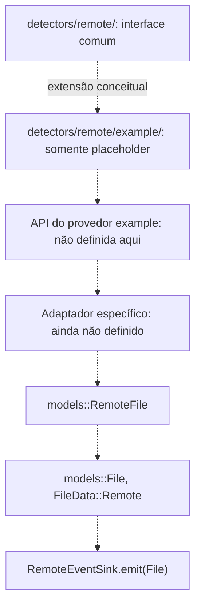

# Detector Remoto — provedor fictício `example`

**Lugar reservado para documentação futura.** A implementação especializada observaria mudanças desse provedor e emitiria eventos individuais segundo a [interface do Detector Remoto](../INTERFACES.md), usando a [API específica](../../../providers/example/api/README.md).

Não há implementação ou testes.

## Contrato esperado

O exemplo de provedor seguirá o **mesmo `models::File`**, encapsulando `FileData::Remote(RemoteFile)` produzido por adaptador próprio (sem adicionar variante `FileData::Example`). `RemoteFile.reference` usa a conta + ID do provedor e `provider_data` guarda metadados específicos se autorizados. A API do Detector Remoto permanece estável, com um `File` por emissão e sem decisões de exclusão baseadas em aviso ambíguo. Este é apenas um exemplo documental sem implementação.

## Representação visual do ponto de extensão

**Este submódulo é apenas um marcador documental.** As interfaces disponíveis não definem uma API ou uma classe concreta para o provedor `example`. O diagrama abaixo é uma **estrutura de encaixe esperada**, não um fluxo implementado.

O futuro especialista deverá utilizar o **mesmo contrato remoto existente** (ciclo de vida e emissão individual) e não criar `FileData::Example`, evento alternativo, fila própria nem dependência do Orquestrador. A seleção por conta/provedor é documentada no [README remoto](../README.md); o mecanismo concreto ainda não tem assinatura.

**Não há implementação, API específica validada ou testes deste exemplo.**
