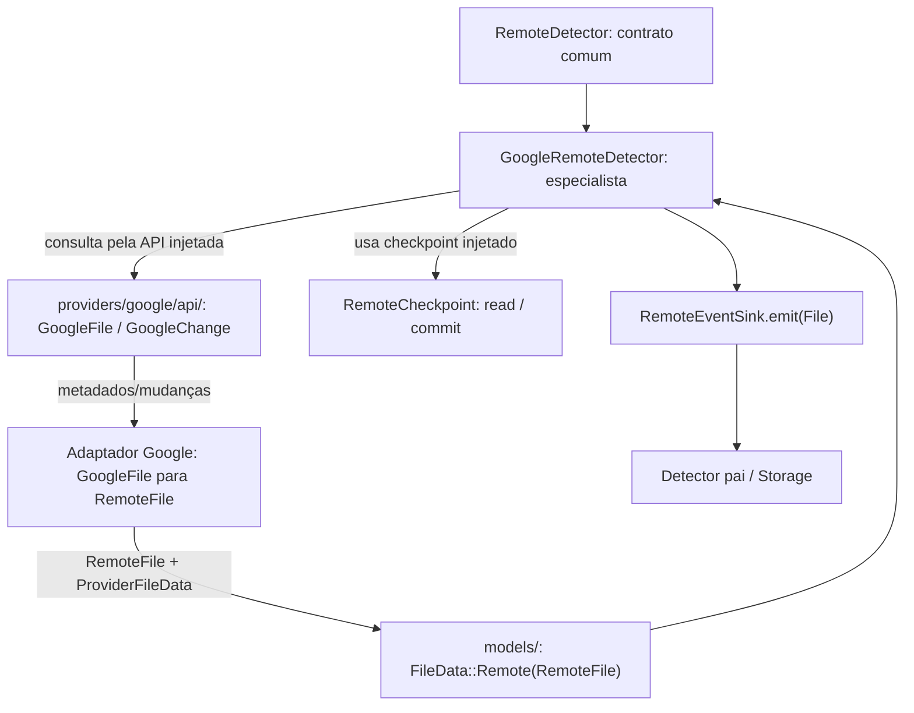
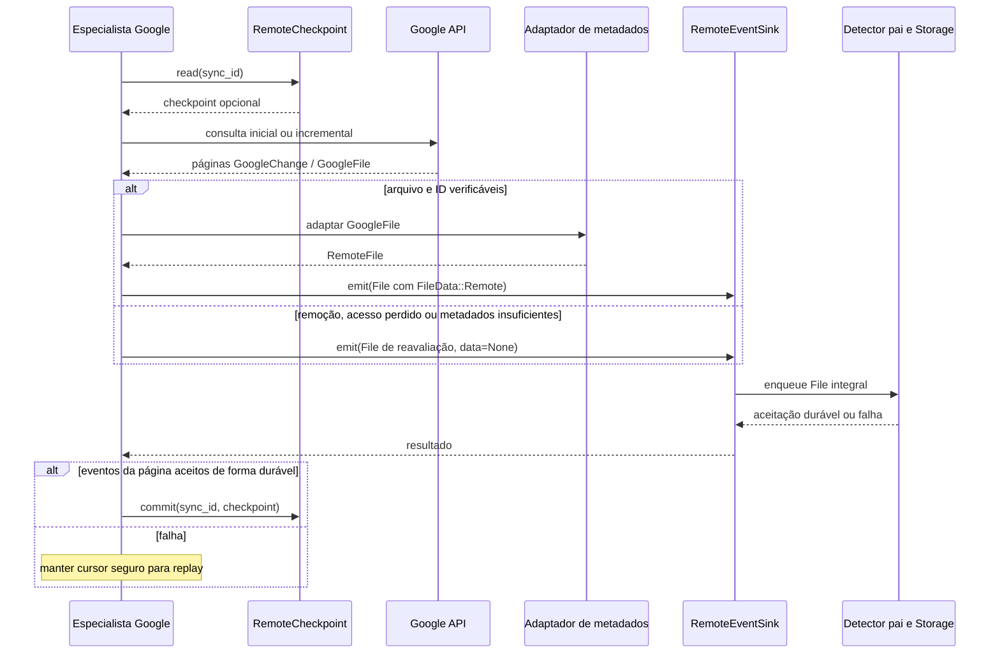

# Detector Remoto Google — implementação especializada

## Objetivo

Este submódulo **especializado** implementará o contrato interno definido em [Detector Remoto](../INTERFACES.md), **obtendo a API Google por [`providers/`](../../../providers/INTERFACES.md)**. A interface técnica recebida é a [Google API](../../../providers/google/api/INTERFACES.md); não existe obrigação de usar uma API genérica compartilhada com outros serviços.

Ele decide **como observar o Google Drive** (consulta incremental, paginação, cursor, recuperação de mudanças e intervalos). O pai `detectors/remote/` define **o que a implementação precisa oferecer** e o tipo de evento individual que deve emitir. A fachada `detectors/` agrega esses eventos em fila própria e fornece lotes ao Orquestrador.

## Limites

- Pode conhecer `GoogleFile`, `GoogleChange` e métodos próprios da API Google obtida por Providers; não criar cliente HTTP independente nem assumir autenticação da conta.
- Não acessar implementação de `detectors/storage/`; emitir um sinal de cada vez para sink injetado, com sucesso somente após aceitação durável.
- Não importar Detector Local, Inventário, Orquestrador ou operadores.
- Controlar checkpoint da leitura Google sem avançar depois de evento rejeitado.
- Não decidir exclusões com base em `removed` ou resposta incompleta.

## Independência

Testar e implementar com Google API simulada, sink de eventos fake e checkpoint fake/temporário. Nenhum Detector pai real, Local real ou Storage real é exigido. Não criar versões futuras do OneDrive como pré-requisito.

[INTERFACES](INTERFACES.md) · [TESTS](TESTS.md) · [AGENTS](AGENTS.md). **Esta é uma especificação de implementação, não código existente.**

## Encapsulamento com Models

O especialista Google usa `GoogleFile` no processamento especializado e no adaptador, mas **não** o expõe na interface comum do Detector: ele cria `RemoteFile` com `RemoteFileRef(account_id, file_id)`, metadados comuns e `ProviderFileData` opaco/filtrado. Cada emissão ao `RemoteEventSink` é um `models::File` completo com `FileData::Remote` quando possível, ou `data=None` e reavaliação quando faltar ID/arquivo. Renomeação/movimentação usam `FileEvent.previous/current` com evidência. `removed` da Changes API pode ser perda de acesso.

O Detector pai/Storage não precisa compreender `GoogleFile`, e alterações nos atributos de `RemoteFile` só afetam o adaptador. Antes de implementar, revisar necessidade e privacidade dos campos, sem transmitir credenciais ou conteúdo binário.


## Arquitetura visual do especialista Google

A implementação especializada é descrita em [INTERFACES.md](INTERFACES.md), utiliza o contrato do [Detector Remoto](../INTERFACES.md), solicita a [API Google por Providers](../../../providers/INTERFACES.md) e usa os tipos comuns de [Models](../../../models/INTERFACES.md). Os diagramas mostram **responsabilidades contratuais propostas**, não código já executado.

### Componentes e fronteiras



O especialista **não** implementa HTTP, OAuth, banco do Detector ou decisões de conflito. `GoogleFile` pertence ao contrato do provedor; `RemoteFile` e `File`, aos modelos genéricos. A tradução preserva a identidade qualificada por conta e campos efetivamente retornados, sem inventar metadados ausentes.

### Sequência documentada de leitura de mudanças



### Relação de identidades e encapsulamento

```text
GoogleFile (API) + AccountId (conta configurada)
    └── Adaptador Google
        └── RemoteFile
            ├── reference: RemoteFileRef(account_id, file_id)
            ├── provider: Google
            ├── atributos normalizados comprovados
            └── provider_data: ProviderFileData [opaco e filtrado]
                ↓
FileData::Remote(RemoteFile)
    ↓
File { id, sync_id, event, scope, coverage, observed_at, data }
    ↓
RemoteEventSink.emit(File) → Detector pai
```

`GoogleChange.removed` também pode significar **perda de acesso**; não representa exclusão confirmada. Formato, retenção e seleção final do `ProviderFileData` dependem da revisão pré-implementação já registrada.
