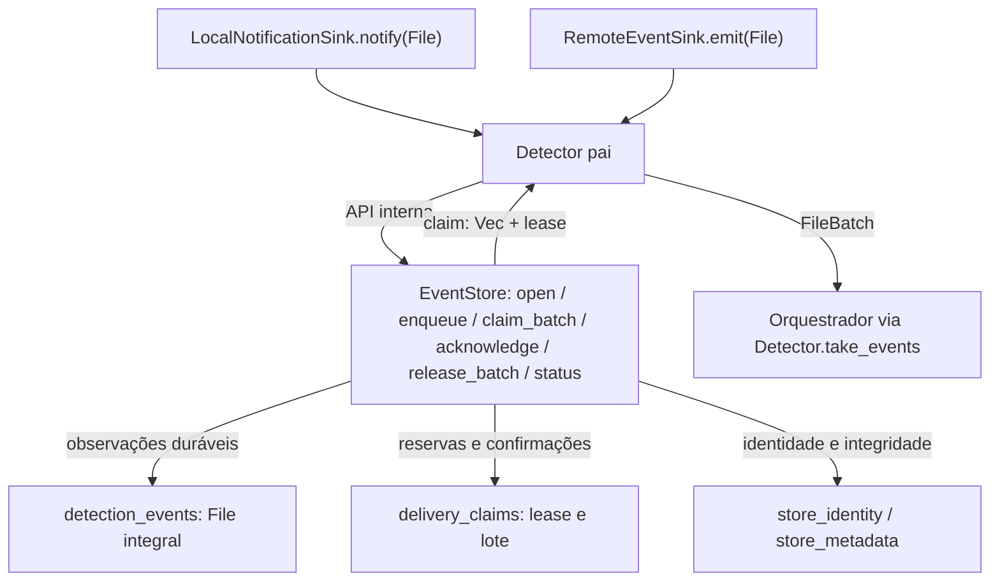
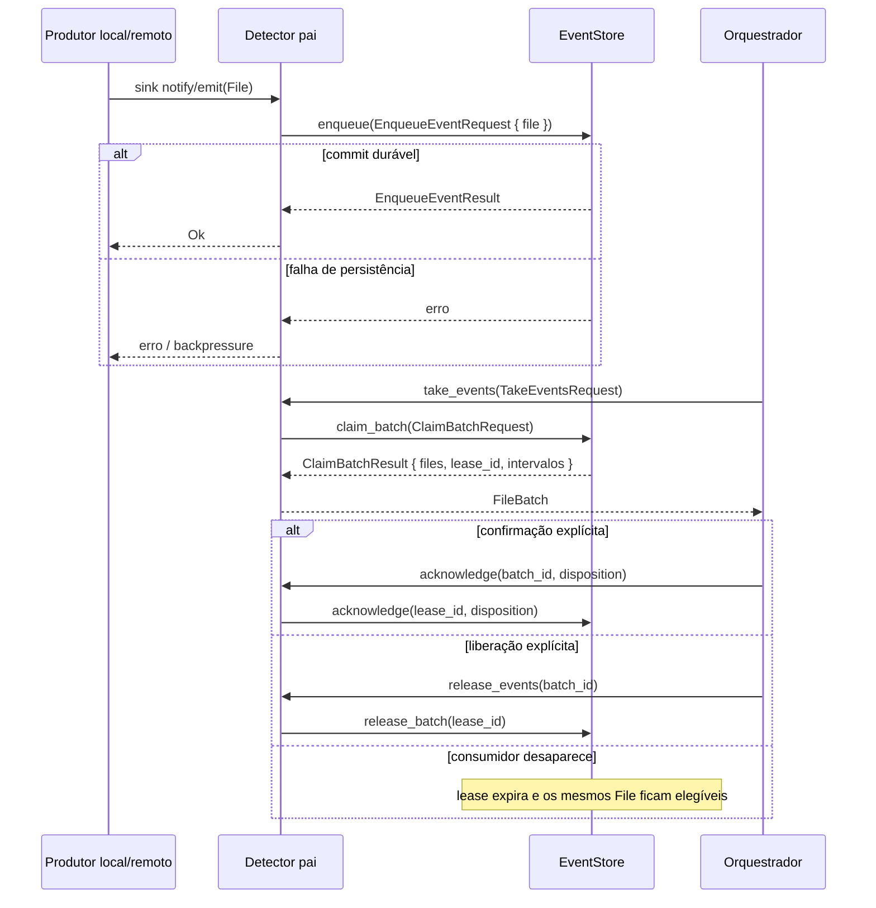
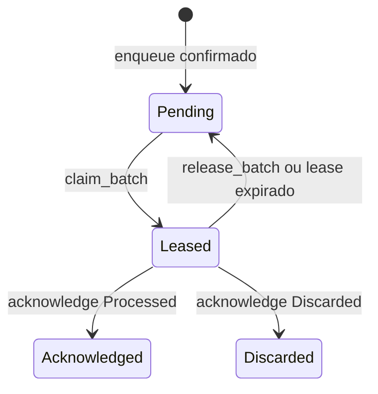

# Detector Storage — persistência privada da fila de eventos

## Objetivo e propriedade

`storage/` é um **submódulo independente** que encapsula a persistência da **fila de eventos detectados**. O `Detector` conhece somente o contrato `EventStore`; não conhece SQLite, tabelas, arquivo físico, `PRAGMA`, conexão, transação ou mecanismo de recuperação. O Storage não conhece filesystem watcher, Google API, Orquestrador, Inventário ou decisões de sincronização.

**Quatro unidades distintas:** `detectors/` (fachada pública), `local/` e `remote/` (produtores individuais), `storage/` (fila privada). Todas possuem testes próprios e podem ser implementadas/validadas com fakes das dependências. A API do Storage é visível **apenas dentro de `detectors/`**, não para outros módulos da engine.

## Armazenamento físico — detalhe interno

Implementação inicial proposta: SQLite isolado por raiz sincronizada, em `<raiz-local>/.drivesync/detector.sqlite3`, **se a raiz local estiver associada e acessível**. O local definitivo é uma política de `storage/`, não um caminho conhecido pelo `Detector`; quando a raiz estiver indisponível, retornar erro tipado e **nunca recriar/esvaziar a fila silenciosamente**. Avaliar cenário de acesso remoto sem raiz local antes de definir o provisionamento definitivo.

Não misturar com `inventory.sqlite3`. O Inventário registra estado dos arquivos, baseline, operações e seus próprios eventos; este banco registra **notificações detectadas ainda sob responsabilidade do produtor–consumidor**, sem criar upload/download nem decidir conflitos.

## Modelo de dados

| Entidade | Dados mínimos | Função |
| --- | --- | --- |
| `store_identity` | `sync_id`, identidade de associação e versão do formato | Impedir mistura de sincronizações |
| `detection_events` | `File.id`, `File.sync_id`, `File` integral serializado e versionado (`FileEvent`, `FileData`, escopo, metadados), estado e sequência | Guardar observações completas duráveis |
| `delivery_claims` | `lease_id`, prazo de reserva, consumidor/geração, itens reservados | Impedir consumo simultâneo e permitir redelivery |
| `store_metadata` | versão/esquema e diagnósticos de integridade | Recuperação e validação |

Estados lógicos: `Pending` → `Leased` → `Acknowledged` ou `Discarded`; reserva expirada volta a elegível para leitura. A eliminação física de itens confirmados é **retenção interna** e não afeta os demais módulos.

**Evento é imutável após persistido** no que diz respeito a identidade, momento e evidência. O Storage não inventa `SyncItemId`, nem qualquer campo de um `File` com `data=None`.

## Fluxo produtor–consumidor

1. `Local` ou `Remote` envia **um evento interno de cada vez** ao `Detector`.
2. O `Detector` chama `EventStore.enqueue` para persistir o evento.
3. Só após confirmação durável, o `Detector` pode informar disponibilidade ao Orquestrador.
4. O Orquestrador chama **somente a API pública do Detector** para obter um lote de eventos.
5. O Detector usa `claim_batch`; a leitura **não exclui** eventos.
6. O Orquestrador confirma o lote por `acknowledge`, podendo selecionar **`Processed` ou `Discarded`**. Apenas o Orquestrador decide descartar o que já foi detectado.
7. Falha/cancelamento antes da confirmação faz os eventos retornarem à fila (liberação explícita ou expiração da reserva).

A garantia é **pelo menos uma vez**, não entrega exatamente uma vez. O consumidor deve tolerar eventos repetidos; o Storage deve impedir perda por leitura sem confirmação.

## Invariantes de segurança

- `enqueue` é transacional: retornar sucesso apenas quando evento e identidade foram persistidos.
- `claim_batch` reserva atomicamente e limita quantidade; duas reservas simultâneas não entregam o mesmo evento sob leases válidos.
- `acknowledge` exige `lease_id` e identidade corretos. Confirmar lote expirado ou de outra sincronização falha, sem apagar dados.
- `discard` é **uma decisão de consumo explícita**, não consequência de `stop` nem de falha.
- `stop` do Detector não limpa a fila; eventos pendentes permanecem após reinício.
- Um banco corrompido, inacessível ou de outra sincronização nunca deve ser substituído por banco vazio para “recuperar”.
- Sob pressão de armazenamento, falhar com erro de backpressure/indisponibilidade e sinalizar necessidade de reconciliação; nunca declarar sucesso sem persistir.
- O `File` é preservado integralmente, incluindo metadados coletados e estados de ausência; os produtores devem aplicar a política aprovada de privacidade/retenção. Nunca persistir conteúdo de arquivo ou credenciais, nem truncar o objeto depois do aceite.
- A fila registra **eventos efetivamente emitidos**; não reconstrói acontecimentos históricos enquanto os produtores estiveram parados.

## Limites e extensão

Storage não recebe comandos `start/stop/scan` de produtores, não analisa diferenças, não edita `SyncItem` e não administra cursor remoto diretamente. Checkpoints dos mecanismos internos pertencem ao respectivo produtor; qualquer avanço remoto deve ocorrer apenas depois de os sinais correspondentes estarem duráveis na fila.

Referências: [INTERFACES.md](INTERFACES.md), [TESTS.md](TESTS.md), [AGENTS.md](AGENTS.md), [Detector](../README.md). Estado: **documentação**, nenhum código executado.

## Fidelidade ao contrato de Models

O registro persistido não é um evento reduzido. Ele contém **`models::File` completo e imutável**, com `FileEvent.kind/previous/current`, `File.scope`, `File.coverage`, `File.observed_at` e `File.data: Option<FileData>`. Se houver LocalFile ou RemoteFile, seus metadados observados (inclusive envelope especializado do provedor) sobrevivem ao round-trip de Storage.

A estrutura externa de lote pertence ao Detector; o Storage devolve `Vec<File>` com reserva interna. O mesmo `File.id` e bytes semânticos devem ser preservados na reentrega. Um ID reapresentado com conteúdo divergente é erro, não atualização silenciosa. Fila, lease e ack não dependem dos atributos internos do modelo; mudanças exigem, quando necessário, apenas ajuste do codec versionado.

A revisão de necessidade, limites e sanitização de dados sensíveis é pré-requisito de implementação. Não guardar conteúdo binário do arquivo nem credenciais. Não alterar Inventário/SyncItem.


## Arquitetura visual do Storage do Detector

Estas figuras reproduzem as operações de [Storage — INTERFACES](INTERFACES.md), com `EventStore` como **porta interna privada**. SQLite é a implementação física **proposta**, não uma dependência do módulo pai nem uma prova de código executado.

### Componentes e dependências



O diagrama representa **entidades lógicas já documentadas**, não um diagrama físico de tabelas aprovado. `FileBatch` é composto no Detector pai; o Storage armazena `File`, não um segundo tipo de evento reduzido.

### Sequência de durabilidade, reserva e recuperação



### Estados lógicos dos registros



```text
EnqueueEventRequest
└── file: File [models/, integral]
    ├── id / sync_id / observed_at / coverage / scope
    ├── event: FileEvent { kind, previous, current }
    └── data: Option<FileData> [LocalFile ou RemoteFile]

ClaimBatchResult [storage/]
├── lease_id: Option<LeaseId>
├── files: Vec<File>
├── first_observed_at: Option<Timestamp>
└── last_observed_at: Option<Timestamp>
    ↓
FileBatch [detectors/]
├── batch_id: Option<BatchId>
├── files: Vec<File>
├── first_observed_at: Option<Timestamp>
└── last_observed_at: Option<Timestamp>
```

`EventStore` não decide conflitos nem compara arquivos. O `File` persiste sem projeção de campos; o mesmo ID com conteúdo divergente causa erro, e leitura sem confirmação não remove dados. `Processed` não comprova sincronização. Localização física da base, formato do codec e retenção dependem das revisões de implementação.
