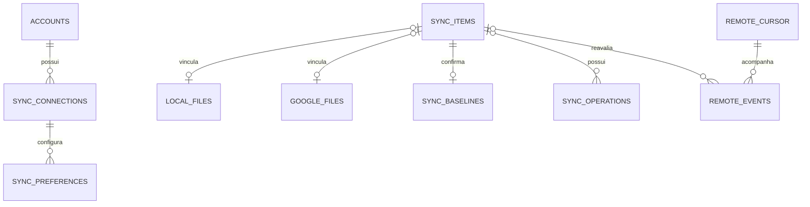

# Modelo de dados — Inventário do DriveSync

## 1. Objetivo e responsabilidade

Este documento é a **referência do modelo persistente pretendido**, independentemente do código atual. O componente `inventory/` é inicialmente o **único responsável pela camada de persistência estruturada da engine**: define contratos de armazenamento e oferece operações de dados, sem delegar SQL aos consumidores. Essa decisão poderá ser revista na arquitetura posteriormente, sem mudar o significado das entidades.

Há **dois níveis de armazenamento**: um banco **global da aplicação** e bancos **independentes por pasta sincronizada**. O histórico é segregado por sincronização. O cofre de credenciais é externo ao SQLite.

| Nível | Banco/local | Responsabilidade | Chave do escopo |
| --- | --- | --- | --- |
| Aplicação | `$XDG_DATA_HOME/drivesync/app.sqlite3` | Contas cadastradas, sincronizações configuradas e preferências persistentes da aplicação | Instalação/perfil da aplicação |
| Pasta sincronizada | `<raiz-local>/.drivesync/inventory.sqlite3` | Inventário, identidade, metadados locais/remotos, baseline, operações pendentes, cursores e eventos | Uma sincronização configurada |
| Histórico por sincronização | `<raiz-local>/.drivesync/history.sqlite3` | Atividades concluídas e resultados observáveis daquela sincronização | Uma sincronização configurada |
| Credenciais | Secret Service/keyring | Refresh tokens, client secrets e outros segredos | Conta/credencial |

**A localização no Flatpak segue o XDG do ambiente isolado.** O banco global da aplicação não deve ficar na pasta sincronizada. Os bancos `.drivesync/` não são enviados ao Drive nem observados pelo detector local como conteúdo de usuário. `history.sqlite3` é distinto do inventário para que consultas de histórico não definam o estado atual.

### Relação entre a configuração global e os bancos locais

- `accounts.id` identifica uma conta cadastrada na aplicação, mas **não substitui** o `GoogleFile.id`.
- `sync_connections.id` identifica o par de raízes local/remota e vincula esse par ao registro `sync_info` do inventário.
- Cada `sync_connections` tem um inventário independente e um histórico independente. Uma conta pode ter várias conexões.
- O banco da aplicação pode existir mesmo sem sincronizações configuradas. A pasta sincronizada pode estar temporariamente ausente; sua ausência **não** autoriza excluir arquivos remotos.
- A separação é intencional: o banco global administra **cadastros e configurações**; o banco por sincronização administra **objetos e operações daquele repositório**.

## 2. Entidades e relações

| Entidade | Banco | Identidade | Relacionamento |
| --- | --- | --- | --- |
| `accounts` | Aplicação | `account_id` | 1:N com `sync_connections` |
| `sync_connections` | Aplicação | `sync_id` | Cada conexão referencia uma conta e um par de raízes |
| `app_preferences` | Aplicação | `key` | Opções globais tipadas |
| `sync_preferences` | Aplicação | `sync_id, key` | Opções específicas de uma conexão |
| `sync_info` | Inventário | `singleton=1` | Valida a conexão que possui o banco |
| `local_files` | Inventário | `local_file_id` | 0..1 para cada `sync_items` |
| `google_files` | Inventário | `google_file_id` (PK local) | 0..1 para cada `sync_items` |
| `sync_items` | Inventário | `item_id` | Um vínculo lógico com referências opcionais para os dois lados |
| `sync_baselines` | Inventário | `item_id` | 0..1 baseline confirmado por `sync_items` |
| `sync_operations` | Inventário | `operation_id` | Fila persistente de ações que ainda não foram concluídas |
| `remote_cursor` | Inventário | `corpus` | Checkpoints por escopo do provedor |
| `remote_events` | Inventário | `event_id` | Eventos remotos pendentes; podem apontar para um item |
| `activity` | Histórico | `id` | Resultado de atividade, com `item_id` lógico opcional |

**Importante:** `GoogleFile` e `LocalFile` são **contratos Rust** de origem externa ao Inventário. As tabelas `google_files` e `local_files` são projeções relacionais dos atributos que precisam ser persistidos, não obrigação de copiar integralmente as estruturas de transporte. O `SyncItem` é montado em uma consulta via `JOIN` e pode retornar `local: Option<LocalFile>`, `remote: Option<GoogleFile>`, `baseline: Option<SyncBaseline>`.



*As relações entre bancos separados são verificadas na aplicação: SQLite não aplica FKs entre arquivos de banco distintos. Dentro de cada banco, usar FKs reais.*

## 3. Banco global `app.sqlite3`

O banco contém **somente cadastros e preferências da aplicação**. Não contém árvores de arquivos, snapshots, filas de transferência, cursores ou segredos OAuth.

### Tabelas

| Tabela | Campos | Observações |
| --- | --- | --- |
| `accounts` | `account_id`, `provider`, `provider_user_id`, `email`, `display_name`, `created_at`, `updated_at` | `provider_user_id` corresponde a `sub` para Google OIDC; e-mail pode mudar |
| `sync_connections` | `sync_id`, `account_id`, `remote_root_id`, `local_root`, `display_name`, `enabled`, `created_at` | Identidade estável do par de pastas, não resolve arquivos |
| `app_preferences` | `key`, `value_type`, `value_text`, `value_integer`, `value_real` | Um único valor escalar tipado por linha |
| `sync_preferences` | `sync_id`, `key`, `value_type`, `value_text`, `value_integer`, `value_real` | Preferências por conexão; sem JSON opaco |

### Esquema SQL inicial

```sql
PRAGMA foreign_keys = ON;

CREATE TABLE accounts (
  account_id TEXT PRIMARY KEY,
  provider TEXT NOT NULL CHECK (provider = 'google'),
  provider_user_id TEXT NOT NULL,
  email TEXT,
  display_name TEXT,
  created_at TEXT NOT NULL,
  updated_at TEXT NOT NULL,
  UNIQUE(provider, provider_user_id)
);

CREATE TABLE sync_connections (
  sync_id TEXT PRIMARY KEY,
  account_id TEXT NOT NULL REFERENCES accounts(account_id) ON DELETE RESTRICT,
  remote_root_id TEXT NOT NULL,
  local_root TEXT NOT NULL UNIQUE,
  display_name TEXT,
  enabled INTEGER NOT NULL DEFAULT 1 CHECK (enabled IN (0, 1)),
  created_at TEXT NOT NULL
);

CREATE TABLE app_preferences (
  key TEXT PRIMARY KEY,
  value_type TEXT NOT NULL CHECK (value_type IN ('text', 'integer', 'real', 'boolean')),
  value_text TEXT,
  value_integer INTEGER,
  value_real REAL,
  CHECK (
    (value_type = 'text' AND value_text IS NOT NULL AND value_integer IS NULL AND value_real IS NULL) OR
    (value_type IN ('integer', 'boolean') AND value_integer IS NOT NULL AND value_text IS NULL AND value_real IS NULL) OR
    (value_type = 'real' AND value_real IS NOT NULL AND value_text IS NULL AND value_integer IS NULL)
  ),
  CHECK (value_type != 'boolean' OR value_integer IN (0, 1))
);

CREATE TABLE sync_preferences (
  sync_id TEXT NOT NULL REFERENCES sync_connections(sync_id) ON DELETE CASCADE,
  key TEXT NOT NULL,
  value_type TEXT NOT NULL CHECK (value_type IN ('text', 'integer', 'real', 'boolean')),
  value_text TEXT,
  value_integer INTEGER,
  value_real REAL,
  PRIMARY KEY (sync_id, key),
  CHECK (
    (value_type = 'text' AND value_text IS NOT NULL AND value_integer IS NULL AND value_real IS NULL) OR
    (value_type IN ('integer', 'boolean') AND value_integer IS NOT NULL AND value_text IS NULL AND value_real IS NULL) OR
    (value_type = 'real' AND value_real IS NOT NULL AND value_text IS NULL AND value_integer IS NULL)
  ),
  CHECK (value_type != 'boolean' OR value_integer IN (0, 1))
);
```

As permissões de acesso ao banco global são restritas ao usuário. A raiz local deve ser validada por identidade canônica de caminho/volume para impedir duas conexões sobrepostas, inclusive quando os nomes de caminhos diferirem.

## 4. Banco por sincronização `inventory.sqlite3`

### 4.1 Metadados locais e remotos

| Tabela | Campos principais | Observações |
| --- | --- | --- |
| `local_files` | ID interno, nome local, localização relativa, tipo, tamanho, timestamps, dispositivo, inode, hash | Não depende de Google e não identifica arquivo apenas por inode |
| `google_files` | ID interno, ID Google, nome, MIME, pais, versão, tamanho, timestamps, hashes e estado de lixeira | ID Google permanece imutável após mover/renomear; alguns campos são omitidos por `fields` ou tipo MIME |
| `sync_items` | ID lógico, duas FKs opcionais, presença observada de cada lado, status, revisão e timestamps | Estado unificado, não duplica os metadados das duas tabelas |
| `sync_baselines` | ID lógico, presença, nomes, pais e versões/hashes **confirmados** | Não é novo objeto físico, mas estado anterior comprovado |

Para `GoogleFile.parents` (coleção), não serializar lista: a relação usa `google_file_parents` com uma linha por parent, ainda que um arquivo comum tenha um único pai efetivo. Outras coleções que precisem ser persistidas receberão tabelas próprias, não BLOB/JSON serializado. `mime_type`, checksums e outros campos podem permanecer `NULL` quando não fornecidos; **NULL não significa exclusão remota**.

### 4.2 Esquema SQL inicial

```sql
PRAGMA foreign_keys = ON;

CREATE TABLE sync_info (
  singleton INTEGER PRIMARY KEY CHECK (singleton = 1),
  sync_id TEXT NOT NULL,
  account_id TEXT NOT NULL,
  remote_root_id TEXT NOT NULL,
  initial_download_complete INTEGER NOT NULL DEFAULT 0
    CHECK (initial_download_complete IN (0, 1)),
  generation INTEGER NOT NULL DEFAULT 1 CHECK (generation > 0)
);

CREATE TABLE local_files (
  local_file_id TEXT PRIMARY KEY,
  local_parent_item_id TEXT REFERENCES sync_items(item_id),
  name BLOB,
  relative_path BLOB,
  file_kind TEXT CHECK (file_kind IN ('file', 'directory', 'symlink', 'other')),
  size INTEGER CHECK (size IS NULL OR size >= 0),
  modified_ns INTEGER,
  created_ns INTEGER,
  changed_ns INTEGER,
  device_id INTEGER,
  inode INTEGER,
  checksum TEXT,
  checksum_algorithm TEXT,
  observed_at TEXT NOT NULL
);

CREATE TABLE google_files (
  google_file_id TEXT PRIMARY KEY,
  remote_id TEXT NOT NULL UNIQUE,
  name TEXT,
  mime_type TEXT,
  version TEXT,
  size INTEGER CHECK (size IS NULL OR size >= 0),
  modified_time TEXT,
  created_time TEXT,
  md5_checksum TEXT,
  sha1_checksum TEXT,
  sha256_checksum TEXT,
  trashed INTEGER CHECK (trashed IS NULL OR trashed IN (0,1)),
  drive_id TEXT,
  observed_at TEXT NOT NULL
);

CREATE TABLE sync_items (
  item_id TEXT PRIMARY KEY,
  local_file_id TEXT UNIQUE REFERENCES local_files(local_file_id),
  google_file_id TEXT UNIQUE REFERENCES google_files(google_file_id),
  local_presence TEXT NOT NULL DEFAULT 'unknown'
    CHECK (local_presence IN ('unknown', 'present', 'absent_confirmed')),
  remote_presence TEXT NOT NULL DEFAULT 'unknown'
    CHECK (remote_presence IN ('unknown', 'present', 'absent_confirmed')),
  sync_status TEXT NOT NULL DEFAULT 'pending_reconciliation'
    CHECK (sync_status IN ('pending_reconciliation', 'pending_upload', 'pending_download',
                          'synced', 'conflict', 'error')),
  conflict_reason TEXT,
  last_checked_at TEXT,
  last_synced_at TEXT,
  revision INTEGER NOT NULL DEFAULT 1 CHECK (revision > 0)
);

CREATE TABLE google_file_parents (
  google_file_id TEXT NOT NULL REFERENCES google_files(google_file_id) ON DELETE CASCADE,
  parent_remote_id TEXT NOT NULL,
  PRIMARY KEY (google_file_id, parent_remote_id)
);

CREATE TABLE sync_baselines (
  item_id TEXT PRIMARY KEY REFERENCES sync_items(item_id) ON DELETE CASCADE,
  local_presence TEXT NOT NULL CHECK (local_presence IN ('unknown', 'present', 'absent_confirmed')),
  remote_presence TEXT NOT NULL CHECK (remote_presence IN ('unknown', 'present', 'absent_confirmed')),
  local_name BLOB,
  local_parent_item_id TEXT REFERENCES sync_items(item_id),
  local_checksum TEXT,
  local_size INTEGER,
  local_modified_ns INTEGER,
  remote_id TEXT,
  remote_name TEXT,
  remote_parent_id TEXT,
  remote_version TEXT,
  remote_checksum TEXT,
  remote_size INTEGER,
  confirmed_at TEXT NOT NULL
);

CREATE INDEX idx_sync_items_status ON sync_items(sync_status);
CREATE INDEX idx_sync_items_remote_presence ON sync_items(remote_presence);
CREATE INDEX idx_sync_items_local_presence ON sync_items(local_presence);
CREATE INDEX idx_local_file_parent ON local_files(local_parent_item_id);
CREATE INDEX idx_local_file_device_inode ON local_files(device_id, inode);
CREATE INDEX idx_google_file_name ON google_files(name);
CREATE INDEX idx_google_file_parent ON google_file_parents(parent_remote_id);
```

A sequência de criação das tabelas deve ocorrer na mesma transação de inicialização, ativando `PRAGMA foreign_keys=ON` em cada conexão. As FKs entre `local_files.local_parent_item_id` e `sync_items` são deliberadas: a hierarquia local usa o **ID lógico** do diretório pai, não um caminho completo como identidade. `relative_path` é informação de localização atual, potencialmente derivável da hierarquia; será validada quanto à redundância antes da implementação.

### 4.3 Fila persistente, mudanças e cursores

| Tabela | Finalidade | Estado de conclusão |
| --- | --- | --- |
| `sync_operations` | Ações solicitadas para um item e ainda pendentes/concluídas, inclusive offline | Resultado verificado e fila durável |
| `remote_cursor` | Cursor de changes por corpus remoto e geração | Avançar cursor apenas junto à persistência dos eventos entregues |
| `remote_events` | Sinais de mudanças remotas pendentes de reconciliação | Somente confirmar após tratamento explícito |

```sql
CREATE TABLE sync_operations (
  operation_id INTEGER PRIMARY KEY AUTOINCREMENT,
  item_id TEXT NOT NULL REFERENCES sync_items(item_id) ON DELETE RESTRICT,
  direction TEXT NOT NULL CHECK (direction IN ('upload', 'download')),
  operation_kind TEXT NOT NULL CHECK (
    operation_kind IN ('create', 'update_content', 'rename', 'move', 'trash', 'delete', 'restore')
  ),
  state TEXT NOT NULL DEFAULT 'pending' CHECK (
    state IN ('pending', 'running', 'retry_wait', 'blocked', 'completed', 'failed')
  ),
  base_item_revision INTEGER NOT NULL CHECK (base_item_revision > 0),
  expected_remote_version TEXT,
  attempt_count INTEGER NOT NULL DEFAULT 0 CHECK (attempt_count >= 0),
  next_attempt_at TEXT,
  last_error_kind TEXT,
  created_at TEXT NOT NULL,
  started_at TEXT,
  completed_at TEXT
);

CREATE INDEX idx_operations_queue
  ON sync_operations(state, next_attempt_at, operation_id);
CREATE INDEX idx_operations_item ON sync_operations(item_id, operation_id);

CREATE TABLE remote_cursor (
  corpus TEXT PRIMARY KEY,
  cursor TEXT NOT NULL,
  generation INTEGER NOT NULL CHECK (generation > 0)
);

CREATE TABLE remote_events (
  event_id INTEGER PRIMARY KEY AUTOINCREMENT,
  corpus TEXT NOT NULL REFERENCES remote_cursor(corpus),
  item_id TEXT REFERENCES sync_items(item_id),
  remote_id TEXT,
  event_kind TEXT NOT NULL,
  observed_version TEXT,
  observed_at TEXT NOT NULL,
  processed_at TEXT
);

CREATE INDEX idx_remote_events_pending
  ON remote_events(corpus, event_id) WHERE processed_at IS NULL;
```

**Fila e segurança:** registrar uma operação não é autorizá-la indiscriminadamente; Orquestrador/Analisador aplicam políticas. Alterações de conteúdo, caminho, nome e exclusão devem levar a operações semânticas específicas; não usar campos JSON genéricos. Uma operação `running` na interrupção retorna à reavaliação, sem assumir que o provedor não a executou. O valor `expected_remote_version` é precondição registrada, não substitui consulta fresca antes de uma escrita destrutiva. Transferências físicas e seus checkpoints específicos permanecem de responsabilidade dos operadores.

**Consistência de cursor:** a mesma transação registra os eventos e o cursor da página observada. Eventos só recebem `processed_at` após reavaliação efetiva; um cursor avançado não implica evento concluído.

## 5. Histórico por sincronização `history.sqlite3`

`history.sqlite3` contém atividades realizadas ou falhas pertinentes àquela sincronização. Não é a fila de execução e não substitui o baseline.

```sql
CREATE TABLE activity (
  id INTEGER PRIMARY KEY AUTOINCREMENT,
  item_id TEXT,
  operation_id INTEGER,
  operation TEXT NOT NULL,
  origin TEXT NOT NULL CHECK (origin IN ('local', 'remote', 'system')),
  result TEXT NOT NULL,
  occurred_at TEXT NOT NULL,
  description TEXT
);

CREATE INDEX idx_activity_time ON activity(occurred_at, id);
CREATE INDEX idx_activity_item ON activity(item_id, id);
```

`item_id` e `operation_id` são referências lógicas, não FKs entre arquivos SQLite diferentes. O Analisador determina quando registrar um resultado; a escrita é oferecida pela camada de persistência do Inventário. A retenção histórica deve sobreviver à remoção de itens do inventário.

## 6. Persistência: acesso e transações

| Contrato | Invariante |
| --- | --- |
| Um único acesso de dados | Só o Inventário abre/consulta/escreve os bancos estruturados nesta fase; outros módulos usam interfaces públicas |
| Leitura agregada | `SyncItem` é montado com `LEFT JOIN` entre `sync_items`, `local_files`, `google_files` e `sync_baselines`; relações 1:N carregadas em consultas separadas ou agregação relacional |
| Gravação de observação | Atualiza o lado observado e o vínculo sem avançar o baseline |
| Confirmação | Só confirma baseline após verificação; gravação atômica por item, com `revision` como precondição otimista |
| Idempotência | Reaplicar a mesma observação não duplica `SyncItem` nem vínculos |
| Múltiplas contas | Cada sincronização tem escopo exclusivo; nenhuma operação cruza `sync_id` |
| Divergências | O Inventário armazena fatos e status; não define política nem exclui fisicamente |
| Retenção | Nenhuma ausência decorrente de erro de acesso é convertida em exclusão comprovada |
| Segredos | Nenhum banco registra tokens, client secrets nem URLs secretas de upload |
| Tipos de dados | Uma linha por item/evento/atividade; não serializar listas, mapas, structs ou filas em JSON/BLOB |
| Revisão do esquema | `PRAGMA user_version` e validação estrutural ao abrir; nenhuma camada de compatibilidade legada imposta |

SQLite é transacional **dentro de cada banco**; gravar `inventory.sqlite3` e `history.sqlite3` não deve ser tratado automaticamente como commit atômico entre arquivos. Falhas entre confirmação e registro de atividade devem ter semântica idempotente e recuperável.

## 7. Inicialização, suspensão e recuperação

1. Registrar ou validar a conexão no banco global, vinculando `account_id`, `sync_id` e raízes local/remota.
2. Uma sincronização nova só inicia automaticamente com pasta local vazia (ignorando apenas os arquivos gerenciados `.drivesync/`); diretório com dados sem inventário válido deve ser bloqueado, não mesclado ou apagado automaticamente.
3. Criar inventário por sincronização e verificar `sync_info` na abertura. Inconsistência de escopo bloqueia operações.
4. Registrar observações locais/remotas por item; associá-las em `sync_items` sem inventar baseline.
5. Confirmar baseline apenas após materialização/aplicação efetiva e verificada.
6. Em reinício, recuperar a fila e eventos pendentes; reavaliar antes de repetir operações cujo resultado ficou incerto.
7. Quando a pasta local estiver ausente ou inacessível, **suspender** operações e manter o último estado conhecido. Não interpretar como deleção remota.
8. Um `SyncItem` com ambos os lados não observados pode ser retido para garantir histórico de decisão/remoção; limpeza só por regra explícita e segura.

## 8. Próximas definições

| Documento | Escopo |
| --- | --- |
| [README.md](README.md) | Objetivo, responsabilidades e visão conceitual do Inventário |
| `INTERFACES.md` | Contratos Rust de leitura, atualização, associação, transações, cursores, fila, histórico e bancos globais |
| `TESTS.md` | TDD com SQLite real isolado, integridade de FKs, concorrência, observações, recuperação e consulta composta |
| Este `DATA_MODEL.md` | Esquema relacional proposto e separação entre persistência global e por sincronização |

**Decisões ainda abertas:** atributos definitivos de `LocalFile`; quais subestruturas completas de `GoogleFile` persistir; critérios de limpeza e retenção; campos adicionais de checkpoints/retries e preferências. Essas decisões não alteram a divisão global/por sincronização nem a regra de um `SyncItem` lógico por objeto.
