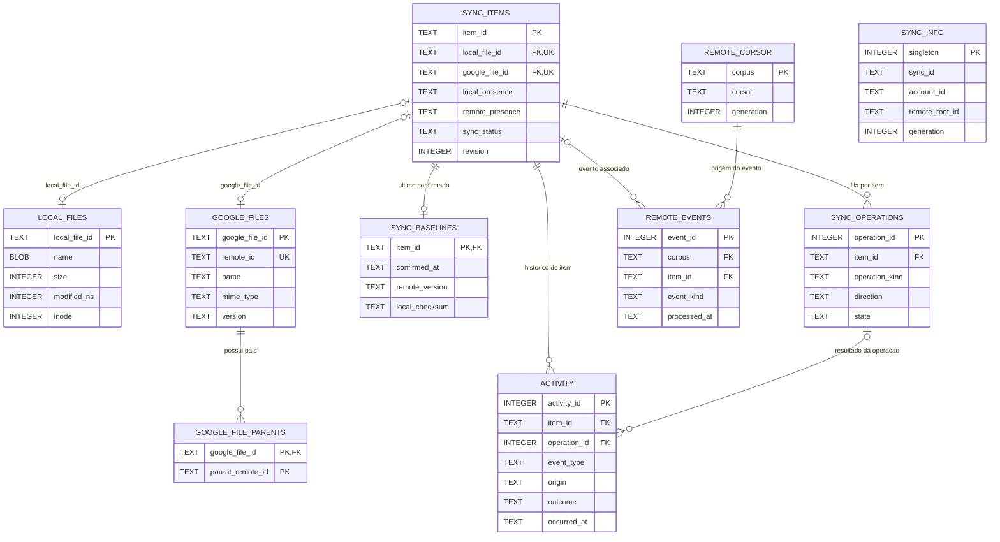

# Inventário — InventoryManager

## Objetivo

O **Inventário** é responsável exclusivamente pelo **acesso e pela persistência dos dados de cada pasta sincronizada**. Os demais módulos consomem suas interfaces e não executam SQL diretamente nesse banco. Dados globais da aplicação, contas e preferências **não** são responsabilidade do Inventário.

O Inventário registra identidades dos itens, metadados observados, vínculos, último estado confirmado, operações pendentes, cursores e atividades. Ele **não** observa o filesystem ou o Google Drive por conta própria, nem executa upload/download ou escolhe qual versão deve prevalecer em um conflito.

## Banco de dados por pasta sincronizada

Cada pasta sincronizada possui **seu próprio banco SQLite**, localizado em:

```text
<pasta-local-sincronizada>/
├── .drivesync/
│   └── inventory.sqlite3      # Arquivos, baseline, operações, eventos e histórico
└── arquivos-do-usuario/
```

O diretório oculto `.drivesync/` guarda o estado durável **daquela sincronização**, permitindo retomada após encerramento do aplicativo. Ele deve ser ignorado pelo detector local e **nunca enviado ao Google Drive**. A inexistência ou indisponibilidade da pasta local não comprova exclusão remota. Uma pasta com arquivos do usuário e inventário ausente não é sincronizada automaticamente sem processo seguro de associação.

**Histórico não tem banco separado:** a tabela `activity` permanece dentro de `inventory.sqlite3`, com relação obrigatória ao `SyncItem` correspondente.

### Fora do escopo deste módulo

- **Cadastro global de contas e pares de pastas:** pertence conceitualmente aos componentes `accounts/` e de gerenciamento de conexões, respectivamente.
- **Persistência global, se necessária:** fica **provisoriamente** sob `configuration/`, até decidir quais dados precisam de SQLite e quais podem utilizar armazenamento padrão do GNOME.
- **Preferências da aplicação:** avaliar `GSettings` (GLib/dconf), observando a distinção entre configurações e dados persistentes. GTK4/Wayland não impõem um banco SQLite para preferências.
- **Credenciais OAuth:** armazenamento seguro via Secret Service/keyring; não persistir segredos neste SQLite.

O Inventário **não abre nem gerencia um `app.sqlite3`**. A existência e o esquema desse banco global continuam como proposta pendente de revisão nos módulos responsáveis.

## 1. Tabelas e relações do inventário (`inventory.sqlite3`)

Este banco representa os arquivos e o processamento **de um único par de pastas**.

### Tabelas e relacionamentos

| Tabela | Chave | Conteúdo |
| --- | --- | --- |
| `sync_info` | `singleton=1` | `sync_id`, conta, raiz remota, geração, conclusão da sincronização inicial |
| `local_files` | `local_file_id` | Nome/caminho local, tipo, tamanho, horários, dispositivo, inode, checksum |
| `google_files` | `google_file_id` | `remote_id` exclusivo, nome, MIME, versão, tamanho, datas, hashes, lixeira e drive |
| `google_file_parents` | `(google_file_id, parent_remote_id)` | Uma linha por relacionamento pai do arquivo no Drive |
| `sync_items` | `item_id` | Vínculo com `local_file_id` e `google_file_id`, presença, status, revisão e horários |
| `sync_baselines` | `item_id` | Estado anterior **confirmado**: presença, nomes, pais, versões, hashes e instante |
| `sync_operations` | `operation_id` | Fila persistente de ações, estado, tipo, direção, tentativas e falhas |
| `remote_cursor` | `corpus` | Cursor de alterações remoto e geração correspondente |
| `remote_events` | `event_id` | Eventos de alterações remotas recebidos, pendentes ou reconhecidos |
| `activity` | `activity_id` | Histórico cronológico de operações por arquivo, com `item_id` obrigatório e `operation_id` opcional |

### Diagrama do banco de cada sincronização



As relações `sync_items.local_file_id` e `sync_items.google_file_id` são **FKs opcionais e únicas**. Assim, um item lógico pode existir só no local, só no Google, nos dois lados ou ficar temporariamente sem representação atual. A falta da referência **não prova exclusão**.

### `LocalFile`, `GoogleFile` e `SyncItem`

| Objeto Rust | Dono do contrato | Papel no Inventário |
| --- | --- | --- |
| `LocalFile` | Componente responsável pelos metadados locais (a definir integralmente) | Produz/representa uma observação local |
| `GoogleFile` | `providers/google/api/` | Produz/representa uma observação remota |
| `SyncItem` | `inventory/` | Reúne as duas representações, baseline e situação de sincronização |

```rust
// Contrato conceitual, não assinatura definitiva.
pub struct SyncItem {
    pub id: SyncItemId,
    pub local: Option<LocalFile>,
    pub remote: Option<GoogleFile>,
    pub baseline: Option<SyncBaseline>,
    pub local_presence: PresenceState,
    pub remote_presence: PresenceState,
    pub status: SyncStatus,
}
```

O Inventário constrói o `SyncItem` a partir das tabelas relacionadas (por exemplo, com `LEFT JOIN`). A aplicação não precisa conhecer o esquema para consultar um arquivo.

Os atributos de `LocalFile` ainda poderão evoluir. Os de `GoogleFile` são orientados pelo contrato da Google API. **As tabelas guardam os atributos necessários à persistência**, não necessariamente uma cópia integral de todos os objetos externos. Campos opcionais não recebidos não se convertem automaticamente em zero, `false` ou exclusão.

### Presença, estado e baseline

| Campo/estado | Valores | Significado |
| --- | --- | --- |
| `local_presence`, `remote_presence` | `unknown`, `present`, `absent_confirmed` | Desconhecido, presença observada ou ausência efetivamente comprovada |
| `sync_status` | `pending_reconciliation`, `pending_upload`, `pending_download`, `synced`, `conflict`, `error` | Condição registrada para o Analisador/Orquestrador |
| `revision` | Inteiro positivo | Versão para evitar atualizações concorrentes obsoletas |
| `SyncBaseline` | Registro opcional por item | Último estado **efetivamente confirmado** em ambos os lados |

Uma observação atualiza metadados locais ou remotos **sem avançar o baseline**. Apenas a confirmação de uma operação concluída e verificada altera o baseline.

O baseline deve reter ao menos presença, nome, pai/localização, versão/assinatura e instante de confirmação. Ele é separado das tabelas de estado observado para evitar sobrescrever o passado ao detectar mudanças atuais.

### Fila de operações, cursores e eventos

| Estrutura | Campos/estados principais | Regra |
| --- | --- | --- |
| `sync_operations` | `item_id`, `direction` (upload/download), `operation_kind` (criar, conteúdo, renomear, mover, lixeira, excluir, restaurar), `state` (pendente, executando, retry, bloqueada, concluída, falha), `attempt_count`, `next_attempt_at`, precondição de versão | Registra trabalho durável, inclusive offline; não executa a ação |
| `remote_cursor` | `corpus`, `cursor`, `generation` | Representa até onde as alterações remotas foram observadas |
| `remote_events` | `corpus`, `remote_id`, `item_id?`, tipo, versão, `observed_at`, `processed_at?` | Evento só fica reconhecido após reavaliação explícita |

- Publicar o cursor de uma página e seus eventos deve ser **transacional** no inventário.
- Avançar o cursor não significa que os eventos foram processados.
- Depois de interrupção, recuperar a fila e os eventos pendentes e **reavaliar antes de repetir** escritas com resultado desconhecido.
- O Inventário persiste as operações, mas a **decisão de executá-las** pertence aos módulos de coordenação e análise.

## 2. Histórico como parte de `inventory.sqlite3`

**Histórico não é outro banco.** É a tabela `activity` dentro do mesmo `inventory.sqlite3` de cada pasta. Registra **o que aconteceu e qual foi o resultado**, enquanto `sync_items` representa o estado atual conhecido e `sync_operations` a fila operacional.

| Componente de dados | Pergunta respondida | Exemplo |
| --- | --- | --- |
| `sync_items` e `sync_baselines` | Como está o arquivo agora? Qual foi seu último estado sincronizado? | `relatorio.pdf` está pendente de upload |
| `sync_operations` | O que precisa ser executado, está em execução ou deve ser retomado? | Atualizar conteúdo remoto após reconexão |
| `remote_events` | Quais sinais de mudança remota ainda exigem reavaliação? | Google sinalizou alteração no arquivo X |
| `activity` | O que foi feito ou tentado, quando, por quem/qual origem e com qual resultado? | Upload concluído às 15:32; tentativa anterior falhou |

### Quando registrar uma atividade

| Situação | Histórico? | Por quê? |
| --- | --- | --- |
| Upload/download concluído | Sim | Usuário pode consultar o que foi sincronizado |
| Renomeação, movimentação, criação, lixeira ou exclusão confirmadas | Sim | Registrar ação efetiva, direção e resultado |
| Operação que falhou ou foi interrompida | Sim, para falhas relevantes | Explicar a tentativa e permitir diagnóstico posterior |
| Conflito identificado ou resolvido para um arquivo | Sim | Registrar a ocorrência/resolução, sem criar tabela de conflitos |
| Suspensão/retomada geral da sincronização | **Não nesta tabela** | Não pertence necessariamente a um `SyncItem`; registrar em diagnósticos/estado global |
| Evento remoto recebido ainda não processado | **Não automaticamente** | É sinal técnico na tabela `remote_events`, não ação concluída |
| Releitura repetitiva sem alteração | Não | Evitar ruído e crescimento do histórico |
| Progresso de cada bloco transferido | Não | Progresso é estado de transferência, não acontecimento histórico |

A camada de análise/orquestração determina **quando o evento merece registro**; o Inventário valida e persiste a atividade. O histórico **não** determina automaticamente a política ou o resultado da sincronização. **Cada atividade pertence obrigatoriamente a um arquivo/diretório representado por `SyncItem`**; ocorrências globais da aplicação devem ser registradas por outro mecanismo.

### Campos da tabela `activity`

| Campo | Tipo lógico | Obrigatório? | Significado |
| --- | --- | --- | --- |
| `activity_id` | Inteiro / PK | Sim | Identificador próprio da atividade |
| `item_id` | FK → `sync_items.item_id` | **Sim** | Arquivo ou diretório ao qual a atividade pertence |
| `operation_id` | FK → `sync_operations.operation_id` | Não | Operação que originou o registro, quando aplicável |
| `event_type` | Enum textual | Sim | `upload`, `download`, `rename`, `move`, `delete`, `conflict`, `sync_paused` etc. |
| `origin` | Enum textual | Sim | `local`, `remote` ou `system` |
| `outcome` | Enum textual | Sim | `completed`, `failed`, `cancelled`, `blocked` ou `informational` |
| `occurred_at` | Timestamp | Sim | Instante registrado do acontecimento |
| `description` | Texto | Não | Resumo legível e sanitizado |
| `error_kind` | Texto/enum | Não | Classificação segura da falha, sem token nem dados secretos |
| `item_name` | Texto | Não | Nome conhecido naquele momento, para histórico legível após mudanças |
| `item_remote_id` | Texto | Não | ID remoto conhecido naquele momento, como evidência histórica |
| `item_local_path` | BLOB | Não | Caminho local da época, se necessário preservar bytes Unix |

**Imutabilidade:** uma atividade registrada não muda quando o arquivo é renomeado, movido ou removido posteriormente. Campos de referência podem ser opcionais e protegidos por política de retenção. A descrição não guarda payloads nem dados pessoais desnecessários.

### Integridade, retenção e transações

- `item_id` é uma **FK obrigatória** (NOT NULL) para `sync_items`. Para preservar atividades após a remoção física de um registro, **manter tombstones de `SyncItem`** enquanto houver histórico; não usar `ON DELETE SET NULL` nem `ON DELETE CASCADE` para `activity.item_id`. `operation_id` é FK opcional e pode usar política de retenção própria.
- Confirmar o resultado de uma operação, atualizar baseline, marcar a fila como concluída e inserir a atividade deve, quando for um mesmo resultado lógico, ocorrer na **mesma transação SQLite**.
- Um retry falho pode gerar atividade de falha, seguido de outra atividade de conclusão; são acontecimentos distintos, associados à mesma operação.
- Consultas do histórico devem ser paginadas e filtráveis por `item_id`, período, ação e resultado. Índices recomendados: `(occurred_at, activity_id)`, `(item_id, activity_id)` e `(operation_id, activity_id)`.
- Retenção e limpeza são políticas explícitas e independentes da limpeza de operações; não apagar registros silenciosamente durante uma sincronização.
- O histórico **não** substitui logs técnicos estruturados: stack traces, detalhes HTTP e diagnósticos operacionais detalhados pertencem ao sistema de logs, não à timeline do usuário.

### Exemplo de fluxo

1. O detector identifica alteração de `notas.txt`. O Inventário atualiza `local_files`; o baseline **não** muda.
2. O Analisador autoriza upload; `sync_operations` recebe uma ação pendente.
3. O operador executa a ação e devolve resultado verificável.
4. Em transação, o Inventário atualiza os metadados confirmados, avança `sync_baselines`, marca a operação como concluída e insere em `activity`: **upload, origem local, concluído, horário**.
5. A interface pode consultar a atividade sem depender da fila ou dos nomes atuais do arquivo.

## 3. Regras relacionais e segurança

| Regra | Exigência |
| --- | --- |
| Persistência | Dados estruturados em linhas e colunas; **sem JSON/BLOB para serializar structs, listas, mapas ou filas** |
| Exceção BLOB | Somente valor binário individual, como bytes de nome Unix não UTF-8 |
| Integridade | FKs dentro do mesmo banco, **inclusive histórico**, índices, `UNIQUE`, `CHECK`, transações e `PRAGMA foreign_keys=ON` |
| Isolamento | `sync_info` deve corresponder ao `sync_id`, à conta e à raiz remota cadastradas |
| Versionamento | `PRAGMA user_version` valida a versão física; não implementar compatibilidade legada por padrão |
| Segurança | Tokens, client secrets e links de sessão confidenciais não são persistidos nesses bancos |
| Escalabilidade | Alterar um item não exige carregar ou regravar a árvore inteira |
| Exclusões | `unknown` não pode ser convertido em `absent_confirmed` por falha de leitura, rede ou acesso |
| Execução | Nenhum SQL exposto aos consumidores; nenhum upload/download/exclusão física pelo Inventário |
| Consulta | Associações e itens paginados; nomes/caminhos não substituem a identidade lógica |

## 4. Capacidades oferecidas pelo Inventário

| Interface conceitual | Resultado |
| --- | --- |
| Abrir/validar inventário de uma pasta | Escopo, esquema e integridade verificados |
| Buscar `SyncItem` por ID, ID remoto ou identidade local | Objeto unificado ou ausência |
| Listar itens por status, presença ou hierarquia | Resultados paginados |
| Registrar `LocalFile` / `GoogleFile` | Atualização de um lado sem mudar o baseline |
| Associar registros | Chaves e unicidade preservadas |
| Confirmar baseline | Estado confirmado com transação e revisão |
| Inserir/consultar/reconhecer operação pendente | Fila durável |
| Atualizar cursor e registrar eventos | Escrita consistente |
| Consultar/registrar atividades | Tabela `activity` do mesmo inventário, com filtros e paginação |

A especificação de assinaturas Rust, parâmetros, retornos e erros pertence ao futuro `INTERFACES.md`; os cenários TDD pertencerão ao futuro `TESTS.md`. **O README é a única referência do modelo de bancos e das tabelas do Inventário.**
