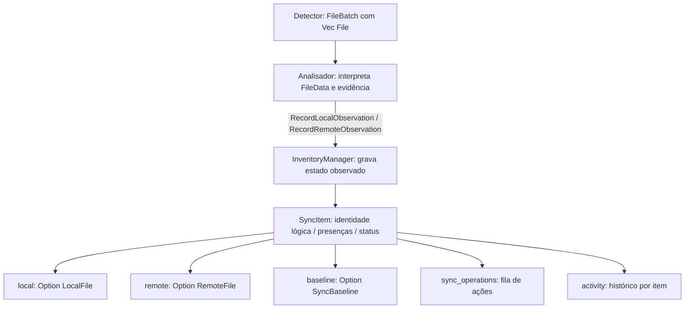
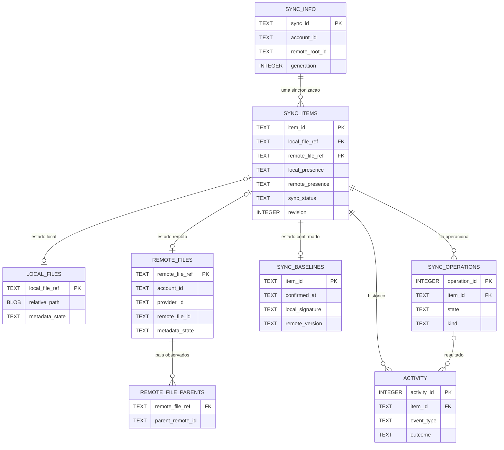

# Inventário — InventoryManager

## Objetivo

O **Inventário** é responsável exclusivamente pelo **acesso e pela persistência dos dados de cada pasta sincronizada**. Os demais módulos consomem suas interfaces e não executam SQL diretamente nesse banco. Dados globais da aplicação, contas e preferências **não** são responsabilidade do Inventário.

O Inventário registra identidades dos itens, metadados observados, vínculos, último estado confirmado, operações pendentes e atividades. A propriedade dos cursores/eventos remotos está pendente de revisão com Detector. Ele **não** observa o filesystem ou o Google Drive por conta própria, nem executa upload/download ou escolhe qual versão deve prevalecer em um conflito.

## Banco de dados por pasta sincronizada

Cada pasta sincronizada possui **seu próprio banco SQLite**, localizado em:

```text
<pasta-local-sincronizada>/
├── .drivesync/
│   └── inventory.sqlite3      # Arquivos, baseline, operações, eventos e histórico
└── arquivos-do-usuario/
```

O diretório oculto `.drivesync/` guarda o estado durável **daquela sincronização**, permitindo retomada após encerramento do aplicativo. Ele deve ser ignorado pelo detector local e **nunca enviado ao Google Drive**. A inexistência ou indisponibilidade da pasta local não comprova exclusão remota. Uma pasta com arquivos do usuário e inventário ausente não é sincronizada automaticamente sem processo seguro de associação.

**Histórico não tem banco separado:** a tabela `activity` permanece dentro de `inventory.sqlite3`, com relação obrigatória ao `SyncItem` correspondente.

### Fora do escopo deste módulo

- **Cadastro global de contas e pares de pastas:** pertence conceitualmente aos componentes `accounts/` e de gerenciamento de conexões, respectivamente.
- **Persistência global, se necessária:** fica **provisoriamente** sob `configuration/`, até decidir quais dados precisam de SQLite e quais podem utilizar armazenamento padrão do GNOME.
- **Preferências da aplicação:** avaliar `GSettings` (GLib/dconf), observando a distinção entre configurações e dados persistentes. GTK4/Wayland não impõem um banco SQLite para preferências.
- **Credenciais OAuth:** armazenamento seguro via Secret Service/keyring; não persistir segredos neste SQLite.

O Inventário **não abre nem gerencia um `app.sqlite3`**. A existência e o esquema desse banco global continuam como proposta pendente de revisão nos módulos responsáveis.

## 1. Modelo lógico do inventário e seus relacionamentos

O Inventário é o **proprietário de `SyncItem`**, identificador lógico persistente de um arquivo/diretório associado à sincronização. **Não redefine `LocalFile`, `RemoteFile`, `File` nem seus IDs**, que pertencem a [Models](../models/INTERFACES.md). `File.id` identifica uma **ocorrência** observada, enquanto `SyncItem.id` identifica o **item lógico** ao longo de múltiplas observações e operações.

### Encapsulamento — observado × registrado × confirmado



```text
File [models/]                           evento/observação, não entidade persistente estável
├── id: FileId                            identifica a ocorrência
├── event: FileEvent                      kind, previous, current
├── coverage / scope / observed_at
└── data: Option<FileData>
    ├── Local(LocalFile)
    └── Remote(RemoteFile)

                     ↓ Analisador / registro de observação

SyncItem [inventory/]                    item lógico e persistente
├── id: SyncItemId
├── kind: ItemKind
├── local: Option<LocalFile>              último estado local conhecido
├── remote: Option<RemoteFile>            último estado remoto conhecido
├── local_presence: PresenceState
├── remote_presence: PresenceState
├── baseline: Option<SyncBaseline>        último estado sincronizado confirmado
├── status: SyncStatus
├── conflict_reason: Option<String>
├── revision: u64                         controle otimista do item
├── last_checked_at: Option<Timestamp>
└── last_synced_at: Option<Timestamp>
```

**Não duplicar modelos:** o Inventário armazena o último estado conhecido de cada lado em `SyncItem`, **não** dois objetos `File` simultâneos ou `GoogleFile` específico da API. Eventos `File.event` são fatos observados; `SyncStatus`, `PresenceState` e `SyncBaseline` são conclusões/estados persistentes. `FileEventKind::Deleted` e `File.data=None` não são provas suficientes de `AbsentConfirmed`.

### Estruturas relacionais previstas (não DDL final)

| Estrutura | Chave conceitual | Conteúdo |
| --- | --- | --- |
| `sync_info` | singleton | `SyncId`, `AccountId`, raiz remota, geração e inicialização |
| `local_files` | identidade local interna / item vinculado | Metadados locais selecionados do **`models::LocalFile`**, com estados `MetadataValue<T>` preservados |
| `remote_files` | referência única por **conta + ID remoto** | Metadados remotos selecionados de **`models::RemoteFile`**, `ProviderId` e identidade do recurso |
| `remote_file_parents` | arquivo remoto + ID do pai | Relacionamentos remotos com pais quando observados; não inventar pai para resultado parcial |
| `sync_items` | `SyncItemId` | Relaciona último local/remoto, presenças, status, revisão e diagnóstico |
| `sync_baselines` | `SyncItemId` | Último estado **confirmado**, separado de observações |
| `sync_operations` | `OperationId` | Fila de ações, retry e precondições; distinta da fila de eventos do Detector |
| `activity` | `ActivityId` | Histórico com relação obrigatória a `SyncItem` |
| `remote_cursor` / `remote_events` (sobreposição pendente) | **PENDENTE de decisão de propriedade** | Contrato anterior do Inventário se sobrepõe a checkpoint do Detector Remoto e eventos do Detector Storage; **não implementar duplicação** |

`ProviderFileData` é um envelope de metadados específicos, **não conteúdo de arquivo**. Seu codec, campos selecionados e necessidade de retenção serão definidos antes de implementar. O Inventário não importa `GoogleFile` nem usa cliente de Google API. O princípio de **não serializar estruturas inteiras em JSON/BLOB indiscriminadamente** permanece; atributos complexos exigirão mapeamento revisado. Não truncar metadados recebidos silenciosamente depois de aceitar o registro.

### Diagrama lógico entidade-relacionamento



**Diagrama conceitual:** nomes `local_file_ref`, `remote_file_ref` e `metadata_state` são apenas indicadores de identidade/grupos, **não definição de colunas SQLite já aprovadas**. Preservar unicidade de `RemoteFileRef(account_id,file_id)`; IDs locais só são estáveis quando comprovados. `RemoteFile` pode ser de qualquer provedor suportado, sem tabela `google_files` no contrato genérico.

### Estados persistentes e regras de atualização

| Campo | Semântica |
| --- | --- |
| `SyncItem.local` / `remote` | Último snapshot observado e confiável, mesmo quando há reavaliação pendente |
| `local_presence` / `remote_presence` | `Unknown`, `Present`, `AbsentConfirmed`; somente prova suficiente permite ausência confirmada |
| `SyncBaseline` | Estado **anterior confirmado**, não avançado por observação nova |
| `SyncStatus` | Diagnóstico/condição aplicado pelo consumidor autorizado, não pelo Detector |
| `SyncItem.revision` | Revisão de concorrência do registro, independente de `File.id` ou versão remota |
| `sync_operations` | Fila persistente de operações de sincronização, separada do Detector Storage |

**Observação parcial:** `MetadataValue::NotCollected` não apaga valor anterior conhecido; `Known(false)`, `Known([])` e `Known(0)` são observações reais. Uma atualização precisa conservar o estado de coleta ou a prova de que houve nova inspeção completa. Não transformar `Unsupported`, `PermissionDenied` ou `Unavailable` em dados conhecidos.

**Associação:** `SyncItem` pode existir só no lado local, só no remoto, nos dois lados ou sem snapshot atual (tombstone), conservando vínculo e baseline até decisão segura. Movimentar ou renomear preserva `SyncItemId` quando a identidade foi correlacionada; o Analisador decide a correspondência, não o Inventário por nome semelhante.

### Fronteira com Detector / cursores

O [Detector Remoto](../detectors/remote/INTERFACES.md) declara `RemoteCheckpoint.read/commit`; o [Detector Storage](../detectors/storage/INTERFACES.md) persiste o `File` inteiro e reserva `FileBatch`. **O Inventário não deve implementar outra fila de entrega dos mesmos eventos ou avançar o cursor do Detector independentemente**. As quatro APIs antigas de cursores/eventos ainda aparecem na interface existente do Inventário e exigem decisão explícita de eliminação ou realocação **antes de implementar**. Não inventar compatibilidade, migração ou duplicação entre bancos; a revisão atual apenas aponta a sobreposição e mantém inalteradas as assinaturas não relacionadas.

## 2. Histórico como parte de `inventory.sqlite3`

**Histórico não é outro banco.** É a tabela `activity` dentro do mesmo `inventory.sqlite3` de cada pasta. Registra **o que aconteceu e qual foi o resultado**, enquanto `sync_items` representa o estado atual conhecido e `sync_operations` a fila operacional.

| Componente de dados | Pergunta respondida | Exemplo |
| --- | --- | --- |
| `sync_items` e `sync_baselines` | Como está o arquivo agora? Qual foi seu último estado sincronizado? | `relatorio.pdf` está pendente de upload |
| `sync_operations` | O que precisa ser executado, está em execução ou deve ser retomado? | Atualizar conteúdo remoto após reconexão |
| Detector Storage | Quais eventos detectados ainda exigem entrega/reavaliação? | Mudança remota aguardando análise; **fora do Inventário** |
| `activity` | O que foi feito ou tentado, quando, por quem/qual origem e com qual resultado? | Upload concluído às 15:32; tentativa anterior falhou |

### Quando registrar uma atividade

| Situação | Histórico? | Por quê? |
| --- | --- | --- |
| Upload/download concluído | Sim | Usuário pode consultar o que foi sincronizado |
| Renomeação, movimentação, criação, lixeira ou exclusão confirmadas | Sim | Registrar ação efetiva, direção e resultado |
| Operação que falhou ou foi interrompida | Sim, para falhas relevantes | Explicar a tentativa e permitir diagnóstico posterior |
| Conflito identificado ou resolvido para um arquivo | Sim | Registrar a ocorrência/resolução, sem criar tabela de conflitos |
| Suspensão/retomada geral da sincronização | **Não nesta tabela** | Não pertence necessariamente a um `SyncItem`; registrar em diagnósticos/estado global |
| Evento remoto recebido ainda não processado | **Não automaticamente** | É sinal técnico na tabela `remote_events`, não ação concluída |
| Releitura repetitiva sem alteração | Não | Evitar ruído e crescimento do histórico |
| Progresso de cada bloco transferido | Não | Progresso é estado de transferência, não acontecimento histórico |

A camada de análise/orquestração determina **quando o evento merece registro**; o Inventário valida e persiste a atividade. O histórico **não** determina automaticamente a política ou o resultado da sincronização. **Cada atividade pertence obrigatoriamente a um arquivo/diretório representado por `SyncItem`**; ocorrências globais da aplicação devem ser registradas por outro mecanismo.

### Campos da tabela `activity`

| Campo | Tipo lógico | Obrigatório? | Significado |
| --- | --- | --- | --- |
| `activity_id` | Inteiro / PK | Sim | Identificador próprio da atividade |
| `item_id` | FK → `sync_items.item_id` | **Sim** | Arquivo ou diretório ao qual a atividade pertence |
| `operation_id` | FK → `sync_operations.operation_id` | Não | Operação que originou o registro, quando aplicável |
| `event_type` | Enum textual | Sim | `upload`, `download`, `rename`, `move`, `delete`, `conflict`, `sync_paused` etc. |
| `origin` | Enum textual | Sim | `local`, `remote` ou `system` |
| `outcome` | Enum textual | Sim | `completed`, `failed`, `cancelled`, `blocked` ou `informational` |
| `occurred_at` | Timestamp | Sim | Instante registrado do acontecimento |
| `description` | Texto | Não | Resumo legível e sanitizado |
| `error_kind` | Texto/enum | Não | Classificação segura da falha, sem token nem dados secretos |
| `item_name` | Texto | Não | Nome conhecido naquele momento, para histórico legível após mudanças |
| `item_remote_id` | Texto | Não | ID remoto conhecido naquele momento, como evidência histórica |
| `item_local_path` | BLOB | Não | Caminho local da época, se necessário preservar bytes Unix |

**Imutabilidade:** uma atividade registrada não muda quando o arquivo é renomeado, movido ou removido posteriormente. Campos de referência podem ser opcionais e protegidos por política de retenção. A descrição não guarda payloads nem dados pessoais desnecessários.

### Integridade, retenção e transações

- `item_id` é uma **FK obrigatória** (NOT NULL) para `sync_items`. Para preservar atividades após a remoção física de um registro, **manter tombstones de `SyncItem`** enquanto houver histórico; não usar `ON DELETE SET NULL` nem `ON DELETE CASCADE` para `activity.item_id`. `operation_id` é FK opcional e pode usar política de retenção própria.
- Confirmar o resultado de uma operação, atualizar baseline, marcar a fila como concluída e inserir a atividade deve, quando for um mesmo resultado lógico, ocorrer na **mesma transação SQLite**.
- Um retry falho pode gerar atividade de falha, seguido de outra atividade de conclusão; são acontecimentos distintos, associados à mesma operação.
- Consultas do histórico devem ser paginadas e filtráveis por `item_id`, período, ação e resultado. Índices recomendados: `(occurred_at, activity_id)`, `(item_id, activity_id)` e `(operation_id, activity_id)`.
- Retenção e limpeza são políticas explícitas e independentes da limpeza de operações; não apagar registros silenciosamente durante uma sincronização.
- O histórico **não** substitui logs técnicos estruturados: stack traces, detalhes HTTP e diagnósticos operacionais detalhados pertencem ao sistema de logs, não à timeline do usuário.

### Exemplo de fluxo

1. O Detector emite `File` referente a `notas.txt`; o Analisador solicita atualização do Inventário, que atualiza `local_files`; o baseline **não** muda.
2. O Analisador autoriza upload; `sync_operations` recebe uma ação pendente.
3. O operador executa a ação e devolve resultado verificável.
4. Em transação, o Inventário atualiza os metadados confirmados, avança `sync_baselines`, marca a operação como concluída e insere em `activity`: **upload, origem local, concluído, horário**.
5. A interface pode consultar a atividade sem depender da fila ou dos nomes atuais do arquivo.

## 3. Regras relacionais e segurança

| Regra | Exigência |
| --- | --- |
| Persistência | Dados estruturados em linhas e colunas; **sem JSON/BLOB para serializar structs, listas, mapas ou filas** |
| Exceção BLOB | Somente valor binário individual, como bytes de nome Unix não UTF-8 |
| Integridade | FKs dentro do mesmo banco, **inclusive histórico**, índices, `UNIQUE`, `CHECK`, transações e `PRAGMA foreign_keys=ON` |
| Isolamento | `sync_info` deve corresponder ao `sync_id`, à conta e à raiz remota cadastradas |
| Versionamento | `PRAGMA user_version` valida a versão física; não implementar compatibilidade legada por padrão |
| Segurança | Tokens, client secrets e links de sessão confidenciais não são persistidos nesses bancos |
| Escalabilidade | Alterar um item não exige carregar ou regravar a árvore inteira |
| Exclusões | `unknown` não pode ser convertido em `absent_confirmed` por falha de leitura, rede ou acesso |
| Execução | Nenhum SQL exposto aos consumidores; nenhum upload/download/exclusão física pelo Inventário |
| Consulta | Associações e itens paginados; nomes/caminhos não substituem a identidade lógica |

## 4. Capacidades oferecidas pelo Inventário

| Interface conceitual | Resultado |
| --- | --- |
| Abrir/validar inventário de uma pasta | Escopo, esquema e integridade verificados |
| Buscar `SyncItem` por ID, ID remoto ou identidade local | Objeto unificado ou ausência |
| Listar itens por status, presença ou hierarquia | Resultados paginados |
| Registrar `File` contendo `LocalFile` ou `RemoteFile` | Atualização de um lado sem mudar o baseline |
| Associar registros | Chaves e unicidade preservadas |
| Confirmar baseline | Estado confirmado com transação e revisão |
| Inserir/consultar/reconhecer operação pendente | Fila durável |
| Cursores e eventos remotos | **Pendência de propriedade** com Detector Remoto/Storage; não duplicar |
| Consultar/registrar atividades | Tabela `activity` do mesmo inventário, com filtros e paginação |

A especificação de assinaturas Rust, parâmetros, retornos e erros pertence ao futuro `INTERFACES.md`; os cenários TDD pertencerão ao futuro `TESTS.md`. **O README é a única referência do modelo de bancos e das tabelas do Inventário.**
