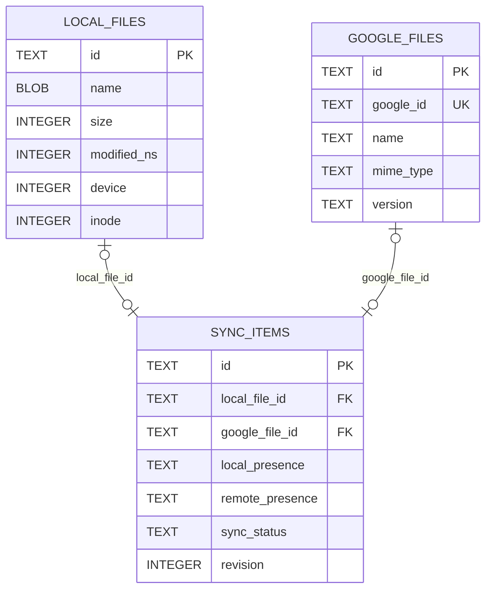

# Inventário — InventoryManager

## Objetivo

**Manter a identidade, os metadados observados e o estado confirmado dos arquivos e diretórios de cada sincronização.**

O Inventário é a referência persistente da engine sobre o que foi observado localmente, o que foi observado no Google Drive e o que foi **efetivamente confirmado como sincronizado**. Não executa upload, download ou operações físicas, nem decide qual lado deve prevalecer em um conflito.

Cada sincronização possui seu próprio inventário. Todos os demais módulos consultam e atualizam os dados **através do `InventoryManager`**, sem acesso direto às tabelas SQLite.

## Modelo conceitual

A entidade principal é **`SyncItem`**: o vínculo lógico entre o registro local, o registro remoto e o estado da sincronização. Os metadados são entidades independentes no banco.

| Entidade Rust | Tabela SQLite | Responsabilidade |
| --- | --- | --- |
| `LocalFile` | `local_files` | Metadados observados de arquivo/diretório no filesystem local |
| `GoogleFile` | `google_files` | Metadados observados de arquivo/diretório na API do Google Drive |
| `SyncItem` | `sync_items` | Associa os dois registros, mantém identidade lógica, presença observada, baseline e estado de sincronização |

`GoogleFile` é definido pela API pública de `google_api/`. `LocalFile` será definido pelo componente responsável pelos metadados locais; **seu conjunto completo de atributos ainda está em definição**. O Inventário trabalha com ambos como tipos externos e não passa a ser proprietário desses contratos.

### Relacionamentos



As colunas do diagrama são **ilustrativas**, não o esquema SQL definitivo.

| Regra | Comportamento |
| --- | --- |
| Um vínculo por objeto lógico | `SyncItem.id` é identidade interna estável e não depende de nome, caminho, inode ou ID do Google |
| Referências opcionais | `local_file_id` e `google_file_id` podem estar ausentes durante criação, descoberta, exclusão ou sincronização parcial |
| Vínculos exclusivos | Um registro local/remoto não deve pertencer a dois `SyncItem` da mesma sincronização |
| ID remoto estável | `google_id` não muda após renomeação ou movimentação no Drive |
| Identidade local | Caminho e inode são evidências de localização/identidade, mas nenhum deles é identidade lógica definitiva |
| Retenção segura | Um `SyncItem` pode permanecer mesmo sem representação atual em um dos lados, para preservar baseline e evidências |
| Integridade | Chaves estrangeiras, unicidade, validações e transações protegem associações; ausência de FK não é evidência de exclusão |

Os registros do banco são **representações observadas**, não cópias obrigatoriamente completas de todos os atributos públicos dos tipos Rust. A persistência seleciona colunas necessárias às consultas e à sincronização; campos adicionais podem ser incorporados por evolução do esquema. Listas e objetos não são serializados integralmente em BLOB/JSON para substituir relações.

## Objeto entregue aos consumidores

O `InventoryManager` monta um objeto unificado a partir das tabelas relacionadas, sem exigir que os consumidores realizem `JOIN` ou conheçam SQL.

```rust
// Modelo conceitual; assinaturas definitivas serão documentadas em INTERFACES.md.
pub struct SyncItem {
    pub id: SyncItemId,
    pub local: Option<LocalFile>,
    pub remote: Option<GoogleFile>,
    pub baseline: Option<SyncBaseline>,
    pub local_presence: PresenceState,
    pub remote_presence: PresenceState,
    pub status: SyncStatus,
}
```

`Option<LocalFile>` e `Option<GoogleFile>` indicam ausência de **representação associada na consulta**. Isso, por si só, não confirma que o objeto foi excluído no filesystem ou no Google Drive.

O vínculo e suas referências internas são persistidos em `sync_items`; a engine trabalha com o `SyncItem` montado, não com três registros isolados.

## Estado observado e baseline

São **três informações diferentes**:

| Informação | Origem | O que representa |
| --- | --- | --- |
| Estado local atual | Observação do filesystem | Metadados locais mais recentes que foram observados |
| Estado remoto atual | Observação via Google API | Metadados remotos mais recentes que foram observados |
| `SyncBaseline` | Confirmação de operação/verificação | Estado anterior comprovadamente sincronizado, usado na comparação |

`SyncBaseline` é parte da responsabilidade do `SyncItem`. Contém as referências e os atributos mínimos necessários à comparação (por exemplo, presença, versão, checksum, nome e localização anteriormente confirmados). **O baseline não é substituído por uma nova observação.** Ele só muda após confirmação verificável.

### Presença

| Estado | Significado |
| --- | --- |
| `unknown` | Não foi possível confirmar a situação atual |
| `present` | Presença confirmada pela observação |
| `absent_confirmed` | Ausência confirmada por observação válida |

A falta de rede, a perda de acesso, um campo omitido pelo Google, a indisponibilidade de uma pasta local ou a ausência de `LocalFile`/`GoogleFile` na consulta **não** autorizam inferir `absent_confirmed`.

### Situação de sincronização

| Estado | Significado |
| --- | --- |
| `pending_reconciliation` | Há alterações/observações ainda não analisadas |
| `pending_upload` | Operação de origem local está pendente |
| `pending_download` | Operação de origem remota está pendente |
| `synced` | Correspondência confirmada |
| `conflict` | Divergência que exige resolução ou política autorizada |
| `error` | Falha registrada que não implica necessariamente conflito |

O Inventário registra o estado, mas a escolha de ação e as políticas de conflito pertencem ao Analisador/Orquestrador.

## Responsabilidades e interfaces oferecidas

| Capacidade | Resultado esperado |
| --- | --- |
| Abrir/validar inventário | Verificar escopo de conta, pasta remota, pasta local e integridade |
| Buscar por `SyncItemId` | Retornar `SyncItem` completo ou ausência de registro |
| Buscar por ID remoto | Localizar o vínculo correspondente, sem depender do nome |
| Buscar por identidade/localização local | Localizar o vínculo usando critérios locais disponíveis e validados |
| Listar itens | Consultas paginadas/filtradas por estado, presença, localização ou hierarquia |
| Registrar observação local | Inserir/atualizar `LocalFile` e sua associação sem alterar automaticamente o baseline |
| Registrar observação remota | Inserir/atualizar `GoogleFile` e sua associação sem alterar automaticamente o baseline |
| Associar/desassociar representações | Manter FKs e identidade lógica com controle de integridade |
| Confirmar sincronização | Atualizar de forma atômica a confirmação e o baseline de um item |
| Registrar estado/conflito/erro | Persistir condições relatadas pelos componentes autorizados |
| Registrar/confirmar eventos remotos | Manter eventos pendentes e cursor de alterações duráveis |
| Consultar diferenças | Expor dados/indicadores comparáveis sem aplicar políticas de resolução |

Essas são **capacidades**, ainda não as assinaturas finais. Cada operação terá entradas, saídas, erros e testes próprios em `INTERFACES.md` e `TESTS.md`.

## Persistência

O inventário de cada sincronização permanece em:

```text
<pasta-local-sincronizada>/.drivesync/inventory.sqlite3
```

A pasta `.drivesync/` é reservada ao aplicativo, ignorada pelo detector local e nunca enviada ao Google Drive.

| Conjunto relacional | Finalidade |
| --- | --- |
| `sync_info` | Identificar e validar conta, raiz remota e inicialização da sincronização |
| `local_files` | Metadados locais observados |
| `google_files` | Metadados remotos observados |
| `sync_items` | Associação, identidade lógica, presença, baseline e status |
| `remote_cursor` | Cursores de observação de alterações no Drive |
| `remote_events` | Eventos remotos pendentes e reconhecimento individual |

O histórico de atividades permanece separado em `history.sqlite3`. O Inventário não cria tabela de conflitos independente nem mantém dados de autenticação.

**Regras de armazenamento:**

- A consulta e atualização de um item **não exigem** carregar/regravar todos os arquivos.
- Metadados relacionais são armazenados em colunas e tabelas próprias, não em objetos Rust serializados.
- `BLOB` pode representar um **valor binário individual**, como nome local Unix não UTF-8, mas não uma estrutura inteira.
- Transações e precondições de versão protegem gravações concorrentes e confirmações.
- A evolução de `LocalFile` ou `GoogleFile` não exige fundir novamente suas tabelas com `sync_items`.
- O esquema relacional definitivo, tipos SQL, índices e regras de remoção serão formalizados depois de revisar os atributos necessários.

## Limites de responsabilidade

O `InventoryManager` **não**:

- observa alterações diretamente no Google Drive ou filesystem;
- executa operações físicas de criação, edição, movimentação ou exclusão;
- decide upload, download ou qual versão deve prevalecer;
- considera arquivos excluídos apenas porque não foram encontrados em leitura incompleta;
- expõe SQLite, tabelas ou SQL como API aos demais componentes.

A implementação deve poder ser testada isoladamente com SQLite real em diretório temporário e objetos `LocalFile`/`GoogleFile` sintéticos.

## Continuidade da documentação

1. **`README.md` (este arquivo):** objetivo, modelo relacional conceitual, responsabilidades e capacidades.
2. **`INTERFACES.md`:** tipos próprios do Inventário, assinaturas Rust, entradas/saídas, contratos de erro e transações.
3. **`TESTS.md`:** casos de teste TDD de integridade, associação, consulta, atualização, concorrência e recuperação.
4. **`DATA_MODEL.md` global:** consolidar posteriormente o esquema SQL completo com as três tabelas e suas regras.

**Nota de consistência:** o [`docs/DATA_MODEL.md`](../../DATA_MODEL.md) atualmente descreve os metadados local e remoto na mesma tabela `sync_items`. **Esta documentação registra a decisão mais recente de separá-los** em `local_files`, `google_files` e `sync_items`; o esquema global precisará ser atualizado antes de orientar a implementação. Nenhuma migração ou compatibilidade com esquema antigo está sendo definida nesta etapa.
