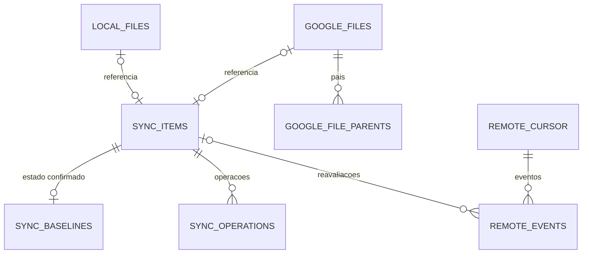

# Inventário — InventoryManager

## Objetivo

O **Inventário** é inicialmente o componente responsável pelo **acesso e pela persistência dos dados estruturados do DriveSync**, tanto os dados globais da aplicação quanto os dados de cada pasta sincronizada. Todos os demais módulos usam suas interfaces: **nenhum consumidor executa SQL diretamente**.

O Inventário registra identidades, metadados observados, vínculos, último estado confirmado, operações pendentes, cursores e atividades. Ele **não** observa o filesystem ou o Google Drive por conta própria, nem executa upload/download ou escolhe qual versão deve prevalecer em um conflito.

## Bancos de dados: quantos são e onde ficam?

O modelo prevê **três tipos de banco SQLite**: **um global da aplicação** e **dois por pasta sincronizada** (inventário e histórico).

| Banco | Quantidade | Localização | Finalidade |
| --- | --- | --- | --- |
| **Aplicação — `app.sqlite3`** | **1 por instalação/perfil** | `$XDG_DATA_HOME/drivesync/app.sqlite3` | Contas cadastradas, pares de pastas e preferências |
| **Inventário — `inventory.sqlite3`** | **1 por pasta sincronizada** | `<pasta-local>/.drivesync/inventory.sqlite3` | Arquivos, vínculos, baseline, fila de operações, eventos e cursor remoto |
| **Histórico — `history.sqlite3`** | **1 por pasta sincronizada** | `<pasta-local>/.drivesync/history.sqlite3` | Atividades e resultados daquela sincronização |

**Exemplo:** com três pastas sincronizadas, haverá um banco global e seis bancos nas pastas: **sete arquivos SQLite** ao todo.

```text
$XDG_DATA_HOME/drivesync/
└── app.sqlite3                         # Aplicação inteira

<Pasta A>/
├── .drivesync/
│   ├── inventory.sqlite3               # Arquivos e estado da Pasta A
│   └── history.sqlite3                 # Histórico da Pasta A
└── arquivos-do-usuario/

<Pasta B>/
└── .drivesync/
    ├── inventory.sqlite3               # Independente da Pasta A
    └── history.sqlite3
```

### Por que a pasta oculta `.drivesync/` existe?

É o diretório de **controle daquela sincronização**: acompanha a própria pasta, registra a última situação conhecida e permite retomar o trabalho após reiniciar a aplicação. Não é um diretório do usuário para enviar ao Google.

- **Nunca enviar** `.drivesync/` ao Google Drive; ignorá-lo no detector e nas operações.
- O banco acompanha **somente aquela pasta**, não compartilha dados de outra sincronização ou conta.
- A ausência/inacessibilidade da pasta local **suspende** a sincronização: não equivale a exclusão remota.
- Se não existe inventário válido e a pasta contém arquivos de usuário, **bloquear a sincronização inicial automática**. Não mesclar, sobrescrever nem excluir sem processo específico de associação.
- A pasta `.drivesync/` não conta como conteúdo do usuário ao verificar se uma pasta nova está vazia.

**Credenciais OAuth não ficam em nenhum desses bancos.** Tokens e segredos pertencem ao Secret Service/keyring. Logs técnicos gerais também não são atividades do histórico de uma pasta.

## 1. Banco da aplicação (`app.sqlite3`)

O banco global existe independentemente das pastas estarem acessíveis. Guarda o **cadastro de contas**, os **pares de sincronização** e as **preferências**.

| Tabela | Identidade | Dados principais |
| --- | --- | --- |
| `accounts` | `account_id` (PK) | `provider`, `provider_user_id` (Google OIDC `sub`), `email`, `display_name`, datas |
| `sync_connections` | `sync_id` (PK) | `account_id` (FK), `remote_root_id`, `local_root`, `enabled`, nome e data de criação |
| `app_preferences` | `key` (PK) | Tipo e valor escalar de uma preferência global |
| `sync_preferences` | `(sync_id, key)` (PK) | Tipo e valor escalar de uma preferência de uma pasta |

**Relações:** uma conta pode ter várias conexões; cada conexão associa exatamente uma conta a uma raiz remota e uma raiz local. Preferências específicas referenciam a conexão. Um e-mail **não** substitui a identidade estável `provider_user_id`.

**Regras:** não guardar árvores de arquivos, filas, tokens ou eventos remotos no banco global. A identidade da pasta deve impedir conexões indevidamente sobrepostas. No Flatpak, o XDG é resolvido dentro do ambiente da aplicação.

## 2. Banco da pasta sincronizada (`inventory.sqlite3`)

Este banco representa os arquivos e o processamento **de um único par de pastas**.

### Tabelas e relacionamentos

| Tabela | Chave | Conteúdo |
| --- | --- | --- |
| `sync_info` | `singleton=1` | `sync_id`, conta, raiz remota, geração, conclusão da sincronização inicial |
| `local_files` | `local_file_id` | Nome/caminho local, tipo, tamanho, horários, dispositivo, inode, checksum |
| `google_files` | `google_file_id` | `remote_id` exclusivo, nome, MIME, versão, tamanho, datas, hashes, lixeira e drive |
| `google_file_parents` | `(google_file_id, parent_remote_id)` | Uma linha por relacionamento pai do arquivo no Drive |
| `sync_items` | `item_id` | Vínculo com `local_file_id` e `google_file_id`, presença, status, revisão e horários |
| `sync_baselines` | `item_id` | Estado anterior **confirmado**: presença, nomes, pais, versões, hashes e instante |
| `sync_operations` | `operation_id` | Fila persistente de ações, estado, tipo, direção, tentativas e falhas |
| `remote_cursor` | `corpus` | Cursor de alterações remoto e geração correspondente |
| `remote_events` | `event_id` | Eventos de alterações remotas recebidos, pendentes ou reconhecidos |



As relações `sync_items.local_file_id` e `sync_items.google_file_id` são **FKs opcionais e únicas**. Assim, um item lógico pode existir só no local, só no Google, nos dois lados ou ficar temporariamente sem representação atual. A falta da referência **não prova exclusão**.

### `LocalFile`, `GoogleFile` e `SyncItem`

| Objeto Rust | Dono do contrato | Papel no Inventário |
| --- | --- | --- |
| `LocalFile` | Componente responsável pelos metadados locais (a definir integralmente) | Produz/representa uma observação local |
| `GoogleFile` | `google_api/` | Produz/representa uma observação remota |
| `SyncItem` | `inventory/` | Reúne as duas representações, baseline e situação de sincronização |

```rust
// Contrato conceitual, não assinatura definitiva.
pub struct SyncItem {
    pub id: SyncItemId,
    pub local: Option<LocalFile>,
    pub remote: Option<GoogleFile>,
    pub baseline: Option<SyncBaseline>,
    pub local_presence: PresenceState,
    pub remote_presence: PresenceState,
    pub status: SyncStatus,
}
```

O Inventário constrói o `SyncItem` a partir das tabelas relacionadas (por exemplo, com `LEFT JOIN`). A aplicação não precisa conhecer o esquema para consultar um arquivo.

Os atributos de `LocalFile` ainda poderão evoluir. Os de `GoogleFile` são orientados pelo contrato da Google API. **As tabelas guardam os atributos necessários à persistência**, não necessariamente uma cópia integral de todos os objetos externos. Campos opcionais não recebidos não se convertem automaticamente em zero, `false` ou exclusão.

### Presença, estado e baseline

| Campo/estado | Valores | Significado |
| --- | --- | --- |
| `local_presence`, `remote_presence` | `unknown`, `present`, `absent_confirmed` | Desconhecido, presença observada ou ausência efetivamente comprovada |
| `sync_status` | `pending_reconciliation`, `pending_upload`, `pending_download`, `synced`, `conflict`, `error` | Condição registrada para o Analisador/Orquestrador |
| `revision` | Inteiro positivo | Versão para evitar atualizações concorrentes obsoletas |
| `SyncBaseline` | Registro opcional por item | Último estado **efetivamente confirmado** em ambos os lados |

Uma observação atualiza metadados locais ou remotos **sem avançar o baseline**. Apenas a confirmação de uma operação concluída e verificada altera o baseline.

O baseline deve reter ao menos presença, nome, pai/localização, versão/assinatura e instante de confirmação. Ele é separado das tabelas de estado observado para evitar sobrescrever o passado ao detectar mudanças atuais.

### Fila de operações, cursores e eventos

| Estrutura | Campos/estados principais | Regra |
| --- | --- | --- |
| `sync_operations` | `item_id`, `direction` (upload/download), `operation_kind` (criar, conteúdo, renomear, mover, lixeira, excluir, restaurar), `state` (pendente, executando, retry, bloqueada, concluída, falha), `attempt_count`, `next_attempt_at`, precondição de versão | Registra trabalho durável, inclusive offline; não executa a ação |
| `remote_cursor` | `corpus`, `cursor`, `generation` | Representa até onde as alterações remotas foram observadas |
| `remote_events` | `corpus`, `remote_id`, `item_id?`, tipo, versão, `observed_at`, `processed_at?` | Evento só fica reconhecido após reavaliação explícita |

- Publicar o cursor de uma página e seus eventos deve ser **transacional** no inventário.
- Avançar o cursor não significa que os eventos foram processados.
- Depois de interrupção, recuperar a fila e os eventos pendentes e **reavaliar antes de repetir** escritas com resultado desconhecido.
- O Inventário persiste as operações, mas a **decisão de executá-las** pertence aos módulos de coordenação e análise.

## 3. Banco de histórico da pasta (`history.sqlite3`)

O histórico é separado para não misturar a fila e o estado atual com acontecimentos passados.

| Tabela | Campos principais | Finalidade |
| --- | --- | --- |
| `activity` | `id`, `item_id?`, `operation_id?`, `operation`, `origin`, `result`, `occurred_at`, `description?` | Registro cronológico de operações e resultados |

O Analisador determina quando uma atividade deve ser registrada; o Inventário fornece o contrato de escrita/leitura. `item_id` e `operation_id` são **referências lógicas**, não FKs SQLite entre bancos diferentes. Um histórico deve continuar legível mesmo após um arquivo deixar o inventário.

SQLite não oferece automaticamente uma única transação atômica para todas as gravações em arquivos separados; o contrato deverá prever confirmação, idempotência e recuperação de atividades quando necessário.

## 4. Regras relacionais e segurança

| Regra | Exigência |
| --- | --- |
| Persistência | Dados estruturados em linhas e colunas; **sem JSON/BLOB para serializar structs, listas, mapas ou filas** |
| Exceção BLOB | Somente valor binário individual, como bytes de nome Unix não UTF-8 |
| Integridade | FKs dentro do mesmo banco, índices, `UNIQUE`, `CHECK`, transações e `PRAGMA foreign_keys=ON` |
| Isolamento | `sync_info` deve corresponder ao `sync_id`, à conta e à raiz remota cadastradas |
| Versionamento | `PRAGMA user_version` valida a versão física; não implementar compatibilidade legada por padrão |
| Segurança | Tokens, client secrets e links de sessão confidenciais não são persistidos nesses bancos |
| Escalabilidade | Alterar um item não exige carregar ou regravar a árvore inteira |
| Exclusões | `unknown` não pode ser convertido em `absent_confirmed` por falha de leitura, rede ou acesso |
| Execução | Nenhum SQL exposto aos consumidores; nenhum upload/download/exclusão física pelo Inventário |
| Consulta | Associações e itens paginados; nomes/caminhos não substituem a identidade lógica |

## 5. Capacidades oferecidas pelo Inventário

| Interface conceitual | Resultado |
| --- | --- |
| Abrir/validar banco global | Contas, conexões e preferências disponíveis |
| Cadastrar/consultar conta e conexão | Identidades estáveis e par de raízes |
| Ler/gravar preferências globais e por sincronização | Valores escalares tipados |
| Abrir/validar inventário de uma pasta | Escopo, esquema e integridade verificados |
| Buscar `SyncItem` por ID, ID remoto ou identidade local | Objeto unificado ou ausência |
| Listar itens por status, presença ou hierarquia | Resultados paginados |
| Registrar `LocalFile` / `GoogleFile` | Atualização de um lado sem mudar o baseline |
| Associar registros | Chaves e unicidade preservadas |
| Confirmar baseline | Estado confirmado com transação e revisão |
| Inserir/consultar/reconhecer operação pendente | Fila durável |
| Atualizar cursor e registrar eventos | Escrita consistente |
| Consultar/registrar atividades | Histórico por sincronização |

A especificação de assinaturas Rust, parâmetros, retornos e erros pertence ao futuro `INTERFACES.md`; os cenários TDD pertencerão ao futuro `TESTS.md`. **O README é a única referência do modelo de bancos e das tabelas do Inventário.**
