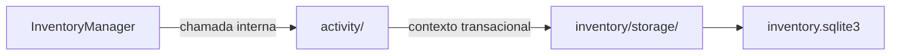

# Inventário / activity — Activity

> **Estado:** proposta documental de submódulo interno; **não é código Rust implementado**. A API pública continua em [InventoryManager](../INTERFACES.md), com 16 métodos.

## Objetivo e responsabilidade

Histórico persistente por arquivo/diretório via `SyncActivity`, distinto dos eventos técnicos do Detector.

## Entradas, operações e resultados

**Entradas:** `NewActivity`, `ActivityFilter`, `Pagination`, `SyncItemId` e `OperationId` opcional.

1. `append` — inserir atividade validada e associada ao item lógico.
2. `list` — consultar histórico de itens, operações e períodos com paginação.
3. Participar da transação coordenada de `confirm_sync` quando uma atividade for obrigatória.

**Saídas:** `SyncActivity` e páginas de histórico, sem alterar registros anteriores.

## Fronteiras e dependências

**Dependências permitidas:** Tipos do Inventário, FK e transações de `storage/`. A fachada valida associação com `items/` e `operations/`.

**Fora do escopo:** Não detecta eventos, não decide conflitos, não executa ações, não registra progresso por chunk nem eventos globais sem `item_id`.

Nenhum submódulo usa conexão SQLite própria; o contexto transacional pertence a [storage](../storage/INTERFACES.md). Regras que atravessam módulos são coordenadas por `InventoryManager`.

## Fluxo interno

Este diagrama representa **limites de responsabilidade**, não módulos de código já implementados.

## Decisões pendentes

Idempotência de atividade, retenção, sanitização de descrição e desempate da ordenação temporal. Não preencher as lacunas com comportamento presumido.

## Documentação

[INTERFACES.md](INTERFACES.md) — portas e assinaturas internas propostas.

[TESTS.md](TESTS.md) — matriz de cenários para o submódulo.

[AGENTS.md](AGENTS.md) — regras de implementação e validação.

[Inventário / README](../README.md) — visão de conjunto e composição.
