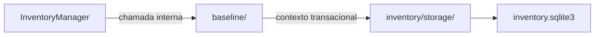

# Inventário / baseline — Baseline

> **Estado:** proposta documental de submódulo interno; **não é código Rust implementado**. A API pública continua em [InventoryManager](../INTERFACES.md), com 16 métodos.

## Objetivo e responsabilidade

Leitura e persistência do último estado local/remoto comprovadamente sincronizado, representado por `SyncBaseline`.

## Entradas, operações e resultados

**Entradas:** `SyncItemId`, `SyncBaseline`, `BaselineSide` e transação de confirmação autorizada por `InventoryManager.confirm_sync`.

1. `load` — recuperar o último baseline, inclusive ausência legítima (`None`).
2. `replace_confirmed` — substituir estado confirmado na transação compartilhada, após validação pela fachada.

**Saídas:** `Option<SyncBaseline>` ou confirmação interna de gravação, sem retornar decisão de sincronização.

## Fronteiras e dependências

**Dependências permitidas:** Tipos definidos em `inventory/INTERFACES.md`, transação de `storage/`; `items/`, `operations/` e `activity/` são coordenados pela fachada.

**Fora do escopo:** Não compara observações, não decide conflitos, não avança com evento de Detector, upload parcial ou ack de `FileBatch`.

Nenhum submódulo usa conexão SQLite própria; o contexto transacional pertence a [storage](../storage/INTERFACES.md). Regras que atravessam módulos são coordenadas por `InventoryManager`.

## Fluxo interno

Este diagrama representa **limites de responsabilidade**, não módulos de código já implementados.

## Decisões pendentes

Tipagem de `BaselineSide.parent_identity`, critérios de verificação, política de baseline para tombstone e persistência de campos opcionais. Não preencher as lacunas com comportamento presumido.

## Documentação

[INTERFACES.md](INTERFACES.md) — portas e assinaturas internas propostas.

[TESTS.md](TESTS.md) — matriz de cenários para o submódulo.

[AGENTS.md](AGENTS.md) — regras de implementação e validação.

[Inventário / README](../README.md) — visão de conjunto e composição.
