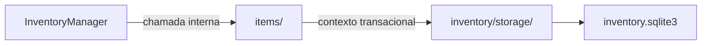

# Inventário / items — Items

> **Estado:** proposta documental de submódulo interno; **não é código Rust implementado**. A API pública continua em [InventoryManager](../INTERFACES.md), com 16 métodos.

## Objetivo e responsabilidade

Identidade lógica, vínculos, presença, status, revisão otimista e tombstones dos `SyncItem`.

## Entradas, operações e resultados

**Entradas:** `SyncItemId`, `ItemSelector`, `ItemFilter`, `ItemLinksChange`, `ItemStatusChange`, `ObservationProof`, `PresenceState`, `LocalFileId`, `RemoteFileRef`.

1. `resolve` — localizar o identificador lógico sem inferir identidade por nome.
2. `list_ids` e `load_header` — consultar itens/atributos estruturais para reconstrução pela fachada.
3. `create` — estabelecer identidade lógica única, sem fabricar presença.
4. `apply_links` — aplicar Keep/Set/Clear com verificação de revisão.
5. `set_presence` — registrar estado com prova de observação.
6. `set_status` — guardar diagnóstico definido pelo consumidor autorizado.

**Saídas:** `SyncItemId`, cabeçalho interno do item, estado e revisão verificados, ou `InventoryFailure`.

## Fronteiras e dependências

**Dependências permitidas:** `models/` para identidades; `inventory/storage/` para contexto de transação. `metadata/` e `baseline/` são coordenados pela fachada, não dependências diretas.

**Fora do escopo:** Não interpreta `FileEvent`, não realiza detecção, não compõe `LocalFile`/`RemoteFile`, não grava baseline ou histórico.

Nenhum submódulo usa conexão SQLite própria; o contexto transacional pertence a [storage](../storage/INTERFACES.md). Regras que atravessam módulos são coordenadas por `InventoryManager`.

## Fluxo interno

Este diagrama representa **limites de responsabilidade**, não módulos de código já implementados.

## Decisões pendentes

Correlação local sem `local_id`, política de tombstones, atualização de `ItemKind`, semântica de revisão em operações compostas, paginação. Não preencher as lacunas com comportamento presumido.

## Documentação

[INTERFACES.md](INTERFACES.md) — portas e assinaturas internas propostas.

[TESTS.md](TESTS.md) — matriz de cenários para o submódulo.

[AGENTS.md](AGENTS.md) — regras de implementação e validação.

[Inventário / README](../README.md) — visão de conjunto e composição.
