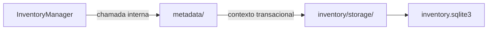

# Inventário / metadata — Metadata

> **Estado:** proposta documental de submódulo interno; **não é código Rust implementado**. A API pública continua em [InventoryManager](../INTERFACES.md), com 16 métodos.

## Objetivo e responsabilidade

Persistência e reconstrução dos atributos selecionados de `LocalFile` e `RemoteFile` definidos em `models/`.

## Entradas, operações e resultados

**Entradas:** `LocalFile`, `RemoteFile`, `SyncItemId`, `MetadataValue<T>`, `RemoteFileRef`, `ProviderFileData` quando autorizado.

1. `LocalMetadataRepository.apply/load` — armazenar e reconstruir metadados locais aprovados.
2. `RemoteMetadataRepository.apply/load` — armazenar e reconstruir metadados remotos aprovados.
3. Preservar estados de coleta/ausência de conhecimento sem inventar atributos.
4. Delegar o mapeamento SQL ao contexto interno de armazenamento.

**Saídas:** `Option<LocalFile>` ou `Option<RemoteFile>` com somente a informação realmente preservada; falhas tipadas.

## Fronteiras e dependências

**Dependências permitidas:** `models/` fornece tipos e semântica de metadados; `storage/` fornece transação; associação com `SyncItem` é coordenada por `InventoryManager`.

**Fora do escopo:** Não acessa filesystem, `statx`, Google API, `GoogleFile` nem credenciais; não classifica eventos, não decide presença/conflitos nem avança baseline.

Nenhum submódulo usa conexão SQLite própria; o contexto transacional pertence a [storage](../storage/INTERFACES.md). Regras que atravessam módulos são coordenadas por `InventoryManager`.

## Fluxo interno

Este diagrama representa **limites de responsabilidade**, não módulos de código já implementados.

## Decisões pendentes

Lista manter/sob demanda/descartar, representação de estados de coleta, DDL, limites, codec versionado e sanitização do envelope especializado. Não preencher as lacunas com comportamento presumido.

## Documentação

[INTERFACES.md](INTERFACES.md) — portas e assinaturas internas propostas.

[TESTS.md](TESTS.md) — matriz de cenários para o submódulo.

[AGENTS.md](AGENTS.md) — regras de implementação e validação.

[Inventário / README](../README.md) — visão de conjunto e composição.
