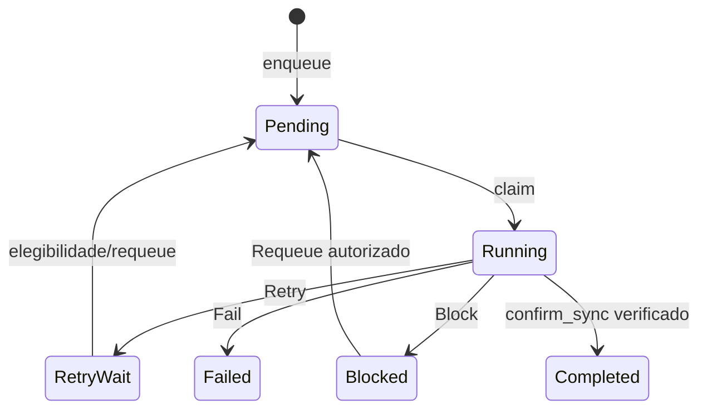

# Operations — contrato interno

**Estado:** porta de persistência proposta. `inventory/operations/` é proprietário da **fila de operações de sincronização** (`SyncOperation`), com estados, reservas, tentativas e confirmação persistentes.

## Responsabilidades

Persiste `OperationId`, `SyncItemId`, `OperationDirection`, `OperationKind`, `OperationState`, revisão-base, precondição de versão remota, tentativas, agendamento e erros. Controla claim atômico, retry, bloqueio, falha e requeue. **Não executa upload, download ou operações de Google Drive**, não escolhe políticas e não confirma baseline.

## Porta interna proposta

```rust
pub(crate) trait OperationRepository {
    fn enqueue(&self, tx: &mut InventoryTx<'_>, item_id: &SyncItemId,
               base_revision: u64, spec: &NewSyncOperation)
        -> InventoryResult<SyncOperation>;
    fn list(&self, tx: &mut InventoryTx<'_>, filter: &OperationFilter,
            pagination: &Pagination)
        -> InventoryResult<Page<SyncOperation>>;
    fn claim(&self, tx: &mut InventoryTx<'_>, request: &ClaimOperationRequest)
        -> InventoryResult<SyncOperation>;
    fn transition(&self, tx: &mut InventoryTx<'_>, request: &UpdateOperationRequest)
        -> InventoryResult<SyncOperation>;
    fn complete_verified(&self, tx: &mut InventoryTx<'_>, id: &OperationId,
                         item_id: &SyncItemId)
        -> InventoryResult<SyncOperation>;
}
```

Os tipos citados já constam de [Inventário — INTERFACES](../INTERFACES.md); `InventoryTx` é o contexto interno de storage. `complete_verified` **não é** um novo método público: só é invocado **pelo `InventoryManager.confirm_sync`**, na mesma transação que baseline, item e histórico. O nome/assinatura concretos serão revisados na implementação.

## Máquina de estados (existente no contrato público)



O diagrama **não** amplia `OperationTransition`: as transições exatas entre estados dependem de validações e dos métodos públicos `claim_operation`, `update_operation`, `confirm_sync`. `Completed` não pode ser produzido por `update_operation`, cuja enum `OperationTransition` não contém `Complete`.

## Segurança e idempotência

- Claim é atômico; duas reivindicações concorrentes não obtêm o mesmo trabalho em `Running`.
- `expected_state`, `base_item_revision` e `expected_remote_version` são precondições reais; ausência de versão não equivale a permissão para sobrescrever.
- `Running` recuperado após crash é **resultado desconhecido**: verificar efeito antes de repetir a operação, não assumir falha nem sucesso.
- `deduplication_key` só agrupa operações conforme política aprovada, nunca mistura contas, sincronizações ou itens.
- `RetryWait` exige elegibilidade temporal; erros tipados sanitizados não contêm tokens nem conteúdo do arquivo.
- Preservar operações pendentes em interrupções e falhas até uma transição válida de estado.

## Testes

Fila offline/reabertura; claim concorrente; transições válidas e inválidas; deduplicação; concorrência por revisão; retry; crash e reavaliação; conclusão atômica com baseline e atividade; preservação de `OperationDirection` e `OperationKind`. Nenhum teste precisa de API remota real.

**Pendente:** critérios exatos de claim/lease de worker, requeue de `Running`, elegibilidade e deduplicação entre operações sequenciais do mesmo item; não presumir um executor dentro do Inventário.
