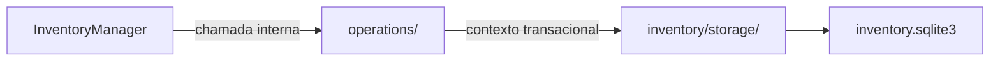

# Inventário / operations — Operations

> **Estado:** proposta documental de submódulo interno; **não é código Rust implementado**. A API pública continua em [InventoryManager](../INTERFACES.md), com 16 métodos.

## Objetivo e responsabilidade

Fila persistente `SyncOperation` de comandos de sincronização, separada da fila de observações do Detector.

## Entradas, operações e resultados

**Entradas:** `NewSyncOperation`, `OperationFilter`, `Pagination`, `ClaimOperationRequest`, `UpdateOperationRequest`, `OperationId`, `SyncItemId`.

1. `enqueue` — inserir operação persistente com revisão e chave de deduplicação, quando definida.
2. `list` — consultar filas e estados com filtros e paginação.
3. `claim` — reivindicar atomicamente uma operação elegível.
4. `transition` — aplicar retry, bloqueio, falha ou requeue conforme contrato.
5. `complete_verified` — conclusão somente durante `InventoryManager.confirm_sync`, na mesma transação de baseline e histórico.

**Saídas:** `SyncOperation` e páginas de operações, com estados e tentativas coerentes.

## Fronteiras e dependências

**Dependências permitidas:** Tipos do Inventário, contexto transacional de `storage/`, confirmação coordenada pela fachada.

**Fora do escopo:** Não executa upload/download, não monitora filesystem ou API remota, não define política de conflito, não marca `Completed` por simples retorno positivo de executor.

Nenhum submódulo usa conexão SQLite própria; o contexto transacional pertence a [storage](../storage/INTERFACES.md). Regras que atravessam módulos são coordenadas por `InventoryManager`.

## Fluxo interno

Este diagrama representa **limites de responsabilidade**, não módulos de código já implementados.

## Decisões pendentes

Elegibilidade e claim após crash, proteção de operações com resultado desconhecido, política de requeue e chave de idempotência. Não preencher as lacunas com comportamento presumido.

## Documentação

[INTERFACES.md](INTERFACES.md) — portas e assinaturas internas propostas.

[TESTS.md](TESTS.md) — matriz de cenários para o submódulo.

[AGENTS.md](AGENTS.md) — regras de implementação e validação.

[Inventário / README](../README.md) — visão de conjunto e composição.
