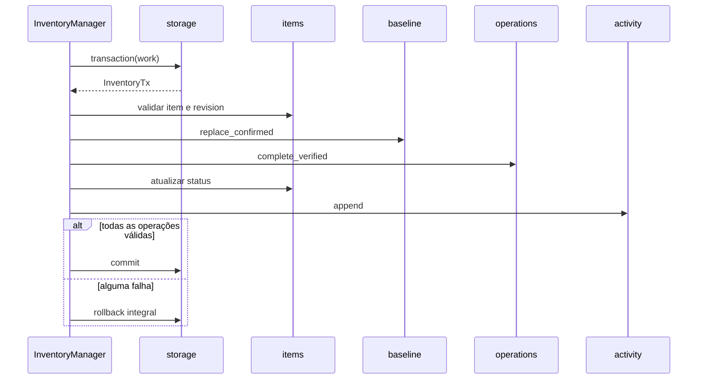

# Storage — contrato interno

**Estado:** infraestrutura e portas propostas para `inventory/storage/`. É o **único submódulo do Inventário que administra conexões, transações, esquema e erros SQLite**. Não é o `detectors/storage/` e não conhece `EventStore`.

## Propriedade e fronteira

- Um banco `<raiz-local>/.drivesync/inventory.sqlite3` **por sincronização**, validado por `SyncIdentity` (conta, `SyncId`, raiz remota). Não criar banco silenciosamente em pasta ocupada ou substituir banco incompatível.
- Esquema e relações conceituais de `sync_info`, `sync_items`, `local_files`, `remote_files`, `remote_file_parents`, `sync_baselines`, `sync_operations`, `activity`, conforme [README](../README.md). **Sem** `remote_cursor` ou `remote_events`.
- Centralizar abertura, `PRAGMA` apropriados após decisão técnica, integridade, transação e rollback. Traduzir erros para `InventoryFailure` sem expor SQL, caminhos pessoais ou conteúdo.
- `items/`, `metadata/`, `baseline/`, `operations/`, `activity/` acessam apenas o **contexto de transação interno**, sem abrir conexões independentes ou efetuar commits autônomos.

## Portas internas propostas

```rust
// Esboço contratual. InventoryTx e seus lifetimes ainda não são tipos Rust implementados.
pub(crate) trait InventoryStorage {
    fn open(&self, request: &OpenInventoryRequest)
        -> InventoryResult<StorageOpenResult>;
    fn read<T>(&self, work: impl FnOnce(&mut InventoryTx<'_>) -> InventoryResult<T>)
        -> InventoryResult<T>;
    fn transaction<T>(&self,
                      work: impl FnOnce(&mut InventoryTx<'_>) -> InventoryResult<T>)
        -> InventoryResult<T>;
}

pub(crate) struct StorageOpenResult {
    // Contexto privado de armazenamento + SyncInfo validado.
}

pub(crate) struct InventoryTx<'a> {
    // Contexto de leitura/escrita privado da transação, não uma Connection pública.
}
```

A forma acima é **ilustrativa**: o `impl Trait` em método de trait, retorno com `InventoryTx<'_>` e lifetimes precisam de revisão de ergonomia Rust. Nenhum desses tipos ou métodos deve escapar pela API pública. A abertura de `InventoryManager` continua sendo `open(OpenInventoryRequest)`.

## Fronteira de transação



O diagrama é **lógico**; a propriedade de commit/rollback permanece com `storage/`, mesmo que o contexto seja passado aos repositórios como empréstimo. `confirm_sync` é uma única transação: se falhar histórico, operação, baseline ou status, nada fica parcialmente concluído.

## Invariantes

1. Banco incompatível, corrompido, inacessível ou de outra sincronização: **erro**, jamais recriação destrutiva.
2. FK habilitadas, unicidade por conta para `RemoteFileRef`, revisão otimista e restrições de tombstone/histórico verificadas em SQLite real.
3. Não usar JSON/BLOB opaco para serializar `SyncItem` inteiro ou esconder tabelas relacionais; BLOB permitido para bytes locais específicos. `ProviderFileData` só após aprovação de codec e retenção.
4. Operação transacional é atômica e nenhum repositório faz `commit` unilateral.
5. Não compartilhar conexão, SQL, tabelas nem transação com `detector.sqlite3` ou outros bancos; retorno não inclui `Connection` ou `Transaction`.
6. Sem migrações de formatos legados nesta proposta. Esquema e provisionamento **futuros** precisam de validação antes do primeiro banco real.

## Testes

Criação/abertura e identidade; FK/UNIQUE/CHECK; duas sincronizações isoladas; concorrência de escrita, rollback, reabertura após commit, disco cheio/bloqueado/corrompido; ausência de exposição de SQL, credenciais e caminhos privados; nenhuma transação compartilhada com Detector.

**Pendentes:** DDL exato, índice/consulta, política WAL, busy timeout, provisionamento quando raiz indisponível, codec dos metadados escolhidos e opção para testes de crash em subprocesso.
