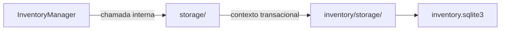

# Inventário / storage — Storage

> **Estado:** proposta documental de submódulo interno; **não é código Rust implementado**. A API pública continua em [InventoryManager](../INTERFACES.md), com 16 métodos.

## Objetivo e responsabilidade

Única infraestrutura de acesso ao SQLite de cada sincronização, incluindo abertura segura, integridade e transações.

## Entradas, operações e resultados

**Entradas:** `OpenInventoryRequest`, `SyncIdentity`, closures/operações internas sobre `InventoryTx<'_>` e estruturas dos repositórios.

1. `open` — validar identidade e existência sem recriar banco inválido.
2. `read` — oferecer acesso de leitura sob contexto privado.
3. `transaction` — executar trabalho multi-repositório com commit/rollback atômico.
4. Manter esquema, FK, índices e tradução de falhas SQL para `InventoryFailure`.

**Saídas:** Contexto de armazenamento validado, resultados genéricos ou erros sanitizados; jamais expor `Connection` para a API externa.

## Fronteiras e dependências

**Dependências permitidas:** Tipos públicos do Inventário apenas para identidade/erros; repositórios recebem `InventoryTx`, sem conexão independente.

**Fora do escopo:** Não interpreta `SyncItem`, não decide operações, não faz rede ou detecção, não acessa `detector.sqlite3` e não cria tabela `remote_events`/`remote_cursor`.

Nenhum submódulo usa conexão SQLite própria; o contexto transacional pertence a [storage](../storage/INTERFACES.md). Regras que atravessam módulos são coordenadas por `InventoryManager`.

## Fluxo interno

Este diagrama representa **limites de responsabilidade**, não módulos de código já implementados.

## Decisões pendentes

DDL final, WAL/locking, timeouts, provisionamento com raiz inacessível, índices, conexões e teste de crash em subprocesso. Não preencher as lacunas com comportamento presumido.

## Documentação

[INTERFACES.md](INTERFACES.md) — portas e assinaturas internas propostas.

[TESTS.md](TESTS.md) — matriz de cenários para o submódulo.

[AGENTS.md](AGENTS.md) — regras de implementação e validação.

[Inventário / README](../README.md) — visão de conjunto e composição.
