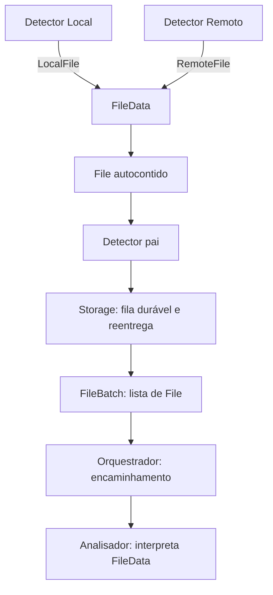

# Models — núcleo de domínio da engine

## Finalidade

`models/` define a **linguagem de dados compartilhada do DriveSync**. Detector, Inventário, Analisador e Operações devem trabalhar com os mesmos conceitos, sem criar representações incompatíveis de um arquivo.

O módulo **representa dados**. Não consulta APIs, não observa filesystem, não persiste, não resolve conflitos, não gerencia filas e não executa operações. Sua interface é formada por **tipos e invariantes**, não por uma trait de serviço ou um `ModelManager`.

## Hierarquia aprovada

```text
FileBatch                     [detectors/ — contrato de entrega]
└── files: coleção de File
    └── File                  [models/ — observação de arquivo]
        └── FileData          [models/ — variante dos dados]
            ├── Local(LocalFile)
            └── Remote(RemoteFile)
```

Os três conceitos são distintos e não devem ser reduzidos a um único tipo.

| Conceito | Quem define | O que significa | O que não faz |
| --- | --- | --- | --- |
| **`LocalFile`** | `models/` | Representação de dados observados em um item local | Não observa o disco |
| **`RemoteFile`** | `models/` | Representação normalizada de dados observados em um item remoto | Não chama a API; não é `GoogleFile` |
| **`FileData`** | `models/` | **Uma** das duas representações: local **ou** remota | Não decide o tratamento; não representa uma fila |
| **`File`** | `models/` | Objeto **autocontido de uma observação**, que encapsula `FileData` quando disponível e seu contexto de detecção | Não é o estado consolidado `SyncItem`; não executa alterações |
| **`FileBatch`** | [`detectors/`](../detectors/README.md) | Coleção de `File` preparada para entrega e confirmação pelo Detector pai | Não é modelo de arquivo; não interpreta os dados |

**Decisão sobre encapsulamento:** o Orquestrador recebe `FileBatch` com uma lista de `File` e **não precisa distinguir `LocalFile` de `RemoteFile`**. O Analisador inspeciona `FileData` e aplica as regras apropriadas. O Detector pai e seu Storage entregam/preservam os objetos; não resolvem diferenças ou conflitos.

## Fluxo conceitual



**Entrega:** o Storage mantém uma notificação completa pendente até reconhecimento seguro do consumidor. Uma entrega comum pode ter **um único `File`**, mas a interface é sempre um lote. O armazenamento é uma proteção contra falhas, não uma fonte para reconstruir metadados perdidos.

**Observação não equivale a estado atual:** um `File` expressa os fatos conhecidos em um instante; o Analisador pode exigir nova verificação antes de uma operação destrutiva. Em falhas de varredura, remoção suspeita ou indisponibilidade, poderá haver observação sem `LocalFile`/`RemoteFile` disponível; a representação exata desse caso será definida na etapa dos atributos, sem transformar ausência de dados em exclusão confirmada.

## Propriedade e limites

- `LocalFile`, `RemoteFile`, `FileData` e `File` pertencem a `models/`.
- `FileBatch` **não** pertence a `models/`; é o contrato de agregação/entrega do Detector.
- `GoogleFile` continua em [`providers/google/api/`](../providers/google/api/README.md); `RemoteFile` pode preservar metadados específicos de provedor sem importar o tipo Google.
- `SyncItem` **não será introduzido nem movido nesta etapa**. Sua posição será reavaliada **quando o planejamento do Inventário for revisado**.
- IDs e tipos auxiliares existentes devem ter um único proprietário; não duplicar `AccountId` ou criar aliases incompatíveis.

## O que foi aprovado e o que não foi

**Aprovado agora:** nomes `FileData`, `File`, `FileBatch`; relações de encapsulamento; divisão de responsabilidade; independência do Orquestrador em relação à origem local/remota; distinção entre observação e estado consolidado.

**Próxima etapa — ainda NÃO definida:** campos exatos, obrigatoriedade/opcionalidade, tipos de IDs, eventos, contexto, cobertura, data, localização, formato de metadados específicos, serialização e invariantes por atributo. Exemplos anteriores de structs e campos **não são contrato aprovado**.

A implementação futura deverá refletir **literalmente a especificação aprovada**, sem escolher atributos, variantes, comportamentos ou mecanismos de entrega por inferência. Não implementar enquanto essas definições permanecerem abertas.

## Estrutura documental

```text
docs/engine/models/
├── README.md       # conceitos, hierarquia, ownership
├── INTERFACES.md   # contratos de tipos; atributos ainda pendentes
├── TESTS.md        # critérios de teste conceituais; casos finais após atributos
└── AGENTS.md       # regras para implementação futura
```

A organização física futura do Rust também não está fixada. Este diretório é **documentação de arquitetura-alvo**, não descrição do código atual.

[INTERFACES.md](INTERFACES.md) · [TESTS.md](TESTS.md) · [AGENTS.md](AGENTS.md).
