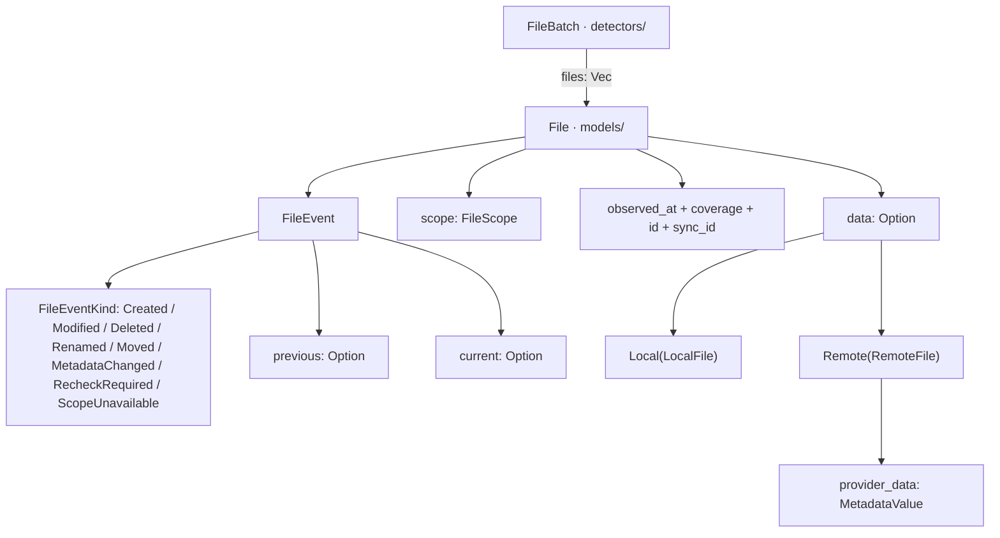
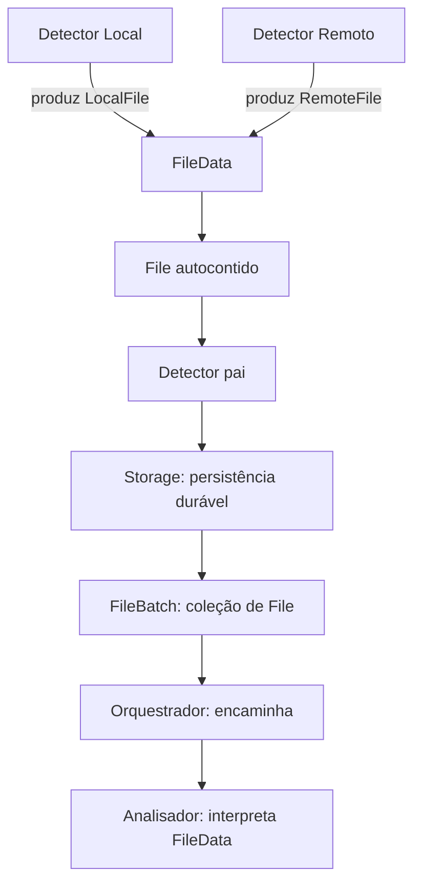

# Models — núcleo de domínio da engine

## Objetivo

`models/` representa os dados compartilhados do DriveSync. Os módulos funcionais observam, armazenam, analisam ou executam operações a partir desses dados; **Models não realiza I/O**, não sincroniza, não decide conflitos, não persiste e não expõe uma trait de serviço.

Os campos e invariantes estão em [INTERFACES.md](INTERFACES.md). O fluxo local tem seleção documental por atributo e testes definidos nesta revisão; a implementação será uma etapa separada. RemoteFile e ProviderFileData continuam catálogo proposto, aguardando revisão específica. Não completar lacunas por inferência.

## Hierarquia e propriedade

```text
FileBatch                         detectors/ — agrupamento e confirmação
└── files: Vec<File>
    └── File                      models/ — ocorrência autocontida
        ├── contexto do evento    id, sync_id, event, observed_at, coverage, scope
        └── data: Option<FileData>
            ├── Local(LocalFile)   models/ — atributos observados do filesystem
            └── Remote(RemoteFile) models/ — atributos remotos normalizados
                                      └── provider_data (opaco)
```

| Tipo | Proprietário | Papel |
| --- | --- | --- |
| `LocalFile` | `models/` | Representar metadados de item local observado |
| `RemoteFile` | `models/` | Representar metadados de item remoto observado, sem dependência concreta de Google |
| `FileData` | `models/` | Encapsular **uma** variante `Local` ou `Remote` |
| `File` | `models/` | Encapsular o arquivo observado e **todo o contexto conhecido da ocorrência** |
| `FileBatch` | `detectors/` | Agrupar `File` para entrega e reconhecimento; não interpretar a origem |
| `SyncItem` | **Reservado à futura revisão de `inventory/`** | Não criar nem mover agora |

## Atributos resumidos

### LocalFile

`LocalFile` contém o perfil selecionado para observar uma entrada abaixo da raiz, incluindo estados explícitos de coleta. A [matriz de seleção](INTERFACES.md#22-matriz-de-revisão-do-catálogo-local) justifica cada campo mantido, sob demanda ou descartado.

| Campo em LocalFile | Finalidade |
| --- | --- |
| local_id, relative_path | ID lógico opcional (None no coletor inicial) e caminho Unix não vazio |
| kind | Arquivo, diretório, link, especial ou tipo desconhecido |
| mode, owner | Bits de tipo/permissão e UID/GID numéricos; não comprovam acesso efetivo |
| times | mtime/ctime e btime quando disponível, com nanossegundos; sem atime |
| storage | Tamanho lógico, quantidade de hardlinks, inode e device amostrados |
| flags | Atributos statx e máscara de suporte, preservados em par quando disponíveis |
| symlink | Alvo literal somente em link simbólico; NotApplicable nos demais tipos conhecidos |

Os estados são Known, NotCollected, NotApplicable, Unsupported, PermissionDenied e Unavailable. O perfil básico obrigatório determina completude da coleta; btime e flags são opcionais à cobertura. Um objeto pode representar observação parcial coerente. Nenhum timestamp ou inode prova precedência, igualdade de conteúdo ou identidade persistente.

ACLs, xattrs, alocação, montagem/subvolume, flags específicas, Direct I/O e AtomicWrite ficam **sob demanda fora do envelope atual**, sujeitos à definição de consulta e limites no componente interessado. atime, rdev, blobs arbitrários e dados derivados não integram o modelo local. Esta seleção não autoriza copiar permissões ou metadados privados para a nuvem.

A raiz usa WholeSync com data=None; LocalRelativePath não admite vazio, absoluto, NUL ou componentes de escape. Validação lexical não substitui proteção física no adaptador. A coleta real é responsabilidade do coletor local, sem I/O em Models.

### RemoteFile — metadados reais e associação ao provedor

`RemoteFile` representa os **metadados remotos normalizados** e preserva **a associação ao recurso original do provedor**. O catálogo, as fontes e o exemplo `GoogleFile → RemoteFile` estão em [INTERFACES.md, seção 3](INTERFACES.md#3-remotefile--metadados-remotos-e-associação-ao-provedor).

| Grupo/atributo | Finalidade |
| --- | --- |
| `reference` | Identidade remota qualificada por conta (`AccountId + RemoteFileId`) |
| `provider` | Serviço de origem (Google etc.) |
| `identity` | Nome, descrição e nome original |
| `classification` | Tipo, MIME e extensões |
| `location` | IDs de pastas pais e container/drive |
| `times` | Criação, modificação, lixeira e visualização |
| `content` | Tamanho, quota, versões, revisões e hashes |
| `state` | Indicadores de lixeira, compartilhamento e propriedade |
| `access` | Capacidades genéricas quando efetivamente reportadas |
| `presentation` | Links web e imagens de apresentação |
| `provider_data` | Snapshot especializado, com provedor, formato, versão e payload opaco |

O **adaptador do provedor** transforma `GoogleFile` (ou outro tipo nativo) em `RemoteFile`, preenche dados comuns e conserva metadados especializados em `ProviderFileData`. A referência de conta e ID mantém o vínculo mesmo após renomear/mover. `models/` não importa `GoogleFile`, não lê API nem guarda credenciais.

A inclusão/remoção de campos do modelo deve exigir mudanças **somente no adaptador de metadados e nos consumidores interessados**, nunca na lógica de detecção remota, cursor ou fila.

**Antes da implementação**, revisar campos de todos os provedores: levantar tudo, depois classificar **manter / sob demanda / descartar** segundo utilidade, custo, dados sensíveis e suporte. Resposta parcial não equivale a atributo vazio ou exclusão.

### FileData

```rust
pub enum FileData {
    Local(LocalFile),
    Remote(RemoteFile),
}
```

O Orquestrador não precisa examinar a variante. O Analisador é responsável por interpretá-la.

### File — evento contextualizado

`id`, `sync_id`, `event`, `observed_at`, `coverage`, `scope`, `data?`.

`File.event` agora é um **`FileEvent`**, composto por `kind` (`FileEventKind`), `previous` e `current` (localizações opcionais). `FileEventKind` contempla **`Created`, `Modified`, `Deleted`, `Renamed`, `Moved`, `MetadataChanged`, `RecheckRequired` e `ScopeUnavailable`**.

`FileLocation` preserva caminhos locais ou referência remota com pasta pai e nome, quando conhecidos. Para renomeações/movimentos correlacionados, os valores anterior/atual acompanham a observação. `Deleted` não autoriza exclusão remota; pode ter `data=None`, mantendo escopo e localização conhecida para reavaliação.

**`id` identifica a ocorrência**, não o recurso remoto/local. O mesmo arquivo pode gerar várias ocorrências, e a mesma ocorrência mantém seu ID durante retry. O Analisador, e não o Orquestrador, interpreta a categoria e confronta os estados antes de agir.

### FileBatch

`FileBatch` **não é model da engine**: é um objeto de entrega de `detectors/` contendo uma coleção de `File`. IDs de lote, leases, política de ack e estado de fila são do Detector/Storage.

## Representação visual do encapsulamento



A estrutura textual equivalente mostra como **um objeto é encapsulado no seguinte**, independentemente da origem:

```text
FileBatch                           [detectors/]
└── files: Vec<File>                [um ou vários arquivos observados]
    └── File                        [models/]
        ├── id: FileId              [ID da ocorrência]
        ├── sync_id: SyncId
        ├── observed_at: Timestamp
        ├── coverage: ObservationCoverage
        ├── scope: FileScope
        ├── event: FileEvent
        │   ├── kind: FileEventKind
        │   │   ├── Created / Modified / Deleted / Renamed
        │   │   ├── Moved / MetadataChanged
        │   │   └── RecheckRequired / ScopeUnavailable
        │   ├── previous: Option<FileLocation>
        │   └── current: Option<FileLocation>
        └── data: Option<FileData>
            ├── Local(LocalFile)      [metadados reais locais]
            └── Remote(RemoteFile)    [metadados remotos]
                ├── reference        [conta + ID remoto]
                ├── provider         [provedor de origem]
                ├── identity / classification / location / times
                ├── content / state / access / presentation
                └── provider_data    [metadados específicos opcionais]
                    ├── provider / format / format_version
                    └── payload filtrado do objeto original
```

**O Orquestrador recebe o lote e encaminha os objetos sem discriminar `Local`/`Remote`.** O Analisador identifica a variante e verifica o evento. Um aviso de remoção pode não conter `FileData`; isso não comprova exclusão. `previous` e `current` são *localizações*, não duas cópias completas do arquivo.

## Regra de evolução: alterações em LocalFile não modificam o Detector Local

**Obrigatório:** incluir, remover ou reorganizar atributos de `LocalFile` **não pode exigir mudanças no código de observação, watcher, varredura ou notificações do Detector Local**. O Detector chama uma **interface estável de coleta**, recebendo um `LocalFile` pronto; não constrói o objeto campo a campo e não acessa seus atributos para decidir sua entrega.

A lógica de montagem dos campos fica em um **componente de coleta/adaptação de metadados locais**, com funções auxiliares para campos que exigem novas consultas (`statx`, symlink e extensões futuras com contrato próprio). Este componente pode evoluir junto com Models sem modificar o Detector. A interface estável é documentada na [integração do Detector Local](../detectors/local/INTERFACES.md); os modelos permanecem **puros, sem I/O**.

A regra é de isolamento do Detector: mudanças de esquema podem exigir ajustes no **coletor, nos testes e em consumidores que realmente usam o atributo**. Não pressupõe ausência absoluta de impacto em toda a engine. A seleção local está registrada nesta revisão; mudanças futuras devem atualizar matriz, contrato e testes antes de codificar.

## Fluxo de responsabilidades



A entrega normal pode transportar apenas uma ocorrência e ser imediata. O Storage preserva a ocorrência **antes** da entrega, para que falhas permitam reentregar o **mesmo `File`**; um ack só é seguro quando o consumidor assumiu duravelmente a responsabilidade ou concluiu o processamento conforme protocolo a definir no Detector.

## Regras de segurança e independência

- `models/` não depende de `detectors/`, `inventory/`, `providers/` nem de `operations/`.
- Dados de conta/autenticação, tokens e conexões **não entram em `File`**.
- Atributos opcionais representam dados indisponíveis/não observados, **não exclusão ou valores padrão presumidos**.
- `RemoteFile` transporta somente metadados de arquivo, não bytes do conteúdo.
- O `File` reflete o **instante da observação**, não garante estado atual na hora de análise.
- `SyncItem`, baseline e política de conflito ficam fora desta definição, aguardando revisão de Inventário.
- IDs do código atual devem ser reutilizados ou migrados explicitamente; não duplicar tipos existentes.
- `LocalRelativePath` preserva bytes Unix relativos à raiz sem normalização com perda.

## Etapas posteriores à seleção local

O contrato selecionado inclui validação pura de caminhos, timestamps, LocalFile e combinações locais de File. A implementação dos tipos locais pode ser planejada a partir desses casos, sem executar coleta ou alterar outros módulos.

O envelope compartilhado ainda referencia FileData::Remote(RemoteFile). Essa dependência precisa de revisão própria antes da implementação integral do envelope: não criar um modelo remoto fictício, remover sua variante ou implementar todos os campos remotos por inferência. A seleção local não aprova codificação, limite ou retenção de ProviderFileData.

## Documentação e estado

- [INTERFACES.md](INTERFACES.md): **fonte de verdade para nomes, tipos, obrigatoriedade e invariantes dos atributos**.
- [TESTS.md](TESTS.md): testes propostos diretamente derivados desses contratos.
- [AGENTS.md](AGENTS.md): critérios para implementação literal futura.

**Esta etapa é somente documental.** O Detector Local é alinhado às regras de caminho, cobertura e aplicabilidade sem mudar suas assinaturas. Não altera Rust, Scanner, Inventário, Storage, Remoto ou políticas de sincronização; não comprova coleta física nem durabilidade.
