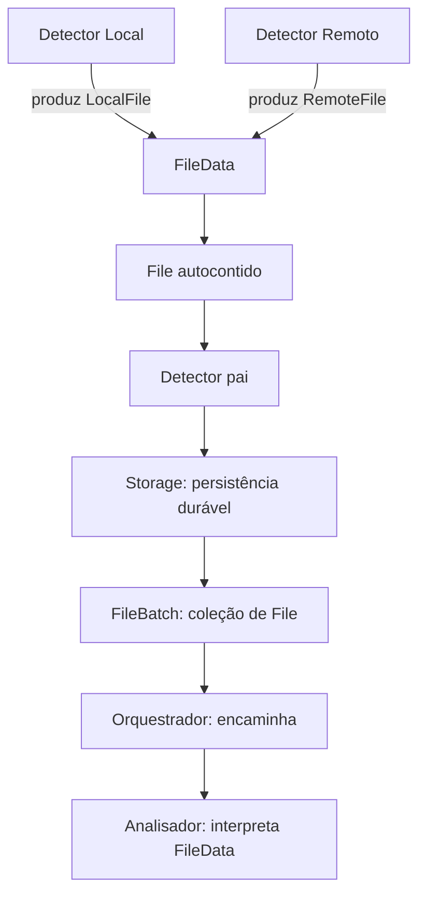

# Models — núcleo de domínio da engine

## Objetivo

`models/` representa os dados compartilhados do DriveSync. Os módulos funcionais observam, armazenam, analisam ou executam operações a partir desses dados; **Models não realiza I/O**, não sincroniza, não decide conflitos, não persiste e não expõe uma trait de serviço.

Os campos e invariantes estão **especificados em [INTERFACES.md](INTERFACES.md)** como proposta documental para revisão. A implementação futura deve seguir **literalmente o contrato que for aprovado**, e não completar lacunas por inferência.

## Hierarquia e propriedade

```text
FileBatch                         detectors/ — agrupamento e confirmação
└── files: Vec<File>
    └── File                      models/ — ocorrência autocontida
        ├── contexto do evento    id, sync_id, event, observed_at, coverage, scope
        └── data: Option<FileData>
            ├── Local(LocalFile)   models/ — atributos observados do filesystem
            └── Remote(RemoteFile) models/ — atributos remotos normalizados
                                      └── provider_data (opaco)
```

| Tipo | Proprietário | Papel |
| --- | --- | --- |
| `LocalFile` | `models/` | Representar metadados de item local observado |
| `RemoteFile` | `models/` | Representar metadados de item remoto observado, sem dependência concreta de Google |
| `FileData` | `models/` | Encapsular **uma** variante `Local` ou `Remote` |
| `File` | `models/` | Encapsular o arquivo observado e **todo o contexto conhecido da ocorrência** |
| `FileBatch` | `detectors/` | Agrupar `File` para entrega e reconhecimento; não interpretar a origem |
| `SyncItem` | **Reservado à futura revisão de `inventory/`** | Não criar nem mover agora |

## Atributos resumidos

### LocalFile

`LocalFile` representa **todos os grupos conhecidos de metadados reais da entrada Linux**, e não somente tamanho/data/hash. A estrutura completa, os tipos e os estados de coleta estão em [INTERFACES.md, seção 2](INTERFACES.md#2-localfile--metadados-reais-completos-do-linux).

| Campo em LocalFile | Metadados reais |
| --- | --- |
| `local_id`, `relative_path` | Identidade lógica opcional e caminho relativo em bytes |
| `kind` | Tipo de entrada: arquivo, diretório, symlink, FIFO, socket, dispositivo etc. |
| `mode`, `owner` | Bits de modo/permissões, UID/GID |
| `times` | atime, mtime, ctime, btime com nanossegundos |
| `storage` | Tamanho, blocos alocados, inode, links, dispositivos, montagem, subvolume |
| `flags` | Atributos statx/máscara de suporte e flags do filesystem |
| `direct_io`, `atomic_write` | Restrições e capacidades relatadas pelo filesystem |
| `xattrs`, `acl` | Atributos estendidos binários e ACLs POSIX |
| `symlink` | Alvo literal do symlink, sem seguir |
| `extra_metadata` | Complementos identificados por família/driver |

Cada metadado consultável distingue `Known(valor)`, `NotCollected`, `Unsupported`, `PermissionDenied` e `Unavailable`. **Completo significa que o modelo representa os campos e a situação real da coleta; não significa que o Linux forneça cada valor.**

`statx` não devolve sozinho ACLs, xattrs e todos os dados específicos do filesystem. Consultas adicionais são responsabilidade do Detector Local. **Hash de conteúdo e MIME inferido são dados derivados, não metadados intrínsecos do filesystem; o campo antigo `LocalFile.hash` foi removido.**

### RemoteFile

`reference`, `provider`, `name`, `kind`, `mime_type?`, `size_bytes?`, `modified_at?`, `version?`, `hash?`, `parent_ids`, `provider_data?`.

A referência combina conta + ID remoto. `parent_ids` distingue `Unknown` de `Known([])`. Metadados especializados permanecem opacos; a Google API conserva seus tipos `GoogleFile` em [providers/google/api/](../providers/google/api/README.md).

### FileData

```rust
pub enum FileData {
    Local(LocalFile),
    Remote(RemoteFile),
}
```

O Orquestrador não precisa examinar a variante. O Analisador é responsável por interpretá-la.

### File

`id`, `sync_id`, `event`, `observed_at`, `coverage`, `scope`, `data?`.

**`id` identifica a ocorrência**, não o recurso remoto/local. O mesmo arquivo pode gerar várias ocorrências, e a mesma ocorrência mantém seu ID durante retry.

O `File` não significa obrigatoriamente que o arquivo foi encontrado: em indisponibilidade ou necessidade de reavaliação, `data=None` preserva motivo e escopo sem inventar dados.

### FileBatch

`FileBatch` **não é model da engine**: é um objeto de entrega de `detectors/` contendo uma coleção de `File`. IDs de lote, leases, política de ack e estado de fila são do Detector/Storage.

## Fluxo de responsabilidades



A entrega normal pode transportar apenas uma ocorrência e ser imediata. O Storage preserva a ocorrência **antes** da entrega, para que falhas permitam reentregar o **mesmo `File`**; um ack só é seguro quando o consumidor assumiu duravelmente a responsabilidade ou concluiu o processamento conforme protocolo a definir no Detector.

## Regras de segurança e independência

- `models/` não depende de `detectors/`, `inventory/`, `providers/` nem de `operations/`.
- Dados de conta/autenticação, tokens e conexões **não entram em `File`**.
- Atributos opcionais representam dados indisponíveis/não observados, **não exclusão ou valores padrão presumidos**.
- `RemoteFile` transporta somente metadados de arquivo, não bytes do conteúdo.
- O `File` reflete o **instante da observação**, não garante estado atual na hora de análise.
- `SyncItem`, baseline e política de conflito ficam fora desta definição, aguardando revisão de Inventário.
- IDs do código atual devem ser reutilizados ou migrados explicitamente; não duplicar tipos existentes.
- `LocalRelativePath` preserva bytes Unix relativos à raiz sem normalização com perda.

## Aviso obrigatório antes de implementar — revisão de necessidade dos dados

**NÃO IMPLEMENTAR DIRETAMENTE O ESQUEMA COMPLETO SEM ESTA REVISÃO.**

A abordagem de documentação é **levantamento abrangente primeiro, seleção depois**: mapear todos os metadados reais conhecidos e potencialmente disponíveis, compreender a origem e a semântica de cada campo e **somente então decidir quais serão coletados, transportados, persistidos e efetivamente utilizados** pelo DriveSync.

Antes de escrever código, revisar cada grupo/atributo com base em requisitos concretos dos consumidores (Detector, Inventário, Analisador, Operações e UI). Registrar a decisão **manter, coletar sob demanda ou descartar** e a justificativa; distinguir dados baratos de obter de dados caros, sensíveis ou não suportados. Não presumir que estar documentado significa coleta obrigatória em toda varredura, nem que um campo deve ser armazenado ou sincronizado na nuvem.

**Até a revisão ser concluída, a listagem completa permanece um catálogo conceitual, não um contrato de implementação integral aprovado.**

## Documentação e estado

- [INTERFACES.md](INTERFACES.md): **fonte de verdade para nomes, tipos, obrigatoriedade e invariantes dos atributos**.
- [TESTS.md](TESTS.md): testes propostos diretamente derivados desses contratos.
- [AGENTS.md](AGENTS.md): critérios para implementação literal futura.

**Esta etapa é somente documental.** Não altera código Rust nem aprova implicitamente refatorações dos consumidores. Os contratos atuais de Detector Local, Detector pai, Storage e Inventário precisarão ser alinhados em revisões próprias.
