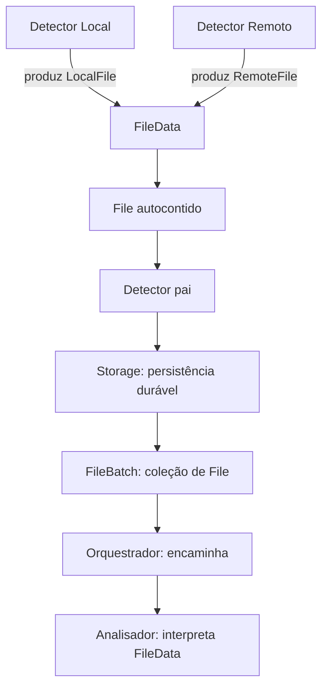

# Models — núcleo de domínio da engine

## Objetivo

`models/` representa os dados compartilhados do DriveSync. Os módulos funcionais observam, armazenam, analisam ou executam operações a partir desses dados; **Models não realiza I/O**, não sincroniza, não decide conflitos, não persiste e não expõe uma trait de serviço.

Os campos e invariantes estão **especificados em [INTERFACES.md](INTERFACES.md)** como proposta documental para revisão. A implementação futura deve seguir **literalmente o contrato que for aprovado**, e não completar lacunas por inferência.

## Hierarquia e propriedade

```text
FileBatch                         detectors/ — agrupamento e confirmação
└── files: Vec<File>
    └── File                      models/ — ocorrência autocontida
        ├── contexto do evento    id, sync_id, event, observed_at, coverage, scope
        └── data: Option<FileData>
            ├── Local(LocalFile)   models/ — atributos observados do filesystem
            └── Remote(RemoteFile) models/ — atributos remotos normalizados
                                      └── provider_data (opaco)
```

| Tipo | Proprietário | Papel |
| --- | --- | --- |
| `LocalFile` | `models/` | Representar metadados de item local observado |
| `RemoteFile` | `models/` | Representar metadados de item remoto observado, sem dependência concreta de Google |
| `FileData` | `models/` | Encapsular **uma** variante `Local` ou `Remote` |
| `File` | `models/` | Encapsular o arquivo observado e **todo o contexto conhecido da ocorrência** |
| `FileBatch` | `detectors/` | Agrupar `File` para entrega e reconhecimento; não interpretar a origem |
| `SyncItem` | **Reservado à futura revisão de `inventory/`** | Não criar nem mover agora |

## Atributos resumidos

### LocalFile

`local_id?`, `relative_path`, `kind`, `size_bytes?`, `modified_at?`, `hash?`.

Representa o que o Detector Local realmente observou. Um atributo opcional ausente **não** significa que o arquivo não existe.

### RemoteFile

`reference`, `provider`, `name`, `kind`, `mime_type?`, `size_bytes?`, `modified_at?`, `version?`, `hash?`, `parent_ids`, `provider_data?`.

A referência combina conta + ID remoto. `parent_ids` distingue `Unknown` de `Known([])`. Metadados especializados permanecem opacos; a Google API conserva seus tipos `GoogleFile` em [providers/google/api/](../providers/google/api/README.md).

### FileData

```rust
pub enum FileData {
    Local(LocalFile),
    Remote(RemoteFile),
}
```

O Orquestrador não precisa examinar a variante. O Analisador é responsável por interpretá-la.

### File

`id`, `sync_id`, `event`, `observed_at`, `coverage`, `scope`, `data?`.

**`id` identifica a ocorrência**, não o recurso remoto/local. O mesmo arquivo pode gerar várias ocorrências, e a mesma ocorrência mantém seu ID durante retry.

O `File` não significa obrigatoriamente que o arquivo foi encontrado: em indisponibilidade ou necessidade de reavaliação, `data=None` preserva motivo e escopo sem inventar dados.

### FileBatch

`FileBatch` **não é model da engine**: é um objeto de entrega de `detectors/` contendo uma coleção de `File`. IDs de lote, leases, política de ack e estado de fila são do Detector/Storage.

## Fluxo de responsabilidades



A entrega normal pode transportar apenas uma ocorrência e ser imediata. O Storage preserva a ocorrência **antes** da entrega, para que falhas permitam reentregar o **mesmo `File`**; um ack só é seguro quando o consumidor assumiu duravelmente a responsabilidade ou concluiu o processamento conforme protocolo a definir no Detector.

## Regras de segurança e independência

- `models/` não depende de `detectors/`, `inventory/`, `providers/` nem de `operations/`.
- Dados de conta/autenticação, tokens e conexões **não entram em `File`**.
- Atributos opcionais representam dados indisponíveis/não observados, **não exclusão ou valores padrão presumidos**.
- `RemoteFile` transporta somente metadados de arquivo, não bytes do conteúdo.
- O `File` reflete o **instante da observação**, não garante estado atual na hora de análise.
- `SyncItem`, baseline e política de conflito ficam fora desta definição, aguardando revisão de Inventário.
- IDs do código atual devem ser reutilizados ou migrados explicitamente; não duplicar tipos existentes.
- `LocalRelativePath` preserva bytes Unix relativos à raiz sem normalização com perda.

## Documentação e estado

- [INTERFACES.md](INTERFACES.md): **fonte de verdade para nomes, tipos, obrigatoriedade e invariantes dos atributos**.
- [TESTS.md](TESTS.md): testes propostos diretamente derivados desses contratos.
- [AGENTS.md](AGENTS.md): critérios para implementação literal futura.

**Esta etapa é somente documental.** Não altera código Rust nem aprova implicitamente refatorações dos consumidores. Os contratos atuais de Detector Local, Detector pai, Storage e Inventário precisarão ser alinhados em revisões próprias.
