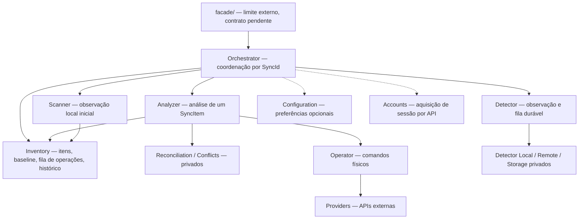
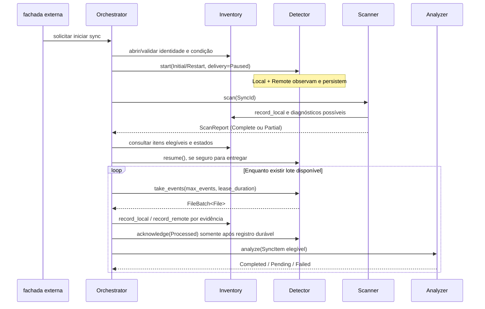

# Orchestrator — coordenação interna da sincronização

## Objetivo

Coordenar o ciclo de vida e a continuidade de **uma sincronização identificada por `SyncId`** por meio das APIs públicas de Detector, Scanner, Inventory e Analyzer. Não inspeciona SQL, não consulta diretamente APIs de provedores, não executa Operator nem reimplementa regras de reconciliação/conflitos.

As seções de coordenação completa descrevem a **API interna conceitual da engine**; a composição mínima compilada está na seção final. Não definem a API externa completa de `facade/`. A hipótese inicial é um fluxo de coordenação por sincronização pertencente a uma conta; **não** fixa uma instância global/per-account/per-sync, número de workers, threads ou concorrência de upload/download. A composição de instâncias é decisão posterior.

## Diagrama de responsabilidades

Uma seta é uma dependência **de contrato**, não acesso a detalhes internos. Detector, Scanner e Analyzer não invocam o Orchestrator de volta para executar operações; sinais externos de disponibilidade são notificações leves, não entrega dos `File` por callback.

## Responsabilidades exclusivas

1. Associar um contexto de coordenação a um `SyncId` e sua conta/raízes já validadas; não definir aqui quem persiste o cadastro de conexões (ainda pendente).
2. Decidir **quando** iniciar, pausar a entrega, retomar consumo ou interromper explicitamente o Detector. `start` inicia Local e Remoto juntos.
3. Solicitar e aguardar `Scanner::scan`; consultar seu relatório e cobertura antes de permitir análises que dependam dessa cobertura. O Scanner grava as observações locais pelo Inventory; o Orchestrator não duplica a varredura.
4. Consumir lotes do Detector pela sua API (`take_events`, `acknowledge`, `release_events`) e **projetar observações** no Inventory por `record_local/record_remote` mediante evidências, identidade e revisão.
5. Converter resultados persistidos do Inventory em `AnalyzeRequest { item, resolution }`, solicitando `Analyzer::analyze` para itens elegíveis; não interpretar diffs nem criar `OperationCommand`.
6. Encaminhar resultados `Completed`, `Pending` e `Failed` à camada externa usando estado e histórico confiáveis. Retomar um conflito somente com `Resolution` íntegra e revalidada pelo Analyzer.
7. Consolidar estados rápidos de Scanner/Detector/Analyzer/Inventory/Accounts sem reexecutar trabalho; expor diagnósticos e erros sem alegar percentuais não comprovados.
8. Coordenar parada e recuperação de falhas estruturais sem converter banco reconstruído, falta de eventos ou ausência de leitura em exclusão confirmada.

## Fluxo de inicialização seguro

**Barreira de inicialização:** `start(delivery=Paused)` precede `scan()` para captar mudanças concorrentes; entrega suspensa **não** suspende coleta. Scanner é apenas local; a cobertura remota depende do Detector Remoto e das evidências disponíveis. `ScanReport::Partial` não vira `Complete` por política. A decisão sobre elegibilidade de um item exige evidências suficientes e pode produzir reobservação ou `Pending`; não pressupor uma rodada remota concluída apenas porque o Scanner terminou.

**Atenção:** `Detector.pause/resume` controla entrega, **não** observação; `Detector.stop` encerra observação e desloca para esta coordenação as consequências do intervalo não observado. `request_scan` é uma solicitação de **observação adicional no Detector** e não substitui `Scanner.scan` de reconstrução do Inventário.

## Consumo durável: do evento ao item

O Detector entrega `FileBatch { batch_id, files: Vec<File> }`. O Analyzer **não** recebe `File` nem `FileBatch`; recebe `SyncItem`.

1. Validar `File.sync_id`, origem/variante `FileData`, escopo e evidências sem reinterpretar campos específicos do provedor.
2. Resolver `ObservationTarget` pela API do Inventory: identidade remota qualificada, identidade local, item existente ou criação somente quando a unicidade estiver comprovada. Caminho/nome sozinho não prova identidade global. Se não resolver de forma inequívoca, registrar necessidade de reobservação e **não inventar** associação.
3. Traduzir observação em `RecordLocalObservation` ou `RecordRemoteObservation`, com `PresenceState`, `ObservationProof` e revisão esperada. `Deleted`, `data=None`, cobertura incompleta e erro de fonte não autorizam `AbsentConfirmed` sem prova independente.
4. Confirmar o lote no Detector **somente depois de todas as observações daquele lote estarem duravelmente registradas e de o Inventário preservar a necessidade de reanálise de cada item afetado** (ou de descarte explícito aprovado pela política). Se qualquer registro falhar, `release_events` quando válido, ou permitir expiração e redelivery. Não descartar parte de um lote usando `Processed` global.
5. Selecionar `SyncItemId` afetados usando resultados efetivamente persistidos; consolidar apenas **requisições de análise**, não fundir/remover as ocorrências do Detector. Uma nova observação pode exigir outra análise após a primeira.
6. Chamar Analyzer sobre snapshot atual do item obtido do Inventory; não criar uma cópia concorrente do estado nem antecipar decisões físicas.

**Segunda lacuna de continuidade:** `record_local/record_remote` não garantem expressamente que a gravação deixe o item em `PendingReconciliation` ou crie uma intenção durável de reanálise. Se o Detector receber ack e a aplicação cair **antes** de `Analyzer::analyze`, os eventos já não estarão na fila. É necessário formalizar o marcador durável de trabalho pendente no Inventário e seu mecanismo de recuperação/listagem antes de tratar esse fluxo como fechado.

**Fronteira de atomicidade:** o ack da fila do Detector e a gravação do Inventory ocorrem em **bancos distintos**, sem transação distribuída documentada. Uma queda após `record_*` e antes de `acknowledge` provoca redelivery. A versão atual de Inventory **ainda não documenta deduplicação persistente por `File.id`**; logo a garantia de reprodução sem efeitos duplicados fica **BLOQUEADA** até adicionar contrato de idempotência de observação ou confirmação de ingestão por ID. Não marcar o lote `Processed` antes da durabilidade do Inventory apenas para esconder esse problema.

## Continuidade de análise e resolução

O Analyzer processa um item por chamada e pode executar várias operações pelo Operator. `Completed` exige efeitos verificados e baseline confirmado por API do Inventory. `Pending` encerra a chamada e traz `PendingId`, opções, evidências e contexto; `Failed` preserva efeitos parciais. `Analyzer::status(item_id)` é fotografia transitória da execução ativa, não histórico.

O Orchestrator **não mantém uma segunda fila de eventos**: a fila de detecção pertence ao Detector e a fila de intenções/estado das operações pertence ao Inventory. Também não deve usar uma lista em memória de `PendingAction` como única fonte de recuperação. O Inventory atualmente **não oferece API de armazenamento/consulta de `PendingAction` e `Resolution`**. Até fechar essa interface, entrega de pendências à fachada e reinício após crash devem ser registrados como **lacuna de integração**, não como persistência existente.

Decisão externa não autoriza `Operator` diretamente: após recuperar a pendência e verificar identidade/versão/escopo, a fachada encaminha ao Orchestrator e este reinvoca `Analyzer::analyze` com `resolution=Some(...)`. O Analyzer valida novamente as evidências e pode devolver outra pendência.

## Recuperação, pausas e erros

- Pausa de **consumo**: `Detector.pause`; Local/Remote continuam produzindo eventos e o banco de Detector os guarda. O Orchestrator não cria fila paralela.
- Parada **física**: `Detector.stop` interrompe observação; preservar dados e sinalizar a necessidade de verificar lacunas na reabertura. O Orchestrator não deve presumir cobertura no intervalo.
- Armazenamento indisponível: não reconhecer evento como ingerido ou operação concluída; tornar condição observável e não realizar mutações inseguras.
- Após restauração/reconstrução de Inventory ou Detector Storage, solicitar observação adequada para repor o estado confiável. Backups não provam que filesystem/nuvem continuam iguais ao snapshot.
- Operação remota de resultado incerto: não mandar repetir cegamente; aguardar reobservação e análise segura.
- Falha parcial de Local ou Remote: Detector informa `Degraded` e estados individuais, que permanecem visíveis; manter fonte saudável quando possível.
- Nenhuma etapa usa `EventDisposition::Discarded` para limpar erros ou ignorar eventos sem motivo explícito e auditável.

## Status agregado

A coordenação pode oferecer status conceitual `Idle / Starting / Observing / Reconciling / NeedsAttention / Degraded / Stopping / Stopped / Failed`; **não** é necessário fixar enum público antes de revisar `facade/`. Cada campo deve se basear em estados já documentados e não ser uma segunda máquina de estados incompatível. `Analyzer::status` e `Scanner::status` são por execução; `Inventory::status` é disponibilidade; `Detector::status` é estado, entrega e atividade de ambas as fontes.

## Decisões em aberto (não inventar implementações)

1. API externa de `facade/` não está transcrita na branch `docs/current-architecture`: seus dois arquivos `README.md` estão vazios. Este documento **não** define assinaturas de facade nem substitui a API de código atual.
2. Persistência/recuperação de `PendingAction`, decisões e evidências por item.
3. Ingestão idempotente `File.id`, **marcador durável de análise pendente** e ack coerente entre Detector Storage e Inventory.
4. Fonte de prova, geração/cobertura e persistência dos diagnósticos de `Scanner`; cobertura remota inicial.
5. Propriedade do cadastro de conexões `SyncId/AccountId` e preparação segura da pasta inicial com dados locais.
6. Composição física, compartilhamento de instâncias por conta/sync, escalonamento, worker pools e política de concorrência: **adiados**.
7. Recuperação de operações `Running` e persistência/reconstrução de planos completos; assunto de integração Analyzer–Inventory, não execução direta pelo Orchestrator.

**Estado:** contrato-alvo documental, sem implementação Rust ou testes executados.

## Etapa mínima compilada — inicialização local e conector

A solicitação posterior do usuário autoriza uma composição pública mínima: `Orchestrator::new(Engine, LocalDetectorCreateRequest)` instancia o detector local em Stopped. `start/stop/status` controlam essa instância e `connector()` expõe o conector existente à futura interface externa. A UI atual e a API Engine permanecem sem alterações.

A abertura do conector continua em Engine::open. Start/stop bloqueiam e devem rodar fora da thread de UI; status não faz I/O. Os eventos vão ao sink configurado, sem fila própria ou processamento pelo Orchestrator. Cadastro/ownership de sincronizações, detector remoto e os fluxos completos acima permanecem futuros. Contratos compilados: [INTERFACES](INTERFACES.md#etapa-mínima-compilada--inicialização-local-e-conector).
