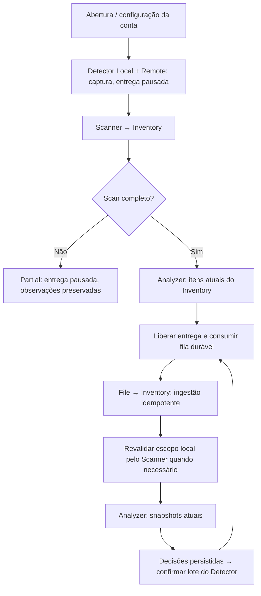

# Orchestrator

A sessão da aplicação executa o fluxo real de observação e análise: inicia os dois
detectores com entrega pausada, aguarda o Scanner, analisa o Inventory e libera
um consumidor contínuo dos eventos locais e remotos. O console acompanha a mesma
sessão; abrir uma página não inicia um pipeline paralelo.

**Este fluxo não executa sincronização física.** O Analyzer identifica e registra
upload, download e conflitos para intervenção manual; o Operator não é chamado,
operações ficam bloqueadas e o Orchestrator não confirma baseline. Requisitos
faltantes permanecem explícitos, sem transformar incerteza em conflito.

## Funcionamento contínuo

O callback público de disponibilidade desperta um worker da sessão, sem guardar
uma segunda fila de `File` em memória. O worker usa apenas `take_events`,
`record_local`/`record_remote`, consultas do Inventory, Scanner e `Analyzer::analyze`.
Uma mesma sessão não tem dois consumidores. A preparação inicial ainda funciona
quando chamada pelo loop GLib sem runtime Tokio no chamador.

Cada `File` associável conserva identidade e payload originais ao ser registrado
no Inventory. Reentrega usa o recibo durável por `File.id`. Identidades remotas são
qualificadas por conta; caminhos locais localizam somente o lado local, sem parear
arquivos locais/remotos pelo nome. Metadados ausentes não provam exclusão.

Observações locais antigas, exclusões suspeitas, diretórios e avisos de captura
reconstruída usam o Scanner existente para revalidar o estado atual. Um aviso de
início já coberto por scan completo não exige repetir a varredura. Um caminho que
sumiu antes de qualquer associação pode ser resolvido por rechecagem do escopo,
sem inventar tombstone ou SyncItem vazio. Avisos técnicos da raiz remota permanecem
no diagnóstico do Detector e não viram arquivos fictícios no Inventory.

## Confirmação e falhas

O lote só recebe `Processed` depois da ingestão, rechecagem necessária e análise
concluídas com persistência. Falha, cancelamento ou scan parcial libera o lote
inteiro sem ack. Nenhum caminho usa `Discarded`. O prefixo já registrado permanece
válido e pode ser reenviado sem duplicar seu recibo de observação.

Falha técnica pausa a entrega e fica visível em `preparation_status`; as fontes
continuam guardando eventos. Nova preparação retira o worker antigo, reconstrói o
estado pelo Scanner e retoma os eventos pendentes. Um scan parcial mantém `Partial`
e não confirma seu lote. Não existe transação distribuída entre os dois bancos:
a segurança depende de reentrega e idempotência, não de ack antecipado.

Os lotes são limitados a 64 eventos, com lease de cinco minutos pela API existente.
Após queda abrupta, leases antigos podem exigir aguardar sua expiração; um heartbeat
reverifica a fila. Expiração durante um processamento longo gera falha segura sem
confirmar o lote. A parada normal libera o lease e aguarda o trabalho local ativo.

## Limites preservados

As interfaces e esquemas de Detector, Scanner e Inventory não foram alterados.
Tipos públicos do Analyzer permanecem intactos; suas políticas de decisão pertencem
exclusivamente ao Analyzer. Itens inicialmente sem vínculo já identificam direção
Upload/Download com requisitos pendentes, sem promover `Unknown` a ausência.
Não há cálculo de hash, pareamento por nome, transferência, resolução automática
ou confirmação de sincronização. Eventos remotos sem snapshot e sem item conhecido
são preservados como erro explícito, aguardando recuperação/evidência adequada.

[Interfaces](INTERFACES.md) · [Testes](TESTS.md) · [Orientações](AGENTS.md)
