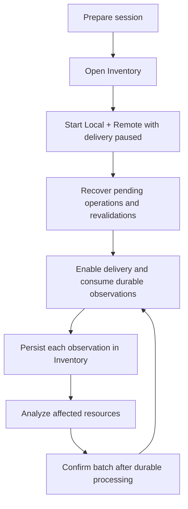

# Orchestrator

The Orchestrator prepares one account-scoped synchronization session, starts
the unified Detector, consumes its durable Local and Remote observations, and
passes affected Inventory items to the Analyzer. It does not select detection
strategies or build a local baseline by walking the root.

The Analyzer owns reconciliation and decides whether to call the Operator. The
Operator executes and verifies the resulting operation. Acknowledging a
Detector event records that its observation was processed; it does not confirm
that a file operation or synchronization completed.

## Continuous operation

Detector owns the only durable observation queue. The Orchestrator uses
availability wakeups only; it keeps no parallel event backlog. Each original
`File` and its ID are preserved when written through the public Inventory API.
The Inventory receipt makes exact event redelivery idempotent. Remote identity
is qualified by account, and a local path is never used to pair unrelated
remote resources by name.

Events with incomplete metadata remain uncertain. Missing information does not
prove absence, and an unassociated observation does not create a placeholder
Inventory item. Local absence requires explicit evidence from a validated local
lookup. Remote recovery and provider versions remain under the Remote Detector
and Inventory contracts.

On failure, cancellation, or lease expiration the complete batch is released or
redelivered. `Processed` is acknowledged only after Inventory persistence and
Analyzer work finish. The Detector and Inventory use separate databases, so
recovery relies on durable receipts and redelivery rather than a distributed
transaction.

## Current limit and future work

Changes made locally while DriveSync is closed are outside the current scope.
The only detection strategies in operation are Local and Remote. A future third
strategy may identify retrospective local changes as an internal Detector
producer. It will be designed from scratch under the generic observation
contract; the Orchestrator will neither start nor coordinate that strategy.

See [interfaces](INTERFACES.md), [tests](TESTS.md), and the [Analyzer execution
contract](../analyzer/EXECUTION.md).
