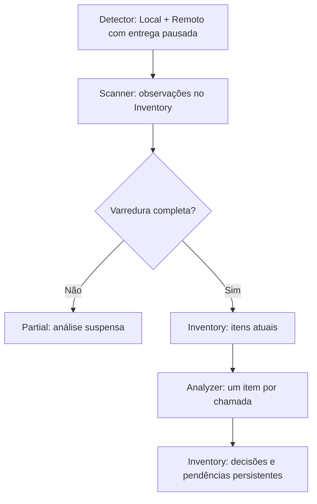

# Orchestrator

Coordena a preparação de uma sincronização pelas fachadas públicas existentes de
Detector, Scanner, Inventory e Analyzer. A etapa atual é uma **passagem finita de
observação local e produção de decisões**, disparada por `prepare()` na abertura
do aplicativo e nos rescans já existentes.

O Analyzer apenas produz e persiste decisões. Não há chamada ao Operator,
transferência, rename físico, exclusão, resolução de conflito ou confirmação do
baseline. Intenções ficam `Blocked` no Inventory até a implementação dos comandos.

## Barreira e ciclo de vida

O Detector inicia as duas fontes com entrega `Paused` **antes** do Scanner. Só um
relatório `ready_for_analysis()` verdadeiro libera a passagem pelo Analyzer. Uma
varredura parcial conserva as observações/diagnósticos e não cria novas análises.

Após varredura completa, o Orchestrator pagina todos os itens pelo Inventory,
recarrega cada snapshot e chama `Analyzer::analyze`. Não filtra apenas status
pendentes: uma observação pode invalidar avaliação antiga sem mudar o status.
As decisões e os conflitos são registrados pelo próprio Analyzer/Inventory.

A análise usa um worker finito com runtime privado, mantendo compatibilidade com
o chamador GLib sem runtime Tokio. Não cria serviço contínuo, fila privada ou
scheduler de operações. Estado transitório `Analyzing` impede rescan concorrente
e comunica a etapa real. Parada/cancelamento invalida o epoch; a passagem verifica
o token entre itens. Uma gravação já iniciada pode terminar, mas nenhum efeito
físico é executado. Não publicar sucesso final após a parada.

## Evidências conservadoras

O Orchestrator não calcula diferenças nem chama os algoritmos privados do Analyzer.
A presença conhecida de cada item vem do Inventory; `Unknown` continua desconhecido.
Isso não comprova cobertura de toda a árvore remota ou atualidade de uma medição
física. Baseline fornecido pelo Inventory é tratado como confirmado por seu contrato.

Não há hash local disponível para comparação confiável: conteúdo local/remoto e
comparação cruzada ficam `Unknown`. Falta de evidência gera pendência, sem igualdade
presumida por tamanho, mtime ou versão remota. Pais são mapeados por consulta indexada
do Inventory e vínculo explícito entre raízes, nunca por nomes locais/remotos iguais.

## Limite desta integração

As interfaces de Detector, Scanner e Inventory permanecem inalteradas. Os métodos
públicos já existentes do Orchestrator mantêm suas assinaturas. A página Scanner
apenas acompanha a nova etapa e informa quando as decisões foram registradas.

A fila do Detector continua pausada: esta entrega **não ativa ingestão contínua**,
não reserva nem confirma lotes e não descarta eventos. Eventos capturados depois
da passagem permanecem na fila até uma futura implementação de ingestão. Novo
rescan observa o estado local e produz outra análise. Não alegar sincronização
contínua, cobertura remota completa ou replay de operações reais.

[Interfaces](INTERFACES.md) · [Testes](TESTS.md) · [Orientações](AGENTS.md)
