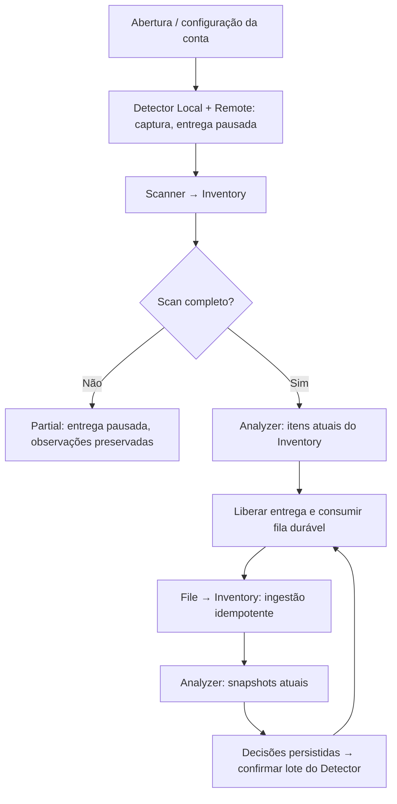

# Orchestrator

A sessão da aplicação executa o fluxo real de observação e análise: inicia os dois
detectores com entrega pausada, aguarda o Scanner, analisa o Inventory e libera
um consumidor contínuo dos eventos locais e remotos. O console acompanha a mesma
sessão; abrir uma página não inicia um pipeline paralelo.

O Orchestrator entrega snapshots atuais ao Analyzer. Com `execute_creations`
habilitado pela aplicação, o **Analyzer chama o Operator**, verifica os dois lados
e confirma baseline somente após execução comprovada. Orchestrator não escolhe
comandos nem executa transferências diretamente. Ver [execução](../analyzer/EXECUTION.md).

## Funcionamento contínuo

O callback público de disponibilidade desperta um worker da sessão, sem guardar
uma segunda fila de `File` em memória. O worker usa apenas `take_events`,
`record_local`/`record_remote`, consultas do Inventory e Analyzer.
Uma mesma sessão não tem dois consumidores. A preparação inicial ainda funciona
quando chamada pelo loop GLib sem runtime Tokio no chamador.

Cada `File` associável conserva identidade e payload originais ao ser registrado
no Inventory. Reentrega usa o recibo durável por `File.id`. Identidades remotas são
qualificadas por conta; caminhos locais localizam somente o lado local, sem parear
arquivos locais/remotos pelo nome. Metadados ausentes não provam exclusão.

O Scanner executa somente na preparação inicial para reconstruir o inventário
local acumulado enquanto o programa estava fechado. Durante o fluxo contínuo,
eventos são tratados pelas observações do Detector e pelo Analyzer; nenhum evento
inicia uma varredura global. Um evento sem dados suficientes não prova ausência
nem cria um item fictício. Cabe ao Detector fornecer observações adequadas para
as mudanças que detecta. Avisos técnicos da raiz remota permanecem no diagnóstico
do Detector e não viram arquivos fictícios no Inventory.

## Confirmação e falhas

O lote só recebe `Processed` depois da ingestão e análise concluídas com
persistência. Falha, cancelamento ou scan parcial da preparação inicial libera o lote
inteiro sem ack. Nenhum caminho usa `Discarded`. O prefixo já registrado permanece
válido e pode ser reenviado sem duplicar seu recibo de observação.

Falha técnica pausa a entrega e fica visível em `preparation_status`; as fontes
continuam guardando eventos. Nova preparação retira o worker antigo, reconstrói o
estado inicial pelo Scanner e retoma os eventos pendentes. Um scan parcial mantém `Partial`
e não confirma seu lote. Não existe transação distribuída entre os dois bancos:
a segurança depende de reentrega e idempotência, não de ack antecipado.

Os lotes são limitados a 64 eventos, com lease de cinco minutos pela API existente.
Após queda abrupta, leases antigos podem exigir aguardar sua expiração; um heartbeat
reverifica a fila. Expiração durante um processamento longo gera falha segura sem
confirmar o lote. A parada normal libera o lease e aguarda o trabalho local ativo.

## Limites preservados

Os esquemas existentes permanecem intactos. A configuração do Orchestrator inclui
`execute_creations`; consumidores de inspeção usam `false`. A aplicação usa `true`.
Criações interrompidas são retomadas com o ID original, antes de tratar observações
novas das réplicas. Novos passes após criação de diretórios liberam dependências dos
filhos. O heartbeat revisita tentativas pendentes respeitando backoff e limite.
Conflitos, colisões e operações ainda não suportadas permanecem bloqueados.

`execution_status` publica somente cache da sessão: fases, bytes observados,
conclusões verificadas, falhas e últimos 64 eventos. Developer apenas consulta esse
cache; não inicia outro consumidor nem faz SQL no loop GTK.

[Interfaces](INTERFACES.md) · [Testes](TESTS.md) · [Orientações](AGENTS.md)
