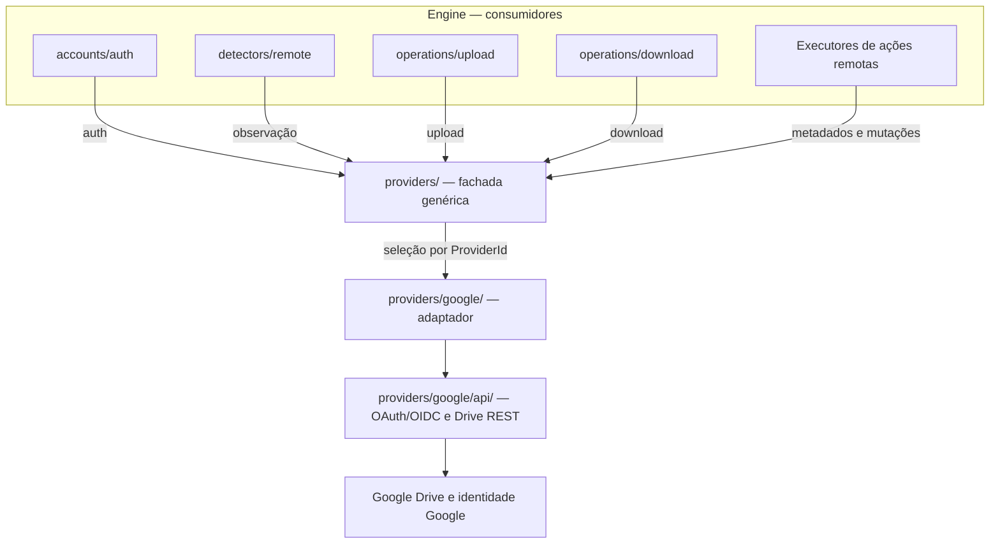
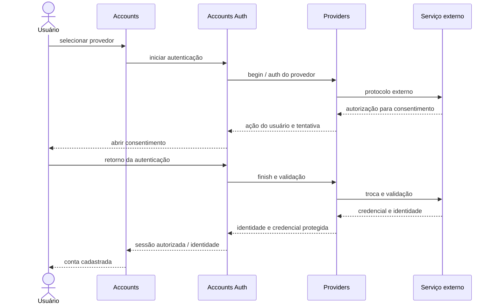

# Providers — fronteira de comunicação externa da engine

## Decisão arquitetural

**`providers/` é o único módulo da engine autorizado a chamar APIs de serviços remotos** (Google Drive e provedores futuros). Outros módulos só conhecem sua fachada e suas portas genéricas. A implementação `providers/google/` encapsula protocolos Google OAuth/OIDC, cliente REST e conversão `GoogleFile → RemoteFile`.

Isso não significa que Providers concentre todas as decisões da sincronização. **Providers executa requisições externas; os consumidores decidem quando, por quê e com qual autorização fazê-las.**

## Diagrama de fronteiras



**Apenas a implementação de `providers/` atravessa a fronteira de serviços externos.** A API técnica do Google pode permanecer documentada com seus endpoints e structs, mas **não é interface pública para outros módulos da engine**.

## Subdivisão lógica da fachada

| Capacidade | Porta | Consumidor |
| --- | --- | --- |
| Descoberta e seleção | `Providers.list_available/capabilities/open_account` | Cadastro/composição |
| Autenticação protocolar | `ProviderAuthentication` | `accounts/auth` |
| Listagens, mudanças e metadados | `ProviderRemoteObservation` | Detector Remoto |
| Renomear, mover, criar pasta, lixeira e excluir | `ProviderRemoteFiles` | Executores autorizados |
| Envio e recebimento de bytes | `ProviderTransfers` | Upload/Download |

Essas portas não equivalem a cinco bancos ou serviços externos. São **faces da mesma implementação autenticada**, vinculada a uma conta e identificada por `ProviderId`.

## Fluxo de cadastro

1. A interface mostra provedores informados por `Providers.list_available` (inicialmente apenas os implementados, como Google).
2. O usuário seleciona o provedor; `AccountManager` inicia a coordenação com `accounts/auth`.
3. `accounts/auth` solicita a `ProviderAuthentication` do provedor selecionado.
4. O adaptador de Providers realiza o protocolo externo; a interface executa a ação de consentimento indicada, como abrir o navegador.
5. `accounts/auth` recebe material protegido, guarda credenciais no Secret Service/keyring e controla a sessão.
6. `accounts/` registra `AccountId`, `ProviderId` e `provider_user_id`; não guarda tokens no registro.



A sessão é **por conta**, não um cliente global que escolhe a conta a cada requisição. A renovação é coordenada por `accounts/auth` e executada protocolarmente por Providers.

## Quem é proprietário de cada coisa?

- **`accounts/`:** cadastro, unicidade da conta, atualização e remoção segura.
- **`accounts/auth/`:** ciclo de vida das credenciais, autorização e keyring.
- **`providers/`:** chamadas externas, protocolos, autenticação específica, tradução de erros e respostas, capacidades.
- **`detectors/remote/`:** polling, produção de `File`, aceitação durável e checkpoint; não faz HTTP.
- **`operations/`:** executar ações de sincronização decididas pela engine, controlar retomada/resultado; não faz HTTP.
- **`inventory/`:** `SyncItem`, baseline, fila de operações e histórico; não faz HTTP.
- **`models/`:** tipos compartilhados, sem comunicação externa.

## Organização documental

```text
providers/
├── README.md                 [fronteira e composição]
├── INTERFACES.md             [portas para consumidores]
├── TESTS.md                  [contratos e isolamento]
├── AGENTS.md                 [regras de implementação]
├── google/
│   ├── README.md             [adaptador Google]
│   └── api/                  [59 métodos Drive REST + OAuth/OIDC especializados]
└── example/                  [somente placeholder documental]
```

A [Google API](google/api/INTERFACES.md) é **contrato técnico interno da implementação Google**; manter sua documentação não autoriza dependências diretas de outros módulos.

## Status

Esta é a **arquitetura-alvo documental**, não uma auditoria da implementação Rust. As assinaturas conceituais estão em [INTERFACES.md](INTERFACES.md), os cenários em [TESTS.md](TESTS.md) e as instruções em [AGENTS.md](AGENTS.md). Antes de codificar, revisar segurança de handles/credenciais, async/streaming e semântica real de cada operação.
